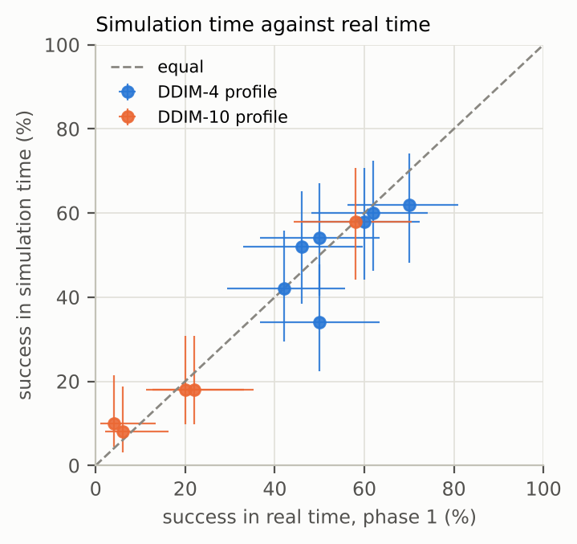
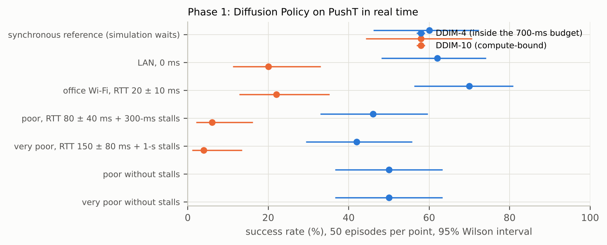
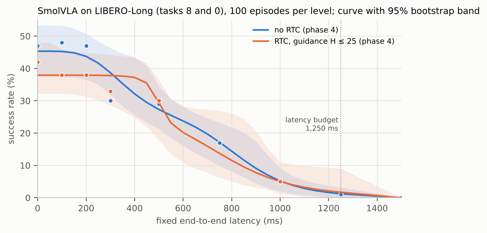
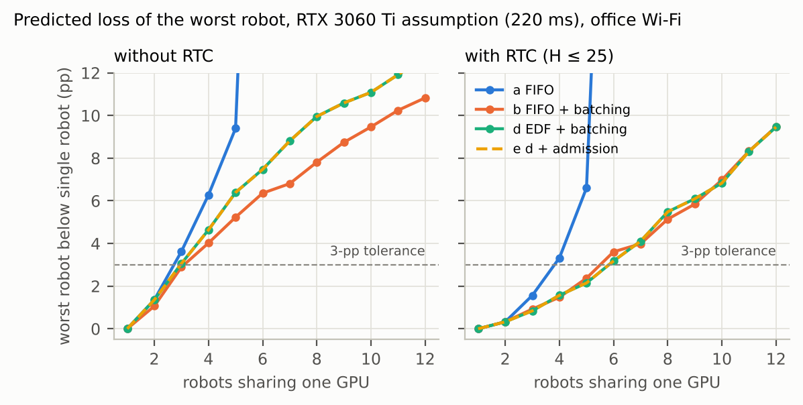
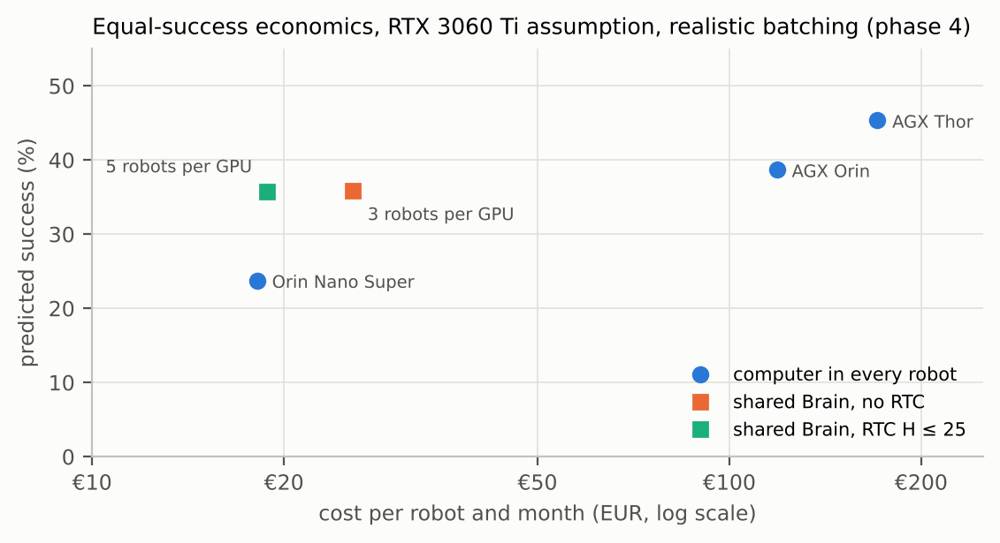
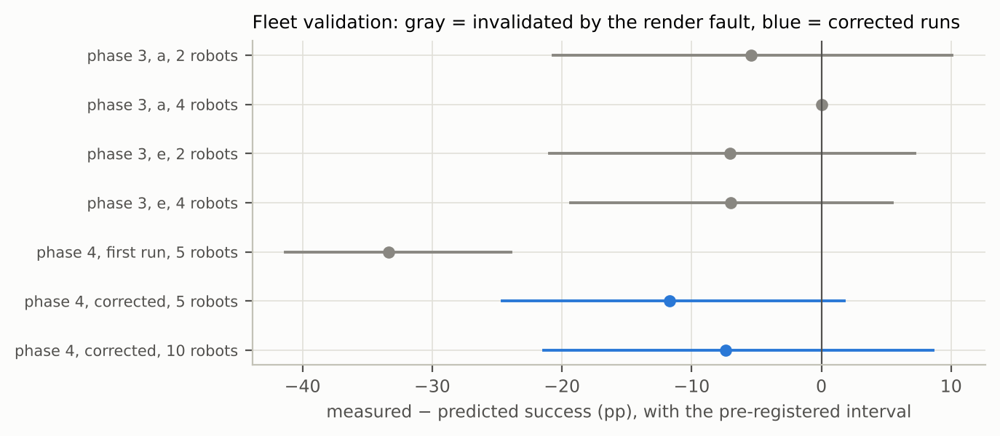
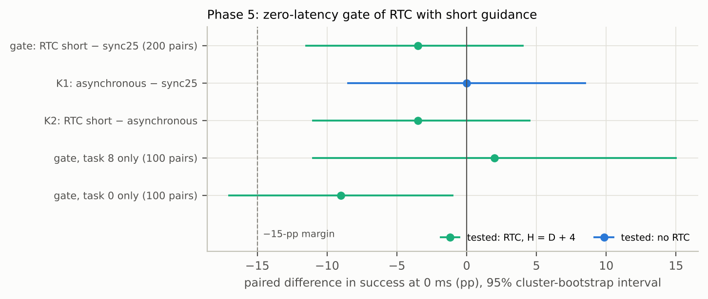

# How much latency can a vision-language-action policy take? A pre-registered simulation study of shared GPU inference for robot fleets

*Kortyn project, technical report, October 2026. Code, data and every number in this report:
<https://github.com/erithy25/Kortyn-Robotics>. Each quantity below is computed from a file in the repository; the
mapping is listed in [`paper/provenance.md`](provenance.md) and checked by `tests/test_paper.py`.*

## Abstract

Robots that run a learned visuomotor policy need a GPU close by. Sharing one GPU server (a "Brain") among many
robots could cut hardware cost, but every plan then arrives late by network, queueing and inference time. We
built Kortyn, an open-source testbed that measures this trade-off: a robot agent, a policy server and a network
emulator, later replaced by a validated simulation-time mode in which latencies are modeled exactly and only the
policy and the simulator are run. Over five pre-registered phases we measured Diffusion Policy on PushT and
SmolVLA on Meta-World and LIBERO-Long. SmolVLA on two long-horizon LIBERO tasks keeps its success up to about
200 ms of end-to-end latency and then falls steeply (47% at 0 ms, 30% at 300 ms, 5% at 1,000 ms). Real-time
chunking (RTC) as implemented in LeRobot did not stretch this curve. With guidance over up to 25 actions, the mean
gain over the latency budget was −1.6 pp [−6.1, +3.4] pp, and RTC failed the check that it matches the synchronous
reference at zero latency. With guidance limited to the frozen actions plus 4, RTC passed a pre-registered
zero-latency gate (45.5% against 49.0%), but its mean gain was again not demonstrable (+2.6 pp [−1.7, +5.6] pp);
the reference behind the phase-4 check had not reproduced because a LIBERO bug moved the stove of one task with
the simulator's history; we fixed it, and with fixed scenes the gate passed again. Under an assumed service time
of 220 ms per plan, one
consumer GPU serves 3 robots without RTC and 4 robots with short guidance within a 3-pp tolerance, and 2 robots by
a conservative estimate. A real fleet validation fell short of the predictions by −9.7 pp on average, and an
earlier validation was invalidated by a rendering fault we found and fixed. A browser measurement on a free
Tesla T4 (91 ms per request with fp16 and `torch.compile`) kept the p99 end-to-end latency within 150 ms for 1
robot only, so a pre-registered business rule, which required 10 robots, rejected the idea of a shared Brain. We
report all negative results.

## 1. Introduction

Vision-language-action (VLA) policies such as SmolVLA [1] or π0 [2] map camera images, robot state and an
instruction to a chunk of future actions. They need a GPU-class accelerator for useful control rates. A fleet
operator can put a computer into every robot or let robots share one server over the network. The second option
is cheaper per robot if one GPU can serve several robots, but it makes each plan older when it arrives: the
robot sends an observation, waits for network, queue and inference, and keeps executing its previous plan in the
meantime. How much success this latency costs, and how many robots a GPU can serve before the cost becomes
noticeable, are empirical questions about a specific policy and task.

We asked three questions:

1. How does success depend on end-to-end latency for current imitation-learned policies, and is the dependence
   driven by stale plans or by starvation (the robot running out of actions)?
2. How many robots can one GPU serve without a noticeable loss of success, and which scheduling strategy
   maximizes that number?
3. Does real-time chunking [3], which guides a new plan towards the remainder of the running one, make a VLA
   tolerant enough to latency to change the answer to question 2?

The project started as a business idea (a shared "Brain" for robot fleets) and was run as a sequence of phases,
each pre-registered before its first measurement [4]. After phase 4 the business idea was not pursued in its
current form. This report documents all five phases, including the results that contradicted our hypotheses and
an infrastructure fault that invalidated part of the earlier evidence.

**Contributions.** (i) Kortyn, an open-source testbed with a real-time mode and a simulation-time mode for
measuring latency effects on LeRobot policies, validated against real-time measurements; (ii) dose-response
curves of SmolVLA on LIBERO-Long, with and without LeRobot's RTC; (iii) a fleet queueing model with batching
schedulers, a capacity criterion and its validation with real multi-robot rollouts; (iv) a capacity tool that
turns a dose-response curve, a network profile and a GPU measurement into robots per GPU and expected success;
(v) the pre-registration record, including where our own measurements were wrong.

## 2. Related work

**Action chunking and generative policies.** Predicting chunks of actions and executing them open-loop reduces
compounding errors and inference rate, as in ACT [5] and Diffusion Policy [6]. Flow matching [7] underlies the
action experts of π0 [2] and SmolVLA [1]. OpenVLA [8] is an autoregressive VLA. Chunking makes latency a question
of plan age: an action is executed some time after the observation it was computed from.

**Asynchronous execution and real-time chunking.** SmolVLA introduced an asynchronous inference stack in LeRobot
that requests the next chunk while the current one runs [1]. Black, Galliker and Levine [3] observed that
switching between independently sampled chunks causes discontinuities and proposed real-time chunking: the new
chunk is generated as an inpainting problem, with the actions that will run before it arrives frozen and the
following ones softly guided towards the previous chunk. LeRobot [9] ships an implementation of RTC for its flow
policies; we evaluate that implementation, which, in the version we used, applies the guidance without
vector-Jacobian products through the network (section 3.5). ACT [5] smooths chunk transitions with temporal
ensembling instead.

**Cloud and fog robotics.** Offloading robot computation to remote servers has a long history [10]. FogROS2 [11]
deploys ROS 2 nodes to cloud machines and reports large speed-ups for planning and perception. These systems
target throughput-heavy tasks; we target closed-loop control with a learned policy, where latency directly
changes the actions taken.

**Serving with batching and deadlines.** Prediction-serving systems batch requests adaptively under latency
objectives [12]. Earliest-deadline-first scheduling [13] is optimal for preemptive scheduling of periodic
tasks on one processor. Our Brain combines both, without preemption: deadlines come from each robot's action
queue, and a batch runs to completion.

**Benchmarks.** We use PushT from Diffusion Policy [6], Meta-World [14] and LIBERO [15], simulated with MuJoCo
[16] and robosuite [17], through LeRobot's environment wrappers [9].

**Method.** We pre-registered hypotheses, criteria and analyses before each phase [4], used exact McNemar tests
[18] for paired success, bootstrap intervals [19] and Wilson intervals [20].

## 3. Methods

### 3.1 System model

A robot (the *agent*) runs a fixed-rate control loop and executes one action per tick from a queue. When at most
a threshold of actions remains, it sends its current observation to the policy server (the *Brain*) and keeps
executing the remaining actions. A plan computed from the observation at tick *k* is merged at the first tick
after it arrives; actions for ticks that have passed are dropped. The *latency budget* is the time the queue
bridges after a request; a plan that arrives later leaves the robot without actions (starvation), in which case
it holds still. At most one request per robot is in flight.

For the LIBERO experiments the agent runs at 20 Hz, receives chunks of 50 actions and requests a new plan every
25 ticks (1.25 s), so the budget is 1,250 ms. Episodes start cold: the first plan arrives with the same latency
as every later one. The PushT experiments ran at 10 Hz with a budget of 700 ms.

### 3.2 Real-time mode (phases 1–2)

In the real-time mode the Brain is a separate gRPC process that runs the LeRobot policy with fixed sampling
noise per request. A user-space proxy between agent and Brain emulates network delay, jitter and stalls with
netem semantics, and the agent runs on the wall clock with absolute deadlines. Episodes with timing violations
were repeated. This mode measures what a deployment would see, but its results depend on the measuring machine
and are not exactly repeatable.

### 3.3 Simulation-time mode (phase 3a onwards)

The simulation-time mode replaces the clock with a discrete-event simulation. The policy still computes every
plan, on the CPU, but simulation time does not advance while it computes; instead the plan becomes available
after a modeled end-to-end latency: a fixed value, a distribution, a model of network plus service time, or a
replay of latencies logged in real time. Every episode is deterministic given its seed, provided the scene
depends on the seed alone; for LIBERO task 8 this took a fix in phase 5 (section 4.8). GPU scenarios can thus be
measured on a CPU: the GPU enters only through its service time.

We validated the mode against all 550 episodes of phase 1. Replaying the logged latencies reproduced every
episode's outcome, 441 bit-identical and the rest identical up to the last floating-point bits of PushT's
coverage. With modeled latencies, 0 of 44 paired differences were significant after Holm correction when the
service time was modeled per episode, and 2 of 52 with a pooled hardware profile (both plan-age differences
traced to drift of the real-time machine). Common random numbers made paired comparisons much more precise: the
standard deviation of a paired reward difference fell from 0.167 in real time to 0.068. Figure 2 compares
success per condition.



*Figure 2. Success per phase-1 condition in real time (x) and in simulation time with the pooled latency model
(y), DDIM-4 and DDIM-10 Brain profiles; 95% Wilson intervals. Sources: `results/kalibriert`, `results/ddim10`,
`results/phase3a/validation_model`.*

### 3.4 Dose-response protocol (phases 3–5)

To separate the policy's latency tolerance from any queueing model we measured success at fixed end-to-end
latencies on the same 100 episodes: LIBERO-Long tasks 8 ("put both moka pots on the stove") and 0 ("put both the
alphabet soup and the tomato sauce in the basket") × init states 0–49, seeds 1000–1099, paired across all
conditions. The two tasks were chosen by a pre-registered rule from a pilot over all ten tasks. The policy is
`lerobot/smolvla_libero` at a pinned revision, as loaded by LeRobot, with 10 flow-matching steps.

Because plans are merged at tick boundaries, a latency *L* delays a plan by *d(L) = max(1, ⌈L/50 ms⌉)* ticks, and
success depends on *L* only through the effective latency *50 ms · d(L)*. We fit per task a log-logistic decay
*g(x) = p / (1 + (x/x₅₀)ʰ)* over the effective latency by binomial maximum likelihood, fall back to an isotonic
curve if a deviance test rejects the fit, let the curve fall linearly to zero between the budget and 1,500 ms,
and pool the tasks with equal weight. Uncertainty comes from a bootstrap over seeds, stratified by task and
shared between conditions measured on the same seeds. The *tolerable latency L\** is the largest latency whose
predicted loss against 0 ms is at most 3 pp.

### 3.5 Real-time chunking

We integrated LeRobot's RTC without modifying LeRobot: the agent sends the remainder of its running plan with
each request; the Brain normalizes it and passes it as `prev_chunk_left_over` together with the number of
frozen actions (`inference_delay`) and the guidance length (`execution_horizon`) to the policy, with an
exponential weight schedule and a maximum guidance weight of 10. In LeRobot 0.6.1 the correction is the weighted
error itself; it does not back-propagate through the network as in the RTC paper [3]. Unit tests confirm that
RTC without a previous plan is bit-identical to sampling without RTC. Phase 4 used guidance over up to 25
actions; phase 5 limits it to the frozen actions plus 4 (section 4.7). RTC added 1.1% to the median inference
time on the CPU.

### 3.6 Fleet model and capacity

In the fleet model, timing-only robots follow exactly the agent's request rules and share one Brain through
the same network model as the rollouts. The Brain serves requests one by one or in batches. Five strategies were
pre-registered: (a) FIFO, (b) FIFO with batching and up to 25 ms of waiting, (c) earliest deadline first, (d)
EDF with batching, and (e) d plus admission control. A batch of *b* requests takes *s(b)*. Without a GPU
measurement, phases 3–4 assumed *s(b) = s₁ (1 + β (b − 1))* with *s₁* = 220 ms for an RTX 3060 Ti and a
realistic batching cost β = 15% (named assumptions). Each simulated robot's success is predicted as the mean of
the dose-response curve over the latencies its requests saw. The pre-registered **capacity** of a configuration
is the largest fleet for which this fleet and every smaller one keep at most 1% of the plans late and the worst
robot at most 3 pp below a single robot.

Predictions were validated with real multi-robot rollouts in simulation time: several robots, each with its own
LIBERO simulator, share one Brain under the same scheduler and latency model, and their measured success is
compared with the prediction for their observed latencies.

### 3.7 Pre-registration and statistics

Before the first new run of each phase we committed the hypotheses, decision criteria, analyses, power
calculations and a runtime estimate to the repository; every later change was logged as a deviation with time
and reason. Paired success is compared with exact McNemar tests and bootstrap intervals over seeds (or over
clusters of seeds). Single rates carry Wilson intervals.

## 4. Results

### 4.1 Phase 1: inside the budget the network barely matters

Diffusion Policy on PushT in real time, with two Brain profiles: DDIM-4 sampling that fits into the 700 ms budget,
and DDIM-10 whose inference time alone exceeds it (Table 1, Figure 1). With DDIM-4, success over a LAN (62%) and
office Wi-Fi (70%) did not differ from the synchronous reference (60%); poor networks with stalls cost more
(46% and 42%). Without stalls, the same delays gave 50% and 50%. The compute-bound profile collapsed to 20% even
on a LAN against 58% for its synchronous reference: inference time beyond the budget hurt far more than any
network scenario.

<!-- table:phase1 -->
| Network scenario | DDIM-4 profile (inside the budget) | DDIM-10 profile (compute-bound) |
|---|---:|---:|
| synchronous reference (simulation waits) | 60% [46%, 72%] | 58% [44%, 71%] |
| LAN, 0 ms | 62% [48%, 74%] | 20% [11%, 33%] |
| office Wi-Fi, RTT 20 ± 10 ms | 70% [56%, 81%] | 22% [13%, 35%] |
| poor, RTT 80 ± 40 ms + 300-ms stalls | 46% [33%, 60%] | 6% [2%, 16%] |
| very poor, RTT 150 ± 80 ms + 1-s stalls | 42% [29%, 56%] | 4% [1%, 13%] |
| poor without stalls | 50% [37%, 63%] | – |
| very poor without stalls | 50% [37%, 63%] | – |
<!-- /table:phase1 -->

*Table 1. PushT success (50 episodes per cell, seeds 1000–1049) with 95% Wilson intervals. Sources:
`results/kalibriert/*/episodes.jsonl`, `results/ddim10/*/episodes.jsonl`.*



*Figure 1. Phase 1 success per network scenario and Brain profile.*

### 4.2 Phase 2: making plans fresher did not help (negative)

Phase 1 suggested that the age of the executed plan, not starvation, drives the loss. Phase 2 built a freshness
engine: a robust per-robot latency estimate, adaptive request timing, timestep alignment, inpainting-based
smoothing of plan transitions and an emergency hold. None of the strategies recovered success. Pooled over six
network scenarios, the best strategy (a fixed request threshold) changed success by +3 pp (p = 0.51), and
inpainting by −7 pp (p = 0.06). Two identical phase-1 runs already differed by −2 pp. Lowering the mean plan age
by requesting more often did not raise success; plan age was a symptom of latency and stalls, not a lever.

### 4.3 Phase 3a: simulation time is valid, and SmolVLA is latency-sensitive

The simulation-time mode reproduced phase 1 (section 3.3). On Meta-World, SmolVLA reproduced LeRobot's own
evaluation, and latency within the budget cost one of three tasks a large share of its success, but Meta-World
episodes are decided within the first one or two plans, which makes them a weak test for continuous operation.
We therefore moved to long-horizon LIBERO tasks.

### 4.4 Phase 3: a steep dose-response curve makes every millisecond count

Kortyn's synchronous pipeline reproduced LeRobot's own evaluation of SmolVLA on 100 LIBERO episodes (54% against
52%, p = 0.82). The dose-response curve was steep (Table 2): 46% at 0 ms, 20% at 500 ms, 6% at 1,000 ms, 2% at the
budget and 0% beyond. Under the pre-registered capacity criterion, which then had no tolerance (any significant
loss of the worst robot counted), the capacity was one robot in all 117 configurations of GPUs, batching
profiles, strategies and networks: the waiting time of a second robot already lowered the predicted success of
the worst robot significantly. This led to the 3-pp tolerance and to real-time chunking in phase 4. The phase-3
fleet validation is invalid because of the rendering fault described in section 4.6.

<!-- table:dose -->
| Latency | Phase 3, no RTC | Phase 4, no RTC | Phase 4, RTC H ≤ 25 | Phase 5, RTC H = D + 4 |
|---:|---:|---:|---:|---:|
| 0 ms | 46% | 47% | 42% | 46% |
| 100 ms | – | 48% | 38% | – |
| 200 ms | – | 47% | 38% | 41% |
| 300 ms | – | 30% | 33% | – |
| 500 ms | 20% | 29% | 30% | 31% |
| 750 ms | – | 17% | – | – |
| 1,000 ms | 6% | 5% | 5% | 6% |
| 1,250 ms | 2% | 1% | – | – |
| 1,500 ms | 0% | 0% | – | – |
| 2,000 ms | 0% | 0% | – | – |
<!-- /table:dose -->

*Table 2. Measured success of SmolVLA on LIBERO-Long tasks 8 and 0 at fixed end-to-end latencies (100 episodes
per level, tasks weighted equally). Sources: `results/phase3/libero/smolvla_libero/*`, `results/phase4/curves.json`,
`results/phase5/curves.json`.*

### 4.5 Phase 4: LeRobot's RTC did not stretch the curve

**Zero-latency check (failed).** At 0 ms, RTC reached 42% against 53% for the synchronous reference with 25
actions per plan, a difference of −11 pp [−23, +1] pp (McNemar p = 0.13). The pre-registered check required
p ≥ 0.05 and a lower interval bound of at least −15 pp; it failed on the second condition. Part of the gap is not
RTC: asynchronous execution without RTC reached 47% at 0 ms. RTC lost a further 5–10 pp at small latencies,
almost entirely in task 0.

**Dense curves.** Without RTC, success stayed flat up to 200 ms (47%, 48%, 47% at 0, 100 and 200 ms) and then
dropped (30% at 300 ms, 29% at 500 ms, 17% at 750 ms, 5% at 1,000 ms; Figure 3). With RTC the plateau was lower
(42% at 0 ms, 38% at 100 and 200 ms) and lasted longer (33% at 300 ms, 30% at 500 ms), reaching the same 5% at
1,000 ms. The tolerable latency rose from 200 ms to 450 ms, but only because RTC lowered its own zero-latency
reference. The pre-registered primary hypothesis H1, a positive mean gain over the latency budget, was not
supported: −1.6 pp [−6.1, +3.4] pp. Its interval excludes the gain of 5–9 pp that a 1.5-fold stretch of the
latency axis would have produced.



*Figure 3. Success against fixed end-to-end latency, measured levels (points) and the pre-registered smooth
curve with its 95% bootstrap band; the phase-4 RTC curve is dashed and drawn without its band. The phase-5 curve
rests on four levels; between them it is interpolation by the curve model. Sources: `results/phase4/curves.json`,
`results/phase5/curves.json`.*

**Capacity.** Under the RTX 3060 Ti assumption with realistic batching and office Wi-Fi (RTT 20 ± 10 ms), the
best strategy served 3 robots without RTC and 5 robots with RTC within the 3-pp tolerance (Table 3, Figure 4).
In absolute terms RTC was worth about one robot: the jump from 3 to 5 is largely an effect of the relative
criterion, because RTC lowers the single-robot reference.

<!-- table:capacity -->
| Scheduling strategy | Without RTC | With RTC (H ≤ 25) | With RTC (H = D + 4) |
|---|---:|---:|---:|
| a: FIFO | 2 (2) | 3 (2) | 3 (2) |
| b: FIFO + batching | 3 (2) | 5 (2) | 4 (2) |
| d: EDF + batching | 2 (2) | 5 (2) | 4 (2) |
| e: EDF + batching + admission | 2 (2) | 5 (2) | 4 (2) |
<!-- /table:capacity -->

*Table 3. Capacity in robots per GPU, point estimate (conservative estimate from the 97.5% bootstrap quantile in
parentheses); RTX 3060 Ti assumption, realistic batching, office Wi-Fi. The column for short guidance (phase 5,
section 4.7) uses the same fleet simulation with the phase-5 curve. Sources: `results/phase4/fleet/capacity.json`,
`results/phase5/curves.json`.*



*Figure 4. Predicted loss of the worst robot against fleet size; a fleet passes while the curve stays below the
3-pp tolerance and at most 1% of the plans are late. Strategies d and e coincide until admission control turns
robots away. Source: `results/phase4/fleet/capacity.json`.*

**Image transport.** A lossless codec (zstd, level 9) reproduced every model input bit for bit (500/500 requests)
and cut a request from 778 kB to 292 kB, from 5.0 Mbit/s to 1.9 Mbit/s per robot. With it, a shared Wi-Fi medium
only limits the fleet below an effective rate of about 100 Mbit/s.

**Economics.** At equal predicted success, the shared Brain was cheaper per robot only against slow on-board
computers (Figure 5). With RTC, 5 robots per RTX 3060 Ti reached 35.7% for €18.80 per robot and month, against
€18.16 and 24% for a Jetson Orin Nano Super in every robot and €118.83 and 39% for a Jetson AGX Orin. No shared
Brain reached the success of a Jetson AGX Thor (45%, €170.80). The phase-4 decision rule formally rated the
business case as viable; the advantage came from sharing hardware, not from RTC, and it shrinks with the
validation shortfall reported below.



*Figure 5. Cost per robot and month against predicted success for a computer in every robot and for a shared
RTX 3060 Ti at capacity (assumptions as in `results/phase4/economics.json`).*

### 4.6 A rendering fault invalidated two fleet validations

The first phase-4 fleet validation (5 robots, strategy d, with RTC) reached 10% against 43% predicted. Replaying
the fleet's logged latencies for each robot alone in a fresh process reproduced the fleet's requests exactly up
to the moment another robot's simulator was reset; from the next rendered frame on, the images differed. The
cause was in robosuite's rendering: when a simulator is destroyed, robosuite frees its OpenGL resources in
whatever context is current. In a process holding several LIBERO simulators, a reset or close of one robot's
simulator therefore freed render resources of another robot, which from then on saw corrupted camera images. We
fixed this in Kortyn's environment wrapper (commit `4c83bac`) by making a simulator's own context current before
robosuite destroys it, and added a regression test that resets and closes a second simulator while the first
renders.

The fault affected only processes with several simulators. All dose-response measurements ran one simulator per
process and are unaffected. It invalidated the phase-3 fleet validation, whose shortfall of 5–7 pp we had
reported as a property of the prediction (an erratum was added to the phase-3 report), and the first phase-4
validation run. A pre-registered re-test of the phase-3 validation against the dense phase-4 curve gave
−19.6 pp, "not explained", because it compared against those faulty fleets.

The corrected validation passed the pre-registered criterion in both cases, but below the prediction (Table 4,
Figure 6): 31.7% measured against 43.4% predicted with 5 robots (−11.7 pp [−24.6, +1.8] pp, 60 episodes) and 38.0%
against 45.4% with 10 robots (−7.4 pp [−21.4, +8.6] pp, 50 episodes; the case stopped at the container's memory
limit). Pooled after inspection, the shortfall was −9.7 pp [−18.8, −0.6] pp; about half of it is smoothing of the
curve. The queueing model matched the observed latencies closely.

<!-- table:validation -->
| Run | Robots | Episodes | Measured | Predicted | Measured − predicted [CI] | Status |
|---|---:|---:|---:|---:|---|---|
| Phase 3, strategy a | 2 | 60 | 16.7% | 22.1% | −5.4 pp [−20.7, +10.1] pp | invalid (render fault) |
| Phase 3, strategy a | 4 | 60 | 0.0% | 0.0% | ±0.0 pp [±0.0, ±0.0] pp | invalid (render fault) |
| Phase 3, strategy e | 2 | 60 | 15.0% | 22.1% | −7.1 pp [−21.0, +7.2] pp | invalid (render fault) |
| Phase 3, strategy e | 4 | 60 | 10.0% | 17.0% | −7.0 pp [−19.3, +5.5] pp | invalid (render fault) |
| Phase 4, first run | 5 | 60 | 10.0% | 43.4% | −33.4 pp [−41.3, −23.9] pp | invalid (render fault) |
| Phase 4, corrected | 5 | 60 | 31.7% | 43.4% | −11.7 pp [−24.6, +1.8] pp | passes |
| Phase 4, corrected | 10 | 50 | 38.0% | 45.4% | −7.4 pp [−21.4, +8.6] pp | passes |
<!-- /table:validation -->

*Table 4. Fleet validations: measured and predicted success of the robots, difference with the pre-registered
interval (97.5% for phase 4, Bonferroni over two cases). Sources: `results/phase3/validation/evaluation.json`,
`results/phase4/validation_renderfehler/evaluation.json`, `results/phase4/validation/evaluation.json`.*



*Figure 6. Measured minus predicted success per validation case with its pre-registered interval.*

**Run order.** Phase 4 also found that one phase-3 level did not reproduce: task 8 at 500 ms reached 26% in
phase 3, 44% in phase 4 and 46% when each of its 50 episodes ran in a fresh process (p = 0.03 against phase 3).
The cause, found in phase 5, is not the policy: LIBERO moved the stove of task 8 with the simulator's history,
so the order of episodes in a process changed the scene (section 4.8). All curves in this report use phase-4
levels.

### 4.7 Phase 5: RTC with short guidance and the GPU measurement

**Design.** Two effects added up in the failed zero-latency check of phase 4. Asynchronous execution without RTC
already reached only 47% at 0 ms against 53% for the synchronous reference, and RTC lost a further 5–10 pp at
small latencies. With a delay of one tick, the guidance over up to 25 actions pulled almost all executed actions
of the new plan towards the old plan, whose observation was 1.25 s older. Phase 5 changed only this parameter:
the guidance covers the *D* actions that will certainly still run plus at most 4 actions with exponentially
decaying weight (*H = D + 4*), where *D* is the delay the agent plans with (one tick at 0 ms). LeRobot's RTC code
and all other settings stayed as in phase 4.

The gate compared RTC with short guidance at 0 ms with a new measurement of the synchronous reference, run in
the same block and worker process, one seed after the other: 200 episodes per condition, each LIBERO init state
twice with different policy noise. Asynchronous execution without RTC ran alongside as a control. The criterion
was the one of phase 4 (McNemar p ≥ 0.05 and a lower 95% bound of the difference of at least −15 pp), with the
interval now from a bootstrap over init-state clusters, and a stop rule: no further RTC measurement if the gate
fails. A power simulation with the gate's own code showed why the phase-4 check had been too weak: with
100 pairs, an RTC exactly as good as the reference would have passed in only 68%–88% of cases, depending on the
pairing; with 200 pairs it passes in 93%–98%, and an RTC at the −15 pp margin passes in at most 3.4%. One risk
was known in advance: if asynchronous execution itself loses 6 pp against the synchronous reference, even an RTC
without any harm of its own passes in only 54%–64% of cases.

**Gate (passed).** RTC with short guidance reached 45.5% at 0 ms against 49.0% for the synchronous reference of
the same block, a difference of −3.5 pp [−11.5, +4.0] pp (McNemar p = 0.43; Table 5, Figure 7). Both conditions
of the criterion held, so the dose block ran. The controls agree: asynchronous execution without RTC also reached
49.0% (K1: ±0.0 pp [−8.5, +8.5] pp, p = 1.00), and RTC changed success against it by −3.5 pp [−11.0, +4.5] pp
(K2, p = 0.44). The loss of 6 pp from asynchronous execution that the power analysis treated as a risk did not
appear in this block; with the scenes of task 8 fixed, it did (section 4.8). The tasks differ: in task 0 both asynchronous conditions lost against the reference (−8.0 pp without and
−9.0 pp with RTC; RTC against asynchronous −1.0 pp), in task 8 neither did (+8.0 pp and +2.0 pp; RTC against
asynchronous −6.0 pp). With 100 pairs per task these differences are descriptive.

<!-- table:gate -->
| Comparison (0 ms) | Pairs | Reference | Test | Difference [95% CI] | McNemar | Gate criterion |
|---|---:|---:|---:|---|---|---|
| Gate: RTC short − sync25 | 200 | 49.0% | 45.5% | −3.5 pp [−11.5, +4.0] pp | p = 0.43 | passed |
| K1: asynchronous − sync25 | 200 | 49.0% | 49.0% | ±0.0 pp [−8.5, +8.5] pp | p = 1.00 | passed |
| K2: RTC short − asynchronous | 200 | 49.0% | 45.5% | −3.5 pp [−11.0, +4.5] pp | p = 0.44 | passed |
| Gate, task 8 only | 100 | 45.0% | 47.0% | +2.0 pp [−11.0, +15.0] pp | p = 0.87 | passed |
| Gate, task 0 only | 100 | 53.0% | 44.0% | −9.0 pp [−17.0, −1.0] pp | p = 0.08 | failed |
<!-- /table:gate -->

*Table 5. Zero-latency gate and its controls at 0 ms, 200 pairs in 100 clusters (task × init state), exact
McNemar tests and 95% cluster-bootstrap intervals. Only the first row decides; the other rows apply the same
criterion descriptively. Source: `results/phase5/gate.json`.*



*Figure 7. Paired differences in success at 0 ms with 95% cluster-bootstrap intervals; the colour marks the
tested condition. The gate passes while the lower bound stays above the margin of −15 pp and McNemar's test finds
no significant loss. Source: `results/phase5/gate.json`.*

**The phase-3 reference did not reproduce.** On the 100 seeds of the phase-4 check, the synchronous reference
reached 42% in phase 5 against 53% in phase 3 (−11.0 pp [−20.0, −2.0] pp, p = 0.03), and 56% on the second
noise replicate of the same init states. Asynchronous execution without RTC reproduced phase 4 (48% against 47%,
p = 1.00). On these seeds RTC with short guidance (46%) did not differ significantly from RTC with long guidance
in phase 4 (42%, p = 0.61). The failed zero-latency check of phase 4 had therefore compared RTC with a reference
from another run context. Section 4.8 shows that the whole difference lies in task 8, whose scene depended on that
context, and that task 0 reproduced episode for episode.

**Dose block: no demonstrable stretch.** With short guidance, RTC reached 46% at 0 ms, 41% at 200 ms, 31% at 500 ms
and 6% at 1,000 ms (Table 2, Figure 3). At no level did it differ significantly from the phase-4 curve without RTC
on the same seeds (McNemar p ≥ 0.39): −1.0 pp [−11.0, +9.0] pp at 0 ms, −6.0 pp [−17.0, +5.0] pp at 200 ms, +2.0 pp
[−7.0, +12.0] pp at 500 ms and +1.0 pp [−5.0, +7.0] pp at 1,000 ms. The pre-registered primary hypothesis, a
positive mean gain over the latency budget, was not supported: +2.6 pp [−1.7, +5.6] pp. The positive point estimate
comes from latencies at which RTC with short guidance was not measured. With four levels, its curve is
interpolation between 200 and 500 ms and between 500 and 1,000 ms, whereas the curve without RTC rests on measured
drops at 300 and 750 ms. The tolerable latency rose from 200 ms to 400 ms (conservative 100 ms, upper bound 450
ms), a coarse estimate for the same reason. Against RTC with long guidance from phase 4, the mean gain was +4.2 pp
[−1.7, +8.3] pp, also not demonstrable.

**Capacity.** With the short-guidance curve and the phase-4 assumptions (RTX 3060 Ti with RTC overhead, realistic
batching, office Wi-Fi), the best strategy served 4 robots, between the 3 robots without RTC and the 5 robots
with long guidance (Table 3). The conservative estimate was 2 robots for every strategy, as without RTC.

**Answer to the RTC question.** Phase 4 left open whether RTC helps, because RTC failed the zero-latency check.
With short guidance it passes that check against a fresh reference, so the dose-response measurement now answers
the question for this setting: LeRobot's RTC does not make SmolVLA demonstrably more tolerant of latency on these
tasks. The interval [−1.7, +5.6] pp excludes most of the 5–9 pp that a 1.5-fold stretch of the latency axis would
have produced.

**GPU measurement.** All GPU service times before phase 5 were assumptions. A notebook measures SmolVLA on a free
Google Colab or Kaggle GPU in the browser: service time per batch of 1 to 32 requests with eight real LIBERO
observations, as loaded by LeRobot (bf16 and fp32 parts), in fp16 and fp32, and compiled with `torch.compile`;
after warm-up, 100 runs per size are timed (p50/p95/p99) and GPU memory is recorded. A configuration counts only
if its actions deviate from the fp32 reference by at most 25% of the policy's own sampling spread; on the CPU the
as-loaded configuration deviates by 6.9% and fp16 by 0.8%. On this machine's CPU a single request takes 2.3 s.
The measurement ran on a Tesla T4 in Google Colab (Table 6), and all four configurations were numerically valid.
As loaded, a request took 498 ms at batch size 1, because the T4 (compute capability 7.5) has no native bf16;
fp16 took 322 ms and fp32 406 ms. Compiled with `torch.compile`, fp16 took 91 ms (p99 112 ms), 41% of the
220 ms assumed in phases 3–4.

<!-- table:gpu -->
| Configuration | Precision | Deviation / spread | Batch 1: median, p99 | Batch 8: median | K150 (best strategy) | Capacity, phase-4 criterion |
|---|---|---:|---|---:|---:|---:|
| standard | bf16/fp32 as loaded | 6.8% | 498 ms, 586 ms | 2,484 ms | 0 | 1 (1) |
| fp16 | fp16 | 0.9% | 322 ms, 374 ms | 578 ms | 0 | 2 (1) |
| fp32 | fp32 | 0.0% | 406 ms, 463 ms | 1,733 ms | 0 | 1 (1) |
| compiled | fp16 + torch.compile | 0.5% | 91 ms, 112 ms | 433 ms | 1 | 12 (6) |
<!-- /table:gpu -->

*Table 6. GPU measurement on a Tesla T4 (Google Colab): deviation of the actions from fp32 relative to the policy's
sampling spread, service time per batch, latency capacity K150 (the largest fleet with a pooled p99 end-to-end
latency of at most 150 ms, the decision criterion) and, for comparison, the capacity under the phase-4 success
criterion (conservative estimate in parentheses); office Wi-Fi, best of strategies a, b, d and e. Sources:
`results/phase5/gpu/smolvla_gpu_teslat4_colab_20261029-1825.json`, `results/phase5/gpu_decision.json`.*

**Decision rule: No.** The pre-registered rule asked whether the measured GPU serves at least 10 robots with a
pooled p99 end-to-end latency (office Wi-Fi, queue and service time) of at most 150 ms. It does not: the best
configuration and strategy kept the p99 within the target for 1 robot only (140 ms), and 10 robots saw a p99 of
330 ms. As pre-registered, the business idea is rejected for good. **Limit of the verdict:** the rule judges the
measured GPU, a Tesla T4, the free GPU of Colab and Kaggle; it says nothing about faster GPUs. We did not change
the rule.

Two secondary results, pre-registered without influence on the verdict, put it into perspective. With the
measured service time of the compiled configuration, the success criterion of phase 4 admits 12 robots
(conservative 6 robots), with a predicted success of 43.4% for the average and 42.9% for the worst robot in a
fleet of 10; the 150 ms target is thus far stricter than the latency the policy tolerates (Table 2). With a shared
Wi-Fi medium of 100 and 200 Mbit/s, the latency capacity was 0 robots.

### 4.8 Reproducibility: LIBERO moved the stove of task 8 with the simulator's history

**Finding.** The phase-3 reference that did not reproduce (section 4.7) differed only in task 8. Compared
episode by episode, by success flag and step count per seed, phase 3 and phase 5 produced the same 50 of 50
episodes on task 0 (25 of 50 successes in both, every success at the same tick), but only 19 of 50 episodes on
task 8 (28 against 17 successes), most of them failures that end at the step limit. Every pair of runs we
compared, across phases and within one session, splits the same way (Table 7).

<!-- table:fingerprints -->
| Runs compared (same seeds, same condition) | Task | Successes | Identical episodes | Successes at the same tick |
|---|---|---:|---:|---:|
| synchronous reference, phase 3 vs phase 5 | task 8 | 28 / 17 | 19 of 50 | 2 of 12 |
| synchronous reference, phase 3 vs phase 5 | task 0 | 25 / 25 | 50 of 50 | 25 of 25 |
| asynchronous at 0 ms, phase 3 vs phase 4 | task 8 | 25 / 26 | 14 of 50 | 0 of 15 |
| asynchronous at 0 ms, phase 3 vs phase 4 | task 0 | 21 / 21 | 50 of 50 | 21 of 21 |
| asynchronous at 0 ms, phase 4 vs phase 5 | task 8 | 26 / 27 | 15 of 50 | 0 of 18 |
| asynchronous at 0 ms, phase 4 vs phase 5 | task 0 | 21 / 21 | 50 of 50 | 21 of 21 |
| 500 ms, phase-4 block A vs a fresh process per episode (same session) | task 8 | 22 / 23 | 19 of 50 | 0 of 14 |
<!-- /table:fingerprints -->

*Table 7. Episodes of the same seed and condition in two runs: successes in each run, identical episodes
(success flag and step count) and, among episodes that succeeded in both runs, those that succeeded at the same
tick. Seeds 1000–1049 are task 8, seeds 1050–1099 task 0. Source:
`results/phase5/reproducibility/fingerprints.json`.*

**Cause.** A probe (`kortyn/reproducibility.py`) runs Kortyn's own rollout path and records SHA-256 digests of
every array of the MuJoCo model, of the simulator state after the reset, of every observation and of every plan.
It compared seed 1000 in a fresh process with seed 1000 run after another episode in the same process. They
differed in 1 of 264 model arrays: `body_pos`, at the stove `flat_stove_1_main`, which moved by 8–13 mm from one
reset to the next. Both camera images and with them the first plan differed, and the episode ended after 383 steps
instead of 424 steps; the phase-3 episode of this seed, also a later episode of its process, had ended after
383 steps as well. The cause lies in LIBERO. Its environments append an on/off sampler for the stove to a list at
every hard reset and never clear the list. Each sampler draws one number from numpy's global random generator
before the fixtures are placed, so after k resets the stove's placement uses the random numbers shifted by k. The
stove is a fixture: its position is written into the model, which the init state does not restore. Task 0 has no
articulated object in its initial state and is unaffected; LIBERO scenes with a stove, a microwave or a drawer in
their initial state are exposed to the same mechanism.

**What we excluded.** The probe also tested the suspects named at the outset. All runs used one PyTorch thread
per worker, and the thread count matters: with four threads the first plan differed for an identical
observation, so it has to stay fixed. `torch.use_deterministic_algorithms(True)` changed no bit, nor did the
vector width of the software renderer (128 instead of 256 bits). The order of seeds mattered only through the
scene.

**Fix.** Kortyn's LIBERO wrapper now empties the sampler list before each seeded reset (`kortyn/libero_env.py`;
LIBERO and LeRobot are unchanged), so the scene is a function of the episode seed alone. With the fix, the fresh
and the warm process produced identical models, states and 21 of 21 requests, and a regression test resets the
same seed after other episodes and in a fresh simulator. LeRobot's own evaluation inherits the bug.

**Gate with fixed scenes (not pre-registered).** We re-ran task 8 of the gate block with the fix, both noise
replicates and all three conditions; task 0 is unaffected and was reused. With the stove now identical across the
conditions of a seed, the pairs in task 8 agreed more often: the share of discordant pairs fell from 38% to 30%
for RTC against the reference and from 52% to 27% for asynchronous execution against the reference. With the
gate's own code, RTC with short guidance reached 51.5% against 55.0% for the reference, a difference of −3.5 pp
[−10.0, +3.0] pp (p = 0.40): the gate passes as before, with a narrower interval. The controls moved. Asynchronous
execution without RTC changed success by −6.5 pp [−12.5, −0.5] pp against the reference (K1, p = 0.08), close to
the loss the power analysis had treated as a risk, and RTC changed success against asynchronous execution by
+3.0 pp [−4.0, +10.5] pp (K2, p = 0.50).

**Which statements change.** Table 8 lists the statements of this report and of the phase reports that the
stove of task 8 touches. The RTC verdict stands; the claim that asynchronous execution costs nothing at zero
latency does not.

| Statement | After the fix |
|---|---|
| Every episode is deterministic given its seed (section 3.3) | Holds for PushT, Meta-World and LIBERO task 0; for task 8 only since the fix |
| The phase-3 reference did not reproduce (section 4.7) | Explained: the whole difference lies in task 8; task 0 reproduced episode for episode |
| A phase-3 level of task 8 did not reproduce ("run order", section 4.6) | Explained by the same mechanism |
| RTC with short guidance passes the zero-latency gate (section 4.7) | Unchanged: passed again with fixed scenes |
| Asynchronous execution matches the reference at 0 ms (K1, section 4.7) | Not robust: ±0.0 pp with moving scenes, −6.5 pp with fixed scenes |
| Curves, H1 and capacities (sections 4.4, 4.5, 4.7) | Not re-measured. Task-8 conditions saw different stove positions drawn from the same range: no expected bias, weaker pairing |
| Fleet validations (section 4.6) | As for the curves |
| Results on task 0, PushT and Meta-World | Unchanged |

*Table 8. Statements affected by the stove of task 8.*

## 5. Limitations

- **Simulation only.** All success rates come from simulated rollouts; no physical robot was used. LIBERO's
  rendering and physics are deterministic per seed (for task 8 since the fix of section 4.8), real sensors and
  actuators are not.
- **One policy, few tasks.** The LIBERO results rest on one checkpoint and two tasks with 100 paired episodes per
  level. The curve shape, in particular the drop between 200 and 300 ms, may differ for other tasks and
  policies. Pairing across conditions is weak, so intervals of differences are wide (about ±12 pp for 100 pairs).
- **CPU inference, one GPU.** Success was measured with CPU inference in bf16 as loaded by LeRobot. Phases 3–4
  assumed GPU service times; the one measurement is a Tesla T4, whose fastest configuration (fp16, compiled)
  deviates from fp32 by 0.5% of the sampling spread. Capacity scales with the service time, and the decision rule
  covers only the T4.
- **Network models.** Office Wi-Fi is modeled as a uniform round-trip delay without loss; contention on a shared
  medium is a simple serialization model.
- **RTC settings.** We tested LeRobot's RTC with two guidance lengths and one weight schedule, without the
  vector-Jacobian correction of the RTC paper [3]; other settings or implementations may behave differently. The
  phase-5 curve rests on four latency levels.
- **Scenes of task 8.** Until the fix of section 4.8, the stove of task 8 moved with the simulator's history.
  Comparisons across runs in task 8 are therefore not episode-by-episode pairs, and the conditions of one seed
  saw different stove positions; only the gate block was re-run with fixed scenes. In phase 5 the compared
  conditions ran one after another for each seed, always in the same order.
- **Thresholds.** The 3-pp tolerance, the 1% late-plan limit and the 150 ms target are choices, not derived
  quantities. The capacity depends on them.
- **Hidden coupling.** The rendering fault shows that multi-simulator rollouts can be wrong without failing
  any test. Our corrected validation still lies below its prediction (−9.7 pp pooled).
- **Economics.** Prices, depreciation and power are assumptions documented in the phase reports; we did not
  model maintenance, networking hardware or reliability.

## 6. Conclusions

For SmolVLA on long-horizon LIBERO tasks, latency tolerance, not scheduling, limits how many robots can share a
GPU: success is flat up to about 200 ms of end-to-end latency and drops steeply after it, far below the 1,250 ms
the action queue could bridge. LeRobot's real-time chunking did not change this. With long guidance it traded
zero-latency success for small gains at 300–500 ms; with guidance limited to the frozen actions plus 4 it no
longer cost success at zero latency, but it did not stretch the curve demonstrably either. Under the phase-4
assumptions one consumer GPU serves 3–5 robots within a 3-pp tolerance and 2 robots by a conservative estimate,
and a shared Brain is cheaper per robot only against slow on-board computers. The one GPU measurement, a free Tesla
T4, served a request in 91 ms when compiled, faster than assumed, but kept the p99 latency within the
pre-registered 150 ms for 1 robot only; by our own rule the business idea is rejected, although the success
criterion alone would have admitted 12 robots.

Three methodological lessons carry beyond this case. The simulation-time mode makes such measurements cheap and
repeatable, but the same seed is not the same episode until that is checked bit by bit: a LIBERO bug moved the
stove of one task with the simulator's history and shifted a reference by −11.0 pp on the same seeds; comparing
episodes, not rates, found it. Multi-robot rollouts need their own checks: a rendering fault in one shared
process silently corrupted two validations. And a comparison against a margin needs a reference measured in the
same block. Pre-registration made these negative results visible instead of tuning them away.

## 7. Reproduction

```bash
git clone https://github.com/erithy25/Kortyn-Robotics && cd Kortyn-Robotics
uv sync                                    # Python 3.12, pinned dependencies (CPU PyTorch on Linux)
uv run pytest                              # unit, golden and regression tests
uv run kortyn-capacity --config examples/capacity/example.yaml          # robots per GPU from curve + network + GPU
uv run python -m kortyn.paper              # this report's tables, figures and provenance from results/
# LIBERO rollouts run in their own environment (.venv-libero), e.g. phase 5 (gate block, then dose block):
UV_PROJECT_ENVIRONMENT=.venv-libero uv run --no-sync python -m kortyn.run_virtual \
    --config kortyn/experiments/phase5/libero_rtc_kurz.yaml --share-model
uv run python -m kortyn.phase5_steps gate          # the zero-latency gate
UV_PROJECT_ENVIRONMENT=.venv-libero uv run --no-sync python -m kortyn.run_virtual \
    --config kortyn/experiments/phase5/libero_rtc_kurz_dose.yaml --share-model
uv run python -m kortyn.phase5_steps curves        # curves, H1 and capacity (only after a passed gate)
uv run python -m kortyn.phase5_steps gpu-decision  # the GPU decision rule on results/phase5/gpu/*.json
```

The phase reports (`reports/phase1.md` to `reports/phase4.md`, in German) list the commands of every earlier
measurement; the pre-registrations are `reports/phase3.md` (section 0), `reports/phase4_preregistration.md` and
`reports/phase5_preregistration.md`. The GPU measurement runs in the browser: `notebooks/gpu_benchmark.ipynb` with
the guide `docs/gpu_benchmark_browser.md`.

## Appendix A: Deviations from the pre-registration (phase 5)

- **Container restart during the gate block.** The container restarted at 21:19 UTC on 27 October 2026, after 29
  of 200 seeds of the gate block. All three conditions of those seeds were complete; the run resumed in the same
  worktree at the same commit and skipped them. No data were lost or repeated.
- **Out-of-memory abort during the gate block (our error).** At 21:43 UTC the kernel killed one of the four
  rollout workers because the container exceeded its memory limit: we had started a CPU test of the GPU notebook,
  which loads the policy several times, next to the running block. 49 of 200 seeds were complete in all three
  conditions, with no partial records; the runner writes a seed only when all its conditions are done. The run
  resumed at 21:49 UTC in the same worktree at the same commit; the seeds that were in progress ran again from
  their start. Afterwards no memory-intensive work ran next to the rollouts. The kernel's message and the run
  logs are in `results/phase5/libero/run_logs/`.

## References

[1] M. Shukor et al. SmolVLA: A Vision-Language-Action Model for Affordable and Efficient Robotics.
arXiv:2506.01844, 2025.

[2] K. Black et al. π0: A Vision-Language-Action Flow Model for General Robot Control. arXiv:2410.24164, 2024.

[3] K. Black, M. Y. Galliker, S. Levine. Real-Time Execution of Action Chunking Flow Policies. NeurIPS 2025.
arXiv:2506.07339.

[4] B. A. Nosek, C. R. Ebersole, A. C. DeHaven, D. T. Mellor. The preregistration revolution. PNAS 115(11):
2600–2606, 2018.

[5] T. Z. Zhao, V. Kumar, S. Levine, C. Finn. Learning Fine-Grained Bimanual Manipulation with Low-Cost Hardware.
RSS 2023. arXiv:2304.13705.

[6] C. Chi et al. Diffusion Policy: Visuomotor Policy Learning via Action Diffusion. RSS 2023. arXiv:2303.04137.

[7] Y. Lipman, R. T. Q. Chen, H. Ben-Hamu, M. Nickel, M. Le. Flow Matching for Generative Modeling. ICLR 2023.
arXiv:2210.02747.

[8] M. J. Kim et al. OpenVLA: An Open-Source Vision-Language-Action Model. arXiv:2406.09246, 2024.

[9] R. Cadene et al. LeRobot: State-of-the-art Machine Learning for Real-World Robotics in PyTorch.
<https://github.com/huggingface/lerobot>, 2024.

[10] B. Kehoe, S. Patil, P. Abbeel, K. Goldberg. A Survey of Research on Cloud Robotics and Automation. IEEE
Transactions on Automation Science and Engineering 12(2):398–409, 2015.

[11] J. Ichnowski et al. FogROS2: An Adaptive Platform for Cloud and Fog Robotics Using ROS 2. arXiv:2205.09778,
2022.

[12] D. Crankshaw et al. Clipper: A Low-Latency Online Prediction Serving System. NSDI 2017.

[13] C. L. Liu, J. W. Layland. Scheduling Algorithms for Multiprogramming in a Hard-Real-Time Environment. Journal
of the ACM 20(1):46–61, 1973.

[14] T. Yu et al. Meta-World: A Benchmark and Evaluation for Multi-Task and Meta Reinforcement Learning. CoRL 2019.
arXiv:1910.10897.

[15] B. Liu et al. LIBERO: Benchmarking Knowledge Transfer for Lifelong Robot Learning. NeurIPS 2023 Datasets and
Benchmarks. arXiv:2306.03310.

[16] E. Todorov, T. Erez, Y. Tassa. MuJoCo: A physics engine for model-based control. IROS 2012.

[17] Y. Zhu et al. robosuite: A Modular Simulation Framework and Benchmark for Robot Learning. arXiv:2009.12293,
2020.

[18] Q. McNemar. Note on the sampling error of the difference between correlated proportions or percentages.
Psychometrika 12(2):153–157, 1947.

[19] B. Efron, R. J. Tibshirani. An Introduction to the Bootstrap. Chapman & Hall, 1993.

[20] E. B. Wilson. Probable inference, the law of succession, and statistical inference. Journal of the American
Statistical Association 22(158):209–212, 1927.
