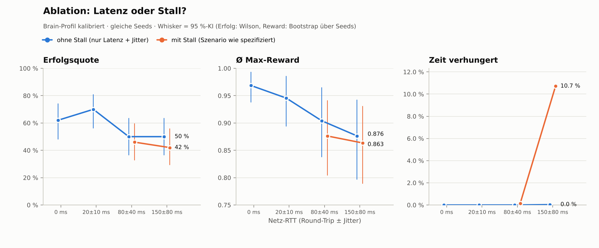
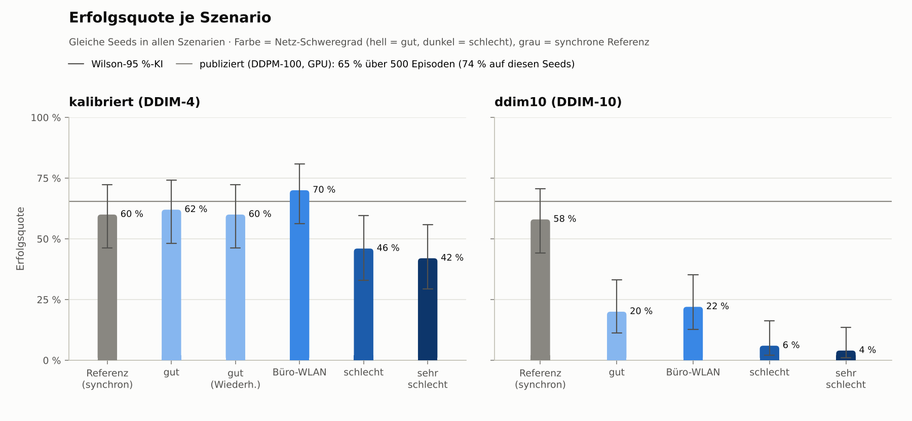
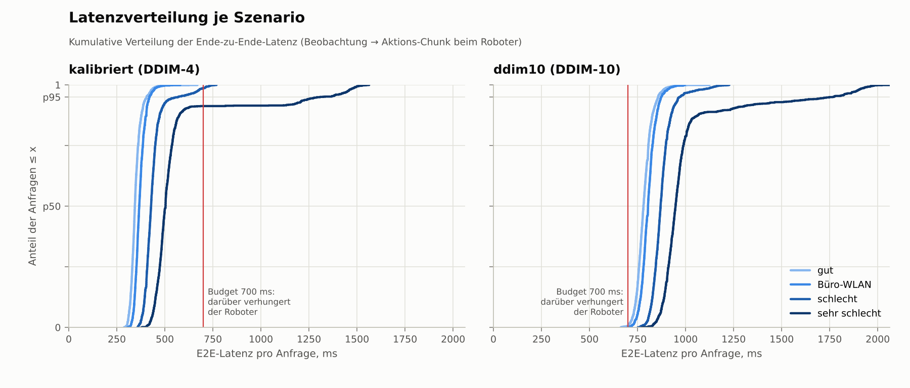
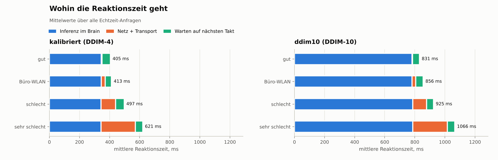
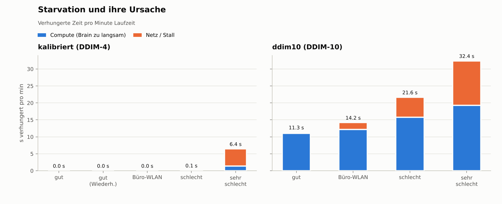
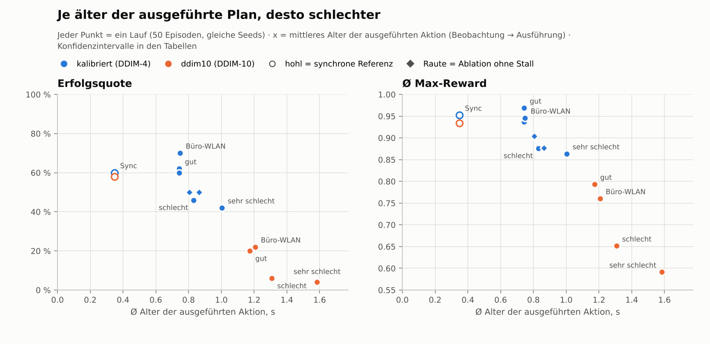
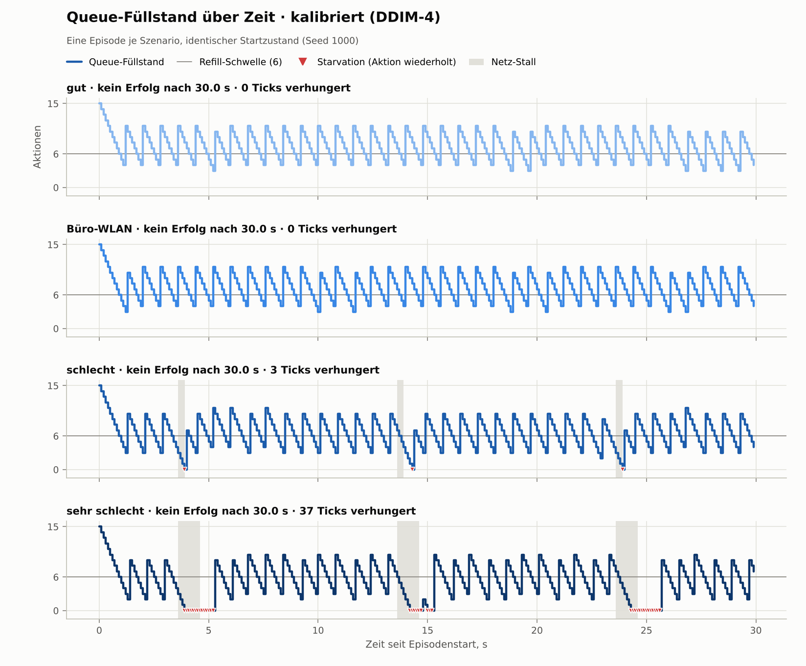
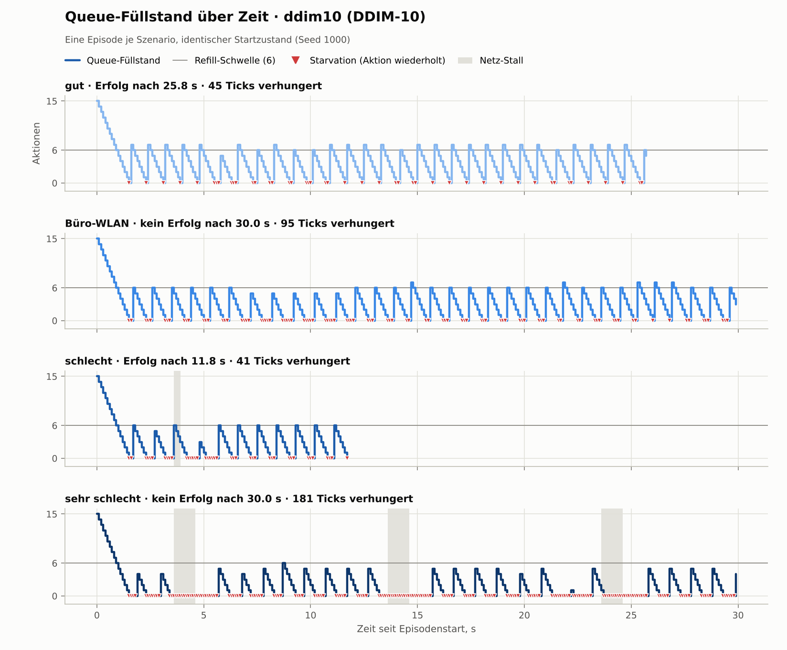

# Kortyn Phase 1 – Baseline-Messung

_Erzeugt 2026-10-24 00:43 UTC mit `python -m kortyn.report` aus `results/`._

## Setup

- **Aufgabe:** PushT (gym-pusht via LeRobot-Konfiguration), 10 Hz Steuertakt, max. 300 Schritte, Erfolg = T-Block ≥ 95 % im Ziel.
- **Policy:** `lerobot/diffusion_pusht` @ `84a7c231` (Diffusion Policy, migriert), LeRobot 0.6.1, torch 2.11.0+cpu.
- **Brain-Hardware:** Linux-6.18.44-fc-v153-x86_64-with-glibc2.39, 4 CPUs, Device `cpu`, 3 Threads.
- **Agent:** Chunk 15 Aktionen, Refill bei ≤ 6 → Latenzbudget **700 ms**; Start „warm“; Starvation = letzte Aktion wiederholen.
- **Seeds:** 1000–1049 (identische Startzustände in allen Szenarien, gepaarte Auswertung), Szenarien seed-weise verschränkt.
- **Netz:** Werte sind Round-Trip-Zeiten, je zur Hälfte auf beide Richtungen verteilt, Jitter gleichverteilt; Stall = Link friert in beide Richtungen ein.

## Auf einen Blick

| Szenario | Netz (RTT) | kalibriert (DDIM-4): Erfolg · verhungert | ddim10 (DDIM-10): Erfolg · verhungert |
|---|---|---:|---:|
| **referenz_sync** | – (Sim wartet) | 60 % · – | 58 % · – |
| **gut** | 0 ms | 62 % · 0.0 % | 20 % · 18.8 % |
| **gut_wiederholung** | 0 ms | 60 % · 0.0 % | – |
| **buero_wlan** | 20 ± 10 ms | 70 % · 0.0 % | 22 % · 23.6 % |
| **schlecht** | 80 ± 40 ms, Stall 300 ms/10 s | 46 % · 0.1 % | 6 % · 36.1 % |
| **sehr_schlecht** | 150 ± 80 ms, Stall 1000 ms/10 s | 42 % · 10.7 % | 4 % · 54.0 % |
| **schlecht_ohne_stall** | 80 ± 40 ms | 50 % · 0.0 % | – |
| **sehr_schlecht_ohne_stall** | 150 ± 80 ms | 50 % · 0.0 % | – |

Erfolg = Anteil gelöster Episoden (n = 50 je Zeile); verhungert = Anteil der Takte ohne frische Aktion. Details, Konfidenzintervalle und Tests in den Tabellen unten.

## Ergebnisse · Brain-Profil `kalibriert` (DDIM-4)

| Szenario | Netz (RTT) | n | Erfolg [95 %-KI] | Δ Erfolg vs. gut (McNemar p) | Ø Max-Reward | Δ Reward vs. gut [95 %-KI] | E2E p50 / p95 / p99 (ms) | Reaktion p50 (ms) | Netz-RTT p50 (ms) | Jitter (ms) | Starvation-Ereignisse/min | verhungert | Payload ↑/↓ (B) |
|---|---|---:|---:|---:|---:|---:|---:|---:|---:|---:|---:|---:|---:|
| **referenz_sync** | – (Sim wartet) | 50 | 60 % [46–72] | – | 0.952 | – | 338 / 402 / 438 | – | 2.9 | 0.5 | – | – | 55 426 / 170 |
| **gut** | 0 ms | 50 | 62 % [48–74] | – | 0.969 | – | 344 / 405 / 447 | 400 | 3.3 | 0.6 | 0.0 | 0.0 % | 55 426 / 170 |
| **gut_wiederholung** | 0 ms | 50 | 60 % [46–72] | -2 pp (p=1.00) | 0.937 | -0.031 [-0.079; -0.002] | 344 / 405 / 437 | 400 | 3.3 | 0.6 | 0.0 | 0.0 % | 55 426 / 170 |
| **buero_wlan** | 20 ± 10 ms | 50 | 70 % [56–81] | +8 pp (p=0.45) | 0.946 | -0.023 [-0.073; +0.016] | 366 / 419 / 458 | 400 | 25.3 | 4.7 | 0.0 | 0.0 % | 55 426 / 170 |
| **schlecht** | 80 ± 40 ms, Stall 300 ms/10 s | 50 | 46 % [33–60] | -16 pp (p=0.15) | 0.876 | -0.092 [-0.170; -0.025] | 428 / 548 / 708 | 500 | 86.0 | 40.7 | 0.8 | 0.1 % | 55 427 / 171 |
| **sehr_schlecht** | 150 ± 80 ms, Stall 1000 ms/10 s | 50 | 42 % [29–56] | -20 pp (p=0.02) | 0.863 | -0.105 [-0.183; -0.034] | 503 / 1 307 / 1 487 | 500 | 159.0 | 174.5 | 8.6 | 10.7 % | 55 427 / 171 |
| **schlecht_ohne_stall** | 80 ± 40 ms | 50 | 50 % [37–63] | -12 pp (p=0.26) | 0.904 | -0.064 [-0.137; +0.005] | 412 / 456 / 488 | 500 | 85.7 | 18.0 | 0.0 | 0.0 % | 55 426 / 170 |
| **sehr_schlecht_ohne_stall** | 150 ± 80 ms | 50 | 50 % [37–63] | -12 pp (p=0.29) | 0.876 | -0.092 [-0.174; -0.022] | 482 / 548 / 584 | 500 | 155.8 | 36.0 | 0.1 | 0.0 % | 55 426 / 170 |

Lesehilfe: `gut_wiederholung` ist exakt dieselbe Bedingung wie `gut`. Ihr Δ (-0.031 [-0.079; -0.002] Reward) zeigt das Rauschen zwischen zwei Läufen (Echtzeit ist nicht bit-genau wiederholbar). Kleinere Effekte sind mit n = 50 nicht belastbar.

Diagnose (Budget, Starvation-Ursache, Messhygiene)

| Szenario | Dauer bis Erfolg (Median) | Anfragen/min | über Budget | Aktionsalter Ø (Ticks) | Starvation Compute/Netz (Ticks) | davon in Stall-Nähe | Inferenz p50 (ms) | Server p95 (ms) | Wire ↑/↓ pro Anfrage (B) | ungültige Versuche | max. Takt-Verspätung |
|---|---:|---:|---:|---:|---:|---:|---:|---:|---:|---:|---:|
| **referenz_sync** | 15.7 s | 76.0 | – | 3.5 | – | – | 334 | 399 | – | 0 | – |
| **gut** | 16.0 s | 73.7 | 0.0 % | 7.4 | 0 / 0 | – | 339 | 401 | 55 488 / 237 | 2 | 47.5 ms |
| **gut_wiederholung** | 14.6 s | 73.7 | 0.1 % | 7.4 | 0 / 0 | – | 339 | 400 | 55 488 / 237 | 3 | 40.9 ms |
| **buero_wlan** | 14.6 s | 73.6 | 0.0 % | 7.5 | 0 / 0 | – | 340 | 393 | 55 488 / 237 | 1 | 47.7 ms |
| **schlecht** | 18.9 s | 73.8 | 1.3 % | 8.3 | 0 / 17 | 100 % | 338 | 389 | 55 488 / 237 | 2 | 46.6 ms |
| **sehr_schlecht** | 17.1 s | 69.6 | 8.7 % | 10.0 | 290 / 1055 | 88 % | 337 | 395 | 55 488 / 237 | 5 | 45.4 ms |
| **schlecht_ohne_stall** | 18.6 s | 73.8 | 0.0 % | 8.0 | 0 / 0 | – | 324 | 365 | 55 489 / 238 | 4 | 43.0 ms |
| **sehr_schlecht_ohne_stall** | 17.3 s | 73.8 | 0.2 % | 8.6 | 0 / 4 | 0 % | 324 | 367 | 55 488 / 238 | 4 | 41.7 ms |

### Ablation: Latenz oder Stall? (`kalibriert`)

Gleiche Latenz und gleicher Jitter wie im Szenario, aber ohne Stalls. „Δ durch Latenz“ ist der Effekt von Delay + Jitter allein gegenüber „gut“, „Δ durch Stall“ der zusätzliche Effekt der Aussetzer (gepaarte Differenzen über dieselben Seeds, Bootstrap-95 %-KI).

| Netz (RTT) | Erfolg ohne → mit Stall | Ø Max-Reward ohne → mit Stall | Δ Reward durch Latenz (ohne Stall − gut) | Δ Reward durch Stall (mit − ohne) | verhungert ohne → mit Stall | Aktionsalter Ø ohne → mit (Ticks) | E2E p99 ohne → mit (ms) |
|---|---:|---:|---:|---:|---:|---:|---:|
| 80 ± 40 ms | 50 % → 46 % | 0.904 → 0.876 | -0.064 [-0.137; +0.005] | -0.028 [-0.080; +0.020] | 0.0 % → 0.1 % | 8.0 → 8.3 | 488 → 708 |
| 150 ± 80 ms | 50 % → 42 % | 0.876 → 0.863 | -0.092 [-0.174; -0.022] | -0.013 [-0.069; +0.050] | 0.0 % → 10.7 % | 8.6 → 10.0 | 584 → 1 487 |

## Ergebnisse · Brain-Profil `ddim10` (DDIM-10)

| Szenario | Netz (RTT) | n | Erfolg [95 %-KI] | Δ Erfolg vs. gut (McNemar p) | Ø Max-Reward | Δ Reward vs. gut [95 %-KI] | E2E p50 / p95 / p99 (ms) | Reaktion p50 (ms) | Netz-RTT p50 (ms) | Jitter (ms) | Starvation-Ereignisse/min | verhungert | Payload ↑/↓ (B) |
|---|---|---:|---:|---:|---:|---:|---:|---:|---:|---:|---:|---:|---:|
| **referenz_sync** | – (Sim wartet) | 50 | 58 % [44–71] | – | 0.934 | – | 779 / 849 / 904 | – | 2.8 | 0.4 | – | – | 55 426 / 170 |
| **gut** | 0 ms | 50 | 20 % [11–33] | – | 0.793 | – | 781 / 857 / 907 | 800 | 3.1 | 0.7 | 68.8 | 18.8 % | 55 427 / 171 |
| **buero_wlan** | 20 ± 10 ms | 50 | 22 % [13–35] | +2 pp (p=1.00) | 0.760 | -0.033 [-0.124; +0.062] | 805 / 872 / 920 | 900 | 25.3 | 5.0 | 67.2 | 23.6 % | 55 427 / 171 |
| **schlecht** | 80 ± 40 ms, Stall 300 ms/10 s | 50 | 6 % [2–16] | -14 pp (p=0.04) | 0.651 | -0.142 [-0.238; -0.049] | 870 / 965 / 1 141 | 900 | 86.0 | 30.1 | 62.8 | 36.1 % | 55 427 / 171 |
| **sehr_schlecht** | 150 ± 80 ms, Stall 1000 ms/10 s | 50 | 4 % [1–13] | -16 pp (p=0.04) | 0.591 | -0.202 [-0.287; -0.114] | 948 / 1 766 / 1 932 | 1 000 | 159.9 | 174.3 | 50.9 | 54.0 % | 55 427 / 171 |

Diagnose (Budget, Starvation-Ursache, Messhygiene)

| Szenario | Dauer bis Erfolg (Median) | Anfragen/min | über Budget | Aktionsalter Ø (Ticks) | Starvation Compute/Netz (Ticks) | davon in Stall-Nähe | Inferenz p50 (ms) | Server p95 (ms) | Wire ↑/↓ pro Anfrage (B) | ungültige Versuche | max. Takt-Verspätung |
|---|---:|---:|---:|---:|---:|---:|---:|---:|---:|---:|---:|
| **referenz_sync** | 16.5 s | 76.1 | – | 3.5 | – | – | 775 | 846 | – | 0 | – |
| **gut** | 18.0 s | 71.0 | 99.5 % | 11.7 | 2565 / 55 | 0 % | 777 | 853 | 55 488 / 238 | 1 | 49.6 ms |
| **buero_wlan** | 14.6 s | 68.9 | 99.9 % | 12.1 | 2730 / 449 | 0 % | 777 | 847 | 55 488 / 238 | 2 | 49.2 ms |
| **schlecht** | 13.4 s | 64.1 | 100.0 % | 13.1 | 3857 / 1428 | 11 % | 781 | 854 | 55 488 / 238 | 1 | 32.6 ms |
| **sehr_schlecht** | 21.1 s | 55.8 | 100.0 % | 15.8 | 4768 / 3231 | 26 % | 781 | 848 | 55 488 / 238 | 4 | 48.8 ms |

## Abbildungen

## Validierungskette (Abnahmekriterium 2)

| Stufe | Was isoliert wird | Erfolg | Ø Max-Reward | n |
|---|---|---:|---:|---:|
| A₀ · publiziert, alle Episoden (DDPM-100, GPU) | Populationswert des Checkpoints | 65.4 % | 0.955 | 500 |
| A · publiziert, Seeds wie hier (`eval_info.json`, DDPM-100, GPU) | Referenz | 74 % | 0.961 | 50 |
| B · `lerobot-eval`, migrierter Checkpoint, DDIM-10 (cpu) | Migration + Sampler | 62 % | 0.926 | 50 |
| B · `lerobot-eval`, migrierter Checkpoint, DDPM-100 (cpu) | Migration + Sampler | 62 % | 0.963 | 50 |
| B · `lerobot-eval`, migrierter Checkpoint, DDIM-4 (cpu) | Migration + Sampler | 52 % | 0.935 | 50 |
| C · Kortyn `referenz_sync`, DDIM-4 | Kortyn-Pipeline (synchron) | 60 % | 0.952 | 50 |
| D · Kortyn `gut`, DDIM-4 | Echtzeit + Inferenzlatenz | 62 % | 0.969 | 50 |
| D' · Kortyn `gut_wiederholung`, DDIM-4 | Lauf-zu-Lauf-Rauschen | 60 % | 0.937 | 50 |
| C · Kortyn `referenz_sync`, DDIM-10 | Kortyn-Pipeline (synchron) | 58 % | 0.934 | 50 |
| D · Kortyn `gut`, DDIM-10 | Echtzeit + Inferenzlatenz | 20 % | 0.793 | 50 |

## Kalibrierung des Brain-Profils `kalibriert`

Gate: keine Starvation in „gut“ und E2E-p99 ≤ 5 Ticks. Empfehlung: **DDIM-4**.

| DDIM-Schritte | Inferenz p50 (ms) | E2E p50 (ms) | E2E p99 (ms) | p99 in Ticks | Starvation/min | Gate |
|---:|---:|---:|---:|---:|---:|---|
| 10 | 801 | 808 | 957 | 9.6 | 152.0 | ❌ |
| 8 | 654 | 658 | 755 | 7.5 | 7.5 | ❌ |
| 6 | 505 | 510 | 640 | 6.4 | 1.3 | ❌ |
| 5 | 427 | 432 | 529 | 5.3 | 0.0 | ❌ |
| 4 | 357 | 362 | 425 | 4.2 | 0.0 | ✅ |

## Definitionen

- **E2E-Latenz:** Beobachtung erfasst → Aktions-Chunk beim Roboter.
- **Reaktionszeit:** Beobachtung erfasst → erste Aktion aus diesem Chunk ausgeführt (inkl. Warten auf den nächsten Takt).
- **Netz-RTT:** Zeit auf der Leitung (Anfrage-RTT minus Serverzeit). **Jitter:** mittlere |ΔRTT| aufeinanderfolgender Anfragen (RFC 5481).
- **Starvation:** Takt ohne frische Aktion – der Roboter wiederholt die letzte Aktion (PushT: hält das letzte Positionsziel). Ereignis = zusammenhängende Folge solcher Takte. **Compute** = wäre auch ohne Netz zu spät gewesen, sonst **Netz/Stall**. Lesehilfe: In Netz-Szenarien entsteht der Compute-Anteil meist als Nachlauf eines Stalls – ist die Queue einmal leer, braucht die nächste Anfrage mindestens eine Inferenzzeit, bevor wieder Aktionen da sind.
- **über Budget:** Anteil der Anfragen mit E2E-Latenz über dem Budget (dann verhungert der Roboter, sofern keine Reserve in der Queue ist). **in Stall-Nähe:** Anteil der verhungerten Takte, die in ein Stall-Fenster oder die Budget-Dauer danach fallen.
- **Reaktionszeit** existiert nur für Chunks, die tatsächlich ausgeführt wurden; komplett veraltete Chunks gehen in die E2E-Latenz und die Starvation ein, nicht in die Reaktionszeit.
- **Ø Max-Reward:** LeRobots `max_reward` pro Episode (PushT: beste Abdeckung / 95 %, gedeckelt auf 1; 1 = Erfolg), gemittelt. Kontinuierlich und daher statistisch trennschärfer als die Erfolgsquote; Δ-Werte sind gepaarte Differenzen über dieselben Seeds mit Bootstrap-95 %-KI.
- **Payload:** serialisierte Protobuf-Größe; **Wire** = Bytes durch den Proxy inkl. HTTP/2-Overhead.
- **Gültigkeit:** Episoden mit Takt-Verspätung > 50 ms, Proxy-Verspätung > 20 ms, Reconnect, CPU-Steal > 20% oder Infrastrukturfehler werden wiederholt.
