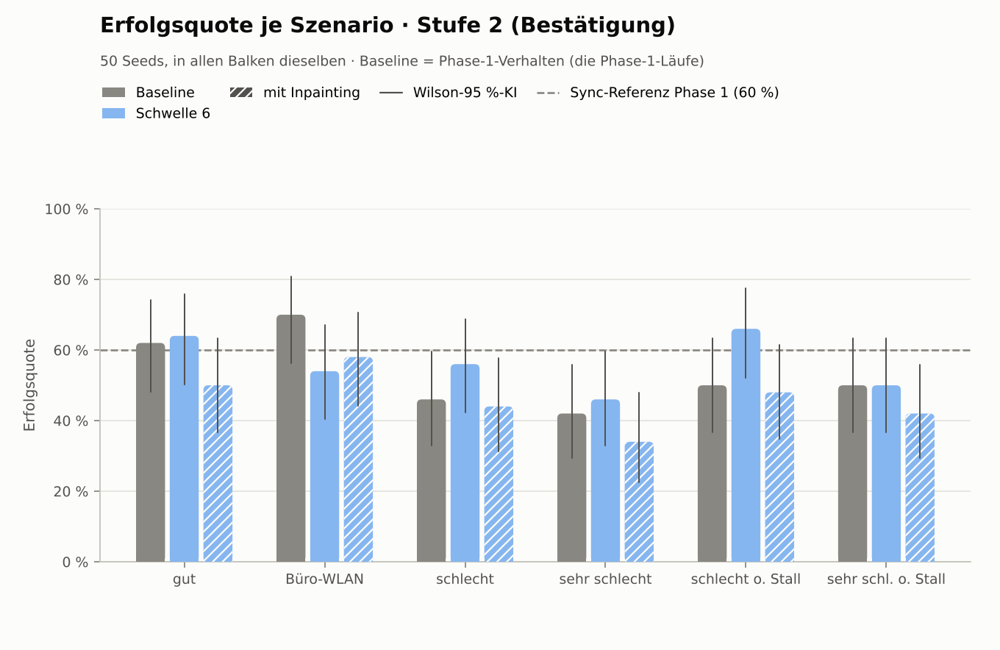
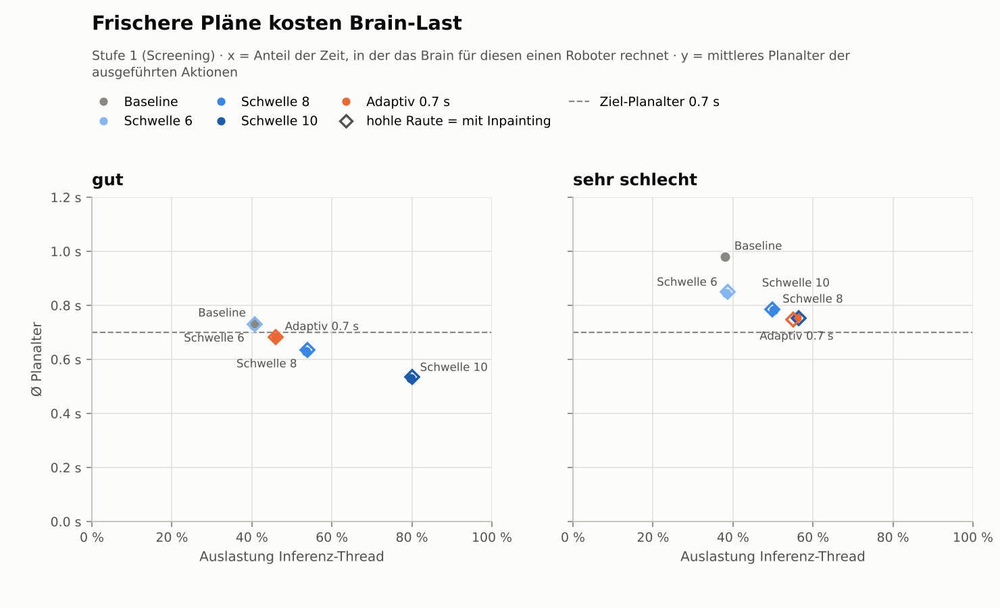
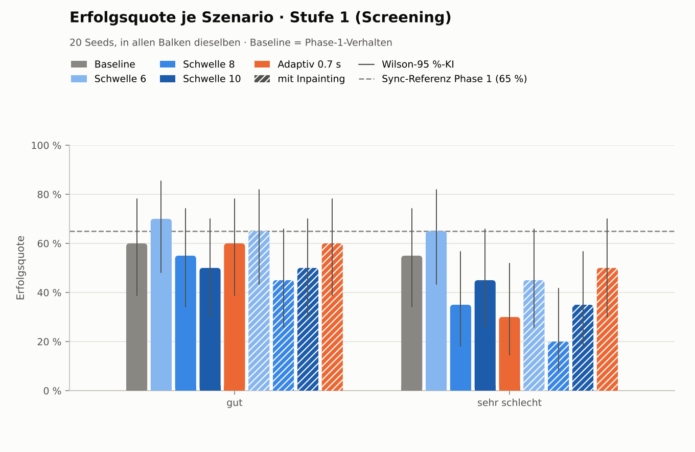
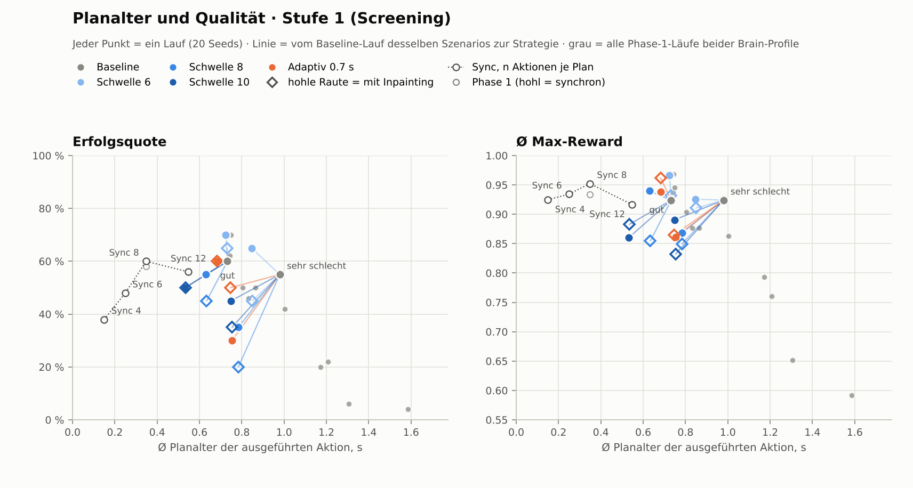
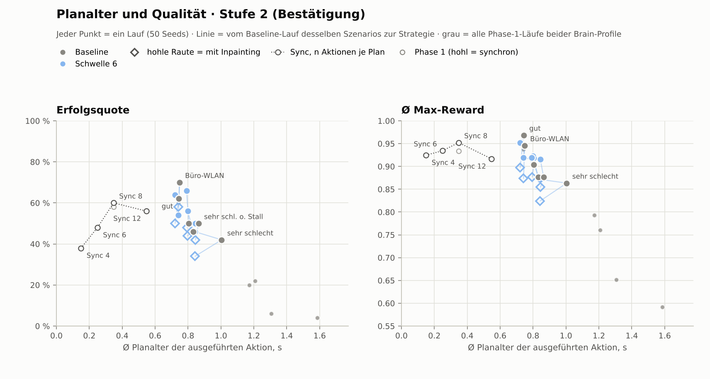

# Kortyn Phase 2 – Freshness Engine

_Erzeugt 2026-10-24 19:46 UTC mit `python -m kortyn.report` aus `results/phase2/` (Brain-Profil `kalibriert`); Phase-1-Referenz: `results/kalibriert/`._

**Frage:** Phase 1 zeigte: nicht der Stillstand kostet Qualität, sondern das Alter der ausgeführten Pläne (ab ≈ 0,75 s Ø-Planalter sinkt der Erfolg). Phase 2 hält das Planalter klein, ohne unnötige Brain-Last, und misst, wie viel Erfolg in schlechten Netzen zurückkommt.

## Kurzfassung (Stufe 2, 50 Seeds)

- **Beste Strategie in Stufe 2** (dieselbe Regel über alle 6 Szenarien: größte Ø gepaarte Reward-Differenz, bei < 0.01 weniger Anfragen/s): Schwelle 6 (`schwelle6`); ebenfalls in Stufe 2 gemessen: Schwelle 6 · Inpainting.
- **schlecht** (n = 50): Erfolg 46 % → 56 % (**+10 pp**, McNemar p = 0.36, Holm 1.00: nicht signifikant); Ø Max-Reward +0.047 [-0.022; +0.128] (Permutation p = 0.24, Holm 1.00: nicht signifikant); Planalter Ø 0.83 → 0.80 s.
- **sehr schlecht** (n = 50): Erfolg 42 % → 46 % (**+4 pp**, McNemar p = 0.81, Holm 1.00: nicht signifikant); Ø Max-Reward +0.008 [-0.059; +0.083] (Permutation p = 0.82, Holm 1.00: nicht signifikant); Planalter Ø 1.00 → 0.84 s.
- **Über alle 6 Szenarien gepoolt:** Schwelle 6 +3 pp Erfolg (p = 0.51), Δ Reward +0.011 [-0.015; +0.038] (p = 0.41, Holm 0.41); Schwelle 6 · Inpainting -7 pp Erfolg (p = 0.06), Δ Reward -0.032 [-0.060; -0.004] (p = 0.03, Holm 0.06).
- **Brain-Mehrlast** (Ø über 6 Szenarien, ein Roboter): 1.22 → 1.22 Anfragen/s (×1.00); Auslastung des Inferenz-Threads 41 % → 39 %. Rechnerisch trägt ein Inferenz-Thread damit ≈ 2.5 statt 2.4 Roboter (ohne Warteschlangeneffekte).
- **Sync-Referenz** (Phase 1, Simulation wartet auf das Brain, gleiche Seeds): 60 % Erfolg, Ø Max-Reward 0.952.
- **Messrauschen:** Zwei identische Phase-1-Läufe („gut“) unterscheiden sich bereits um Δ Reward -0.031 und -2 pp Erfolg (n = 50). Kleinere Effekte sind nicht belastbar.
- **A/A-Kontrolle:** Schwelle 6 unterscheidet sich von der Baseline nur im Notfall-Halt, und der griff in gut, Büro-WLAN praktisch nie ein (< 0.1 % der Takte). Dort ist der Vergleich faktisch Baseline gegen Baseline: Δ Erfolg / Δ Reward gut +2 pp / -0.016, Büro-WLAN -16 pp / -0.026 – so groß ist das Rauschen zwischen zwei Messungen.

## Auf einen Blick

| Szenario | Baseline: Erfolg · Planalter · Anfragen/s | Schwelle 6: Erfolg (Δ, p Holm) · Planalter · Anfragen/s | Schwelle 6 · Inpainting: Erfolg (Δ, p Holm) · Planalter · Anfragen/s |
|---|---:|---:|---:|
| gut | 62 % · 0.74 s · 1.23 | 64 % (+2 pp, 1.00) · 0.72 s · 1.23 | 50 % (-12 pp, 1.00) · 0.72 s · 1.23 |
| Büro-WLAN | 70 % · 0.75 s · 1.23 | 54 % (-16 pp, 0.92) · 0.74 s · 1.23 | 58 % (-12 pp, 1.00) · 0.74 s · 1.23 |
| schlecht | 46 % · 0.83 s · 1.23 | 56 % (+10 pp, 1.00) · 0.80 s · 1.23 | 44 % (-2 pp, 1.00) · 0.80 s · 1.23 |
| sehr schlecht | 42 % · 1.00 s · 1.16 | 46 % (+4 pp, 1.00) · 0.84 s · 1.16 | 34 % (-8 pp, 1.00) · 0.84 s · 1.16 |
| schlecht o. Stall | 50 % · 0.80 s · 1.23 | 66 % (+16 pp, 1.00) · 0.79 s · 1.23 | 48 % (-2 pp, 1.00) · 0.79 s · 1.23 |
| sehr schl. o. Stall | 50 % · 0.86 s · 1.23 | 50 % (+0 pp, 1.00) · 0.84 s · 1.23 | 42 % (-8 pp, 1.00) · 0.85 s · 1.23 |

Δ = gepaarte Differenz zur Baseline auf denselben Seeds; fett = signifikant nach Holm-Korrektur (α = 0.05). Planalter = Ø Alter der ausgeführten Aktionen (Beobachtung → Ausführung).

## Ist das Planalter der Hebel?

Änderung des Ø Max-Reward je +0,1 s Ø-Planalter (Steigung, 95 %-KI per Bootstrap über Seeds):

- **Phase 1, zwischen Szenarien** (gleiches Anfrage-Timing; das Planalter variiert durch Netz, Stalls und Rechenzeit): -0.037 [-0.065; -0.012].
- **Stufe 1, innerhalb eines Szenarios** (gleiches Netz; das Planalter variiert nur durch die Anfrage-Häufigkeit, harte Wechsel): +0.031 [-0.002; +0.073] (einzeln: +0.039 gut, +0.024 sehr schlecht).
- **Differenz** Stufe 1 − Phase 1: +0.067 [+0.025; +0.119].

**Die Kernhypothese hält in dieser Form nicht:** Zwischen den Szenarien geht ein höheres Planalter mit schlechterer Qualität einher, aber ein über die Anfrage-Häufigkeit gesenktes Planalter bringt keine Qualität zurück – der Zusammenhang ist signifikant flacher und nicht negativ. Häufigere Anfragen senken das *mittlere* Alter, nicht die Verzögerung bis zur ersten Aktion eines Plans (Reaktionszeit in der Diagnose), und sie erhöhen die Zahl der Planwechsel, bei denen eine multimodale Diffusion-Policy den Lösungsweg wechseln kann. Je Plan werden nur noch 5–7 statt 8 Aktionen ausgeführt (LeRobot-Eval: 8). Das Planalter ist in Phase 1 ein Symptom von Latenz und Stalls, kein eigenständiger Hebel.

### Gegenprobe ohne Latenz: Aktionen je Plan im Sync-Modus

Zusatz-Ablation außerhalb der vorab festgelegten Stufen: Die Simulation wartet auf das Brain (keine Latenz, jeder Plan beginnt mit Alter 0) und führt n Aktionen je Plan aus; Phase 1 nutzte 8 (LeRobot-Eval). Gleiche Seeds (n = 50).

| Aktionen je Plan | Pläne/s | Planalter Ø (s) | Erfolg [95 %-KI] | Δ Erfolg | McNemar p (Holm) | Ø Max-Reward | Δ Reward vs. 8 [95 %-KI] | Permutation p (Holm) |
|---:|---:|---:|---:|---:|---:|---:|---:|---:|
| 4 | 2.50 | 0.15 | 38 % [26–52] | -22 pp | 0.05 (0.16) | 0.925 | -0.027 [-0.083; +0.025] | 0.34 (0.68) |
| 6 | 1.67 | 0.25 | 48 % [35–61] | -12 pp | 0.34 (0.69) | 0.934 | -0.018 [-0.070; +0.026] | 0.47 (0.68) |
| **8** (Phase 1) | 1.25 | 0.35 | 60 % [46–72] | – | – | 0.952 | – | – |
| 12 | 0.83 | 0.55 | 56 % [42–69] | -4 pp | 0.79 (0.79) | 0.917 | -0.036 [-0.090; +0.013] | 0.19 (0.58) |

Ohne Latenz geht die Tendenz in dieselbe Richtung (weniger Aktionen je Plan, weniger Reward), ist aber nach Holm-Korrektur nicht signifikant.
Der höchste Reward liegt bei den 8 Aktionen je Plan, mit denen die Policy evaluiert wurde; auch längere Pläne schneiden schlechter ab (Zielkonflikt zwischen zeitlicher Konsistenz und Reaktionsfähigkeit, vgl. Chi et al. 2023).

## Was gebaut wurde

1. **Latenzschätzung pro Roboter** (`kortyn/latency.py`): gleitendes Fenster der letzten E2E-Latenzen (Beobachtung → Chunk beim Roboter), Median und Streuung als 1,4826 · MAD – robust gegen Ausreißer wie Stalls; bis 3 Messungen ein konservativer Prior.
2. **Anfrage-Strategien** (`kortyn/freshness.py`): (a) feste Schwellen 6 (Baseline), 8, 10; (b) adaptiv – Deadline (der neue Plan kommt mit dem Latenz-Quantil vor dem Leerlaufen der Queue an) **und** Frische (Anfrageperiode P so, dass das erwartete Ø-Planalter D + (P − 1)/2 Takte das Ziel nicht übersteigt), aber nicht öfter.
3. **Zeitliche Ausrichtung:** jede Aktion trägt ihren Steuertakt; Aktionen, deren Zeitpunkt beim Eintreffen verstrichen ist, werden übersprungen (`alignment: timestep`; `shift` = naiver Gegenentwurf für Tests).
4. **Glättung der Übergänge:** gradientenfreies Inpainting im Brain (`kortyn/inpainting.py`); der Agent schickt mit jeder Anfrage die eingefrorenen Aktionen (vorheriger und aktueller Takt sowie alles, was bis zum erwarteten Eintreffen läuft) und die weich geführte Überlappung mit.
5. **Notfall nur bei Budgetverletzung:** Queue leer oder Planalter über der harten Grenze → Ereignis loggen, Roboter hält an (Positionsziel = aktuelle Position), kein lokales Modell.
6. **Brain-Last:** Anfragen/s, Auslastung des Inferenz-Threads (Inferenzzeit / Episodenzeit) und Wartezeit im Brain aus den Request-Records; die neuen Brain-Zähler (`GetStats`-RPC) prüfen das gegen.

Alle Strategien sind per YAML schaltbar (`kortyn/experiments/phase2/*.yaml`, Schlüssel `strategies`). Die Baseline (`StrategyConfig()`) ist exakt das Phase-1-Verhalten.

| Strategie | Schlüssel | Anfrage-Zeitpunkt | Ausrichtung | Übergang | ohne nutzbare Aktion |
|---|---|---|---|---|---|
| Baseline | `baseline` | ≤ 6 Aktionen in der Queue | timestep | harter Wechsel | letzte Aktion wiederholen |
| Schwelle 6 | `schwelle6` | ≤ 6 Aktionen in der Queue | timestep | harter Wechsel | anhalten + Notfall (auch bei Planalter > 1.2 s) |
| Schwelle 8 | `schwelle8` | ≤ 8 Aktionen in der Queue | timestep | harter Wechsel | anhalten + Notfall (auch bei Planalter > 1.2 s) |
| Schwelle 10 | `schwelle10` | ≤ 10 Aktionen in der Queue | timestep | harter Wechsel | anhalten + Notfall (auch bei Planalter > 1.2 s) |
| Adaptiv 0.7 s | `adaptiv` | adaptiv: Ziel-Planalter 0.7 s; Deadline mit Latenz-Median + 1.645 · σ (robust) + 1 Takt | timestep | harter Wechsel | anhalten + Notfall (auch bei Planalter > 1.2 s) |
| Schwelle 6 · Inpainting | `schwelle6_inpaint` | ≤ 6 Aktionen in der Queue | timestep | Inpainting (exp, ≤ 10 Takte Überlappung) | anhalten + Notfall (auch bei Planalter > 1.2 s) |
| Schwelle 8 · Inpainting | `schwelle8_inpaint` | ≤ 8 Aktionen in der Queue | timestep | Inpainting (exp, ≤ 10 Takte Überlappung) | anhalten + Notfall (auch bei Planalter > 1.2 s) |
| Schwelle 10 · Inpainting | `schwelle10_inpaint` | ≤ 10 Aktionen in der Queue | timestep | Inpainting (exp, ≤ 10 Takte Überlappung) | anhalten + Notfall (auch bei Planalter > 1.2 s) |
| Adaptiv 0.7 s · Inpainting | `adaptiv_inpaint` | adaptiv: Ziel-Planalter 0.7 s; Deadline mit Latenz-Median + 1.645 · σ (robust) + 1 Takt | timestep | Inpainting (exp, ≤ 10 Takte Überlappung) | anhalten + Notfall (auch bei Planalter > 1.2 s) |

## Methodik

- **Gleich wie Phase 1:** Umgebung (PushT, 10 Hz), Checkpoint, Brain-Profil `kalibriert`, Netzszenarien, Seeds ab 1000, seed-weise verschränkte Reihenfolge, Validitäts-Gate mit Wiederholung.
- **Stufe 1 – Screening:** alle Strategien × 20 Seeds auf „gut“ und „sehr schlecht“, Baseline frisch mitgemessen (Reproduktionsprüfung).
- **Auswahlregel (vor Stufe 1 festgelegt):** größte mittlere gepaarte Δ Ø Max-Reward gegenüber der Baseline über beide Szenarien; liegen Strategien weniger als 0.01 auseinander, gewinnt die mit weniger Anfragen/s.
- **Stufe 2 – Bestätigung:** die zwei Besten × 50 Seeds auf allen vier Szenarien plus den zwei Ablationen ohne Stall. Baseline = die Phase-1-Läufe (identische Konfiguration, gleiche Seeds; Stufe 1 prüft die Reproduzierbarkeit) – das spart ≈ 2 h Messzeit.
- **Tests:** Erfolg mit exaktem McNemar, Max-Reward mit gepaartem Vorzeichen-Permutationstest und Bootstrap-KI über Seeds; Holm-Korrektur über alle Vergleiche einer Stufe.

## Stufe 1 · Screening (20 Seeds)

### Reproduktion der Baseline (Abnahmekriterium 2)

| Vergleich (alt → neu) | Seeds | Erfolg | McNemar p (Holm) | Ø Max-Reward | Δ Reward [95 %-KI] | Permutation p (Holm) | Planalter Ø (s) | verhungert | Anfragen/s | E2E p50 (ms) |
|---|---:|---:|---:|---:|---:|---:|---:|---:|---:|---:|
| gut: Phase 1 → Stufe 1 | 20 | 65 % → 60 % | 1.00 (1.00) | 0.975 → 0.924 | -0.051 [-0.103; -0.008] | 0.03 (0.14) | 0.74 → 0.73 | 0.0 % → 0.1 % | 1.23 → 1.23 | 346 → 329 |
| sehr schlecht: Phase 1 → Stufe 1 | 20 | 50 % → 55 % | 1.00 (1.00) | 0.886 → 0.924 | +0.038 [-0.020; +0.091] | 0.22 (0.65) | 1.00 → 0.98 | 10.4 % → 9.9 % | 1.16 → 1.16 | 507 → 490 |
| _gut: Phase-1-Wiederholung → Stufe 1_ | 20 | 60 % → 60 % | 1.00 | 0.952 → 0.924 | -0.028 [-0.090; +0.036] | 0.42 | 0.74 → 0.73 | 0.0 % → 0.1 % | 1.23 → 1.23 | 347 → 329 |
| _gut: Phase 1 → Phase-1-Wiederholung (gleiche Sitzung, identisch)_ | 20 | 65 % → 60 % | 1.00 | 0.975 → 0.952 | -0.023 [-0.064; -0.000] | 0.08 | 0.74 → 0.74 | 0.0 % → 0.0 % | 1.23 → 1.23 | 346 → 347 |

✅ **Reproduziert innerhalb der Unsicherheit:** Max-Reward gut nominal p = 0.03, nach Holm-Korrektur über alle 4 Reproduktionstests p = 0.14. Planalter (± 0,05 s) und Anfragerate (± 5 %) stimmen überein. Zum Vergleich: Phase 1 gegen ihre eigene, identische Wiederholung in derselben Sitzung ergibt Δ Reward -0.031 (n = 50, Permutation p = 0.03) – Unterschiede dieser Größe sind Lauf-zu-Lauf-Rauschen der Echtzeitmessung.

### Ergebnisse je Szenario

#### gut (0 ms)

| Strategie | n | Erfolg [95 %-KI] | Δ Erfolg | McNemar p (Holm) | Ø Max-Reward | Δ Reward [95 %-KI] | Permutation p (Holm) | Planalter Ø / p95 (s) | Zeit verhungert | Notfälle/min | Anfragen/s | Auslastung Inferenz | Wartezeit Brain (ms) |
|---|---:|---:|---:|---:|---:|---:|---:|---:|---:|---:|---:|---:|---:|
| Baseline | 20 | 60 % [39–78] | – | – | 0.924 | – | – | 0.73 / 1.10 | 0.1 % | 0.3 | 1.23 | 41 % | 0.3 |
| **Schwelle 6** ⭐ | 20 | 70 % [48–85] | +10 pp | 0.69 (1.00) | 0.967 | +0.043 [-0.003; +0.100] | 0.15 (1.00) | 0.72 / 1.10 | 0.0 % | 0.3 | 1.23 | 40 % | 0.3 |
| Schwelle 8 | 20 | 55 % [34–74] | -5 pp | 1.00 (1.00) | 0.940 | +0.016 [-0.018; +0.057] | 0.46 (1.00) | 0.63 / 0.90 | 0.0 % | 0.0 | 1.64 | 54 % | 0.3 |
| Schwelle 10 | 20 | 50 % [30–70] | -10 pp | 0.73 (1.00) | 0.860 | -0.064 [-0.231; +0.079] | 0.45 (1.00) | 0.53 / 0.70 | 0.0 % | 0.0 | 2.46 | 80 % | 0.3 |
| Adaptiv 0.7 s | 20 | 60 % [39–78] | +0 pp | 1.00 (1.00) | 0.939 | +0.015 [-0.123; +0.122] | 0.87 (1.00) | 0.68 / 1.00 | 0.0 % | 0.1 | 1.40 | 46 % | 0.3 |
| **Schwelle 6 · Inpainting** ⭐ | 20 | 65 % [43–82] | +5 pp | 1.00 (1.00) | 0.932 | +0.008 [-0.124; +0.105] | 0.95 (1.00) | 0.73 / 1.10 | 0.0 % | 0.3 | 1.23 | 41 % | 0.5 |
| Schwelle 8 · Inpainting | 20 | 45 % [26–66] | -15 pp | 0.51 (1.00) | 0.855 | -0.069 [-0.194; +0.033] | 0.29 (1.00) | 0.63 / 0.90 | 0.0 % | 0.0 | 1.63 | 54 % | 0.5 |
| Schwelle 10 · Inpainting | 20 | 50 % [30–70] | -10 pp | 0.69 (1.00) | 0.883 | -0.041 [-0.202; +0.089] | 0.61 (1.00) | 0.53 / 0.70 | 0.0 % | 0.0 | 2.45 | 80 % | 0.5 |
| Adaptiv 0.7 s · Inpainting | 20 | 60 % [39–78] | +0 pp | 1.00 (1.00) | 0.962 | +0.038 [-0.018; +0.100] | 0.27 (1.00) | 0.68 / 1.00 | 0.0 % | 0.0 | 1.39 | 46 % | 0.5 |

#### sehr schlecht (150 ± 80 ms, Stall 1000 ms/10 s)

| Strategie | n | Erfolg [95 %-KI] | Δ Erfolg | McNemar p (Holm) | Ø Max-Reward | Δ Reward [95 %-KI] | Permutation p (Holm) | Planalter Ø / p95 (s) | Zeit verhungert | Notfälle/min | Anfragen/s | Auslastung Inferenz | Wartezeit Brain (ms) |
|---|---:|---:|---:|---:|---:|---:|---:|---:|---:|---:|---:|---:|---:|
| Baseline | 20 | 55 % [34–74] | – | – | 0.924 | – | – | 0.98 / 1.80 | 9.9 % | 10.0 | 1.16 | 38 % | 0.4 |
| **Schwelle 6** ⭐ | 20 | 65 % [43–82] | +10 pp | 0.69 (1.00) | 0.926 | +0.002 [-0.046; +0.047] | 0.86 (1.00) | 0.85 / 1.20 | 10.3 % | 28.5 | 1.16 | 38 % | 0.4 |
| Schwelle 8 | 20 | 35 % [18–57] | -20 pp | 0.22 (1.00) | 0.869 | -0.056 [-0.136; +0.018] | 0.23 (1.00) | 0.78 / 1.10 | 9.7 % | 7.3 | 1.50 | 50 % | 0.4 |
| Schwelle 10 | 20 | 45 % [26–66] | -10 pp | 0.75 (1.00) | 0.891 | -0.033 [-0.115; +0.037] | 0.44 (1.00) | 0.75 / 1.10 | 8.7 % | 7.1 | 1.70 | 56 % | 0.3 |
| Adaptiv 0.7 s | 20 | 30 % [15–52] | -25 pp | 0.30 (1.00) | 0.861 | -0.063 [-0.186; +0.039] | 0.37 (1.00) | 0.75 / 1.10 | 8.6 % | 7.1 | 1.68 | 56 % | 0.3 |
| **Schwelle 6 · Inpainting** ⭐ | 20 | 45 % [26–66] | -10 pp | 0.75 (1.00) | 0.911 | -0.013 [-0.060; +0.036] | 0.62 (1.00) | 0.85 / 1.20 | 10.3 % | 30.1 | 1.16 | 39 % | 0.5 |
| Schwelle 8 · Inpainting | 20 | 20 % [8–42] | -35 pp | 0.07 (1.00) | 0.850 | -0.074 [-0.167; +0.004] | 0.09 (1.00) | 0.78 / 1.10 | 9.9 % | 7.0 | 1.50 | 50 % | 0.5 |
| Schwelle 10 · Inpainting | 20 | 35 % [18–57] | -20 pp | 0.42 (1.00) | 0.832 | -0.092 [-0.212; +0.011] | 0.18 (1.00) | 0.75 / 1.10 | 8.3 % | 6.7 | 1.70 | 56 % | 0.5 |
| Adaptiv 0.7 s · Inpainting | 20 | 50 % [30–70] | -5 pp | 1.00 (1.00) | 0.865 | -0.059 [-0.167; +0.027] | 0.31 (1.00) | 0.75 / 1.00 | 8.4 % | 6.4 | 1.69 | 55 % | 0.5 |

**Über alle 2 Szenarien gepoolt** (gepaart je Szenario und Seed; Holm über die Strategien):

| Strategie | Paare | Erfolg Baseline → Strategie | Δ Erfolg | McNemar p (Holm) | Δ Reward [95 %-KI] | Permutation p (Holm) |
|---|---:|---:|---:|---:|---:|---:|
| Schwelle 6 | 40 | 57 % → 68 % | +10 pp | 0.39 (1.00) | +0.022 [-0.011; +0.060] | 0.24 (1.00) |
| Schwelle 8 | 40 | 57 % → 45 % | -12 pp | 0.30 (1.00) | -0.020 [-0.067; +0.021] | 0.41 (1.00) |
| Schwelle 10 | 40 | 57 % → 48 % | -10 pp | 0.48 (1.00) | -0.049 [-0.148; +0.034] | 0.31 (1.00) |
| Adaptiv 0.7 s | 40 | 57 % → 45 % | -12 pp | 0.42 (1.00) | -0.024 [-0.113; +0.052] | 0.59 (1.00) |
| Schwelle 6 · Inpainting | 40 | 57 % → 55 % | -2 pp | 1.00 (1.00) | -0.003 [-0.069; +0.052] | 0.95 (1.00) |
| Schwelle 8 · Inpainting | 40 | 57 % → 32 % | -25 pp | 0.04 (0.33) | -0.072 [-0.145; -0.004] | 0.04 (0.36) |
| Schwelle 10 · Inpainting | 40 | 57 % → 42 % | -15 pp | 0.26 (1.00) | -0.066 [-0.170; +0.021] | 0.19 (1.00) |
| Adaptiv 0.7 s · Inpainting | 40 | 57 % → 55 % | -2 pp | 1.00 (1.00) | -0.011 [-0.076; +0.044] | 0.77 (1.00) |

### Auswahl für Stufe 2

| Rang | Strategie | Δ Reward gut | Δ Reward sehr schlecht | Score (Ø Δ Reward) | Anfragen/s (Ø) | Stufe 2 |
|---:|---|---:|---:|---:|---:|:---:|
| 1 | Schwelle 6 | +0.043 | +0.002 | +0.022 | 1.20 | ✅ |
| 2 | Schwelle 6 · Inpainting | +0.008 | -0.013 | -0.003 | 1.20 | ✅ |
| 3 | Adaptiv 0.7 s · Inpainting | +0.038 | -0.059 | -0.011 | 1.54 |  |
| 4 | Schwelle 8 | +0.016 | -0.056 | -0.020 | 1.57 |  |
| 5 | Adaptiv 0.7 s | +0.015 | -0.063 | -0.024 | 1.54 |  |
| 6 | Schwelle 10 | -0.064 | -0.033 | -0.049 | 2.08 |  |
| 7 | Schwelle 10 · Inpainting | -0.041 | -0.092 | -0.066 | 2.07 |  |
| 8 | Schwelle 8 · Inpainting | -0.069 | -0.074 | -0.072 | 1.56 |  |

## Stufe 2 · Bestätigung (50 Seeds)

#### gut (0 ms)

| Strategie | n | Erfolg [95 %-KI] | Δ Erfolg | McNemar p (Holm) | Ø Max-Reward | Δ Reward [95 %-KI] | Permutation p (Holm) | Planalter Ø / p95 (s) | Zeit verhungert | Notfälle/min | Anfragen/s | Auslastung Inferenz | Wartezeit Brain (ms) |
|---|---:|---:|---:|---:|---:|---:|---:|---:|---:|---:|---:|---:|---:|
| Baseline (Phase-1-Lauf) | 50 | 62 % [48–74] | – | – | 0.969 | – | – | 0.74 / 1.10 | 0.0 % | 0.0 | 1.23 | 42 % | 0.3 |
| _Baseline-Wiederholung (Phase 1, identisch)_ | 50 | 60 % [46–72] | -2 pp | 1.00 (–) | 0.937 | -0.031 [-0.079; -0.002] | 0.03 (–) | 0.74 / 1.10 | 0.0 % | 0.0 | 1.23 | 42 % | 0.3 |
| **Schwelle 6** ⭐ | 50 | 64 % [50–76] | +2 pp | 1.00 (1.00) | 0.952 | -0.016 [-0.050; +0.012] | 0.34 (1.00) | 0.72 / 1.10 | 0.0 % | 0.1 | 1.23 | 40 % | 0.3 |
| Schwelle 6 · Inpainting | 50 | 50 % [37–63] | -12 pp | 0.29 (1.00) | 0.897 | -0.071 [-0.147; -0.010] | 0.04 (0.49) | 0.72 / 1.10 | 0.0 % | 0.1 | 1.23 | 40 % | 0.5 |

#### Büro-WLAN (20 ± 10 ms)

| Strategie | n | Erfolg [95 %-KI] | Δ Erfolg | McNemar p (Holm) | Ø Max-Reward | Δ Reward [95 %-KI] | Permutation p (Holm) | Planalter Ø / p95 (s) | Zeit verhungert | Notfälle/min | Anfragen/s | Auslastung Inferenz | Wartezeit Brain (ms) |
|---|---:|---:|---:|---:|---:|---:|---:|---:|---:|---:|---:|---:|---:|
| Baseline (Phase-1-Lauf) | 50 | 70 % [56–81] | – | – | 0.946 | – | – | 0.75 / 1.10 | 0.0 % | 0.0 | 1.23 | 42 % | 0.3 |
| **Schwelle 6** ⭐ | 50 | 54 % [40–67] | -16 pp | 0.08 (0.92) | 0.920 | -0.026 [-0.085; +0.036] | 0.42 (1.00) | 0.74 / 1.10 | 0.0 % | 0.0 | 1.23 | 40 % | 0.3 |
| Schwelle 6 · Inpainting | 50 | 58 % [44–71] | -12 pp | 0.24 (1.00) | 0.873 | -0.072 [-0.151; -0.005] | 0.06 (0.68) | 0.74 / 1.10 | 0.0 % | 0.1 | 1.23 | 40 % | 0.5 |

#### schlecht (80 ± 40 ms, Stall 300 ms/10 s)

| Strategie | n | Erfolg [95 %-KI] | Δ Erfolg | McNemar p (Holm) | Ø Max-Reward | Δ Reward [95 %-KI] | Permutation p (Holm) | Planalter Ø / p95 (s) | Zeit verhungert | Notfälle/min | Anfragen/s | Auslastung Inferenz | Wartezeit Brain (ms) |
|---|---:|---:|---:|---:|---:|---:|---:|---:|---:|---:|---:|---:|---:|
| Baseline (Phase-1-Lauf) | 50 | 46 % [33–60] | – | – | 0.876 | – | – | 0.83 / 1.20 | 0.1 % | 0.8 | 1.23 | 42 % | 0.3 |
| **Schwelle 6** ⭐ | 50 | 56 % [42–69] | +10 pp | 0.36 (1.00) | 0.923 | +0.047 [-0.022; +0.128] | 0.24 (1.00) | 0.80 / 1.20 | 0.1 % | 5.0 | 1.23 | 40 % | 0.4 |
| Schwelle 6 · Inpainting | 50 | 44 % [31–58] | -2 pp | 1.00 (1.00) | 0.918 | +0.041 [+0.001; +0.088] | 0.07 (0.72) | 0.80 / 1.20 | 0.1 % | 4.7 | 1.23 | 39 % | 0.5 |

#### sehr schlecht (150 ± 80 ms, Stall 1000 ms/10 s)

| Strategie | n | Erfolg [95 %-KI] | Δ Erfolg | McNemar p (Holm) | Ø Max-Reward | Δ Reward [95 %-KI] | Permutation p (Holm) | Planalter Ø / p95 (s) | Zeit verhungert | Notfälle/min | Anfragen/s | Auslastung Inferenz | Wartezeit Brain (ms) |
|---|---:|---:|---:|---:|---:|---:|---:|---:|---:|---:|---:|---:|---:|
| Baseline (Phase-1-Lauf) | 50 | 42 % [29–56] | – | – | 0.863 | – | – | 1.00 / 1.90 | 10.7 % | 8.6 | 1.16 | 40 % | 0.3 |
| **Schwelle 6** ⭐ | 50 | 46 % [33–60] | +4 pp | 0.81 (1.00) | 0.872 | +0.008 [-0.059; +0.083] | 0.82 (1.00) | 0.84 / 1.20 | 9.9 % | 22.6 | 1.16 | 37 % | 0.4 |
| Schwelle 6 · Inpainting | 50 | 34 % [22–48] | -8 pp | 0.48 (1.00) | 0.824 | -0.039 [-0.125; +0.047] | 0.40 (1.00) | 0.84 / 1.20 | 10.0 % | 23.8 | 1.16 | 37 % | 0.5 |

#### schlecht o. Stall (80 ± 40 ms)

| Strategie | n | Erfolg [95 %-KI] | Δ Erfolg | McNemar p (Holm) | Ø Max-Reward | Δ Reward [95 %-KI] | Permutation p (Holm) | Planalter Ø / p95 (s) | Zeit verhungert | Notfälle/min | Anfragen/s | Auslastung Inferenz | Wartezeit Brain (ms) |
|---|---:|---:|---:|---:|---:|---:|---:|---:|---:|---:|---:|---:|---:|
| Baseline (Phase-1-Lauf) | 50 | 50 % [37–63] | – | – | 0.904 | – | – | 0.80 / 1.20 | 0.0 % | 0.0 | 1.23 | 40 % | 0.3 |
| **Schwelle 6** ⭐ | 50 | 66 % [52–78] | +16 pp | 0.10 (1.00) | 0.919 | +0.015 [-0.048; +0.084] | 0.68 (1.00) | 0.79 / 1.20 | 0.0 % | 1.0 | 1.23 | 40 % | 0.4 |
| Schwelle 6 · Inpainting | 50 | 48 % [35–61] | -2 pp | 1.00 (1.00) | 0.877 | -0.027 [-0.103; +0.047] | 0.49 (1.00) | 0.79 / 1.20 | 0.0 % | 1.2 | 1.23 | 40 % | 0.5 |

#### sehr schl. o. Stall (150 ± 80 ms)

| Strategie | n | Erfolg [95 %-KI] | Δ Erfolg | McNemar p (Holm) | Ø Max-Reward | Δ Reward [95 %-KI] | Permutation p (Holm) | Planalter Ø / p95 (s) | Zeit verhungert | Notfälle/min | Anfragen/s | Auslastung Inferenz | Wartezeit Brain (ms) |
|---|---:|---:|---:|---:|---:|---:|---:|---:|---:|---:|---:|---:|---:|
| Baseline (Phase-1-Lauf) | 50 | 50 % [37–63] | – | – | 0.876 | – | – | 0.86 / 1.20 | 0.0 % | 0.1 | 1.23 | 40 % | 0.3 |
| **Schwelle 6** ⭐ | 50 | 50 % [37–63] | +0 pp | 1.00 (1.00) | 0.916 | +0.039 [-0.029; +0.118] | 0.32 (1.00) | 0.84 / 1.20 | 0.0 % | 21.6 | 1.23 | 40 % | 0.4 |
| Schwelle 6 · Inpainting | 50 | 42 % [29–56] | -8 pp | 0.56 (1.00) | 0.854 | -0.022 [-0.086; +0.043] | 0.53 (1.00) | 0.85 / 1.20 | 0.0 % | 22.7 | 1.23 | 40 % | 0.5 |

**Über alle 6 Szenarien gepoolt** (gepaart je Szenario und Seed; Holm über die Strategien):

| Strategie | Paare | Erfolg Baseline → Strategie | Δ Erfolg | McNemar p (Holm) | Δ Reward [95 %-KI] | Permutation p (Holm) |
|---|---:|---:|---:|---:|---:|---:|
| Schwelle 6 | 300 | 53 % → 56 % | +3 pp | 0.51 (0.51) | +0.011 [-0.015; +0.038] | 0.41 (0.41) |
| Schwelle 6 · Inpainting | 300 | 53 % → 46 % | -7 pp | 0.06 (0.11) | -0.032 [-0.060; -0.004] | 0.03 (0.06) |

## Diagnose

Messhygiene, Notfall-Ursachen, Latenzschätzer, Brain-Zähler

**Stufe 1**

| Strategie | Szenario | ungültige Versuche | Notfall-Takte leer / zu alt | Reaktion p50 (ms) | Dauer bis Erfolg (Median, s) | Auslastung Records / Zähler | Latenzschätzer: Median-Fehler (ms) | im Planungs-Quantil | Anfrage-Auslöser | Guide fest / weich (Ø) |
|---|---|---:|---:|---:|---:|---:|---:|---:|---|---:|
| Baseline | gut | 2 (9 %) | 6 / 0 | 400 | 18.8 | 41 % / 41 % | 19 | 85 % (z = 1.645) | Schwelle 100 % | – |
| Baseline | sehr schlecht | 4 (17 %) | 451 / 0 | 500 | 14.3 | 38 % / 38 % | 37 | 84 % (z = 1.645) | Schwelle 100 % | – |
| Schwelle 6 | gut | 0 (0 %) | 1 / 3 | 400 | 16.3 | 40 % / 40 % | 21 | 88 % (z = 1.645) | Schwelle 100 % | – |
| Schwelle 6 | sehr schlecht | 1 (5 %) | 455 / 286 | 500 | 15.8 | 38 % / 38 % | 37 | 83 % (z = 1.645) | Schwelle 100 % | – |
| Schwelle 8 | gut | 0 (0 %) | 0 / 0 | 400 | 21.9 | 54 % / 54 % | 19 | 85 % (z = 1.645) | Schwelle 100 % | – |
| Schwelle 8 | sehr schlecht | 3 (13 %) | 511 / 139 | 500 | 17.4 | 50 % / 50 % | 38 | 86 % (z = 1.645) | Schwelle 100 % | – |
| Schwelle 10 | gut | 0 (0 %) | 0 / 0 | 400 | 14.7 | 80 % / 80 % | 19 | 87 % (z = 1.645) | Schwelle 100 % | – |
| Schwelle 10 | sehr schlecht | 3 (13 %) | 425 / 143 | 500 | 16.0 | 56 % / 55 % | 35 | 86 % (z = 1.645) | Schwelle 100 % | – |
| Adaptiv 0.7 s | gut | 1 (5 %) | 0 / 1 | 400 | 22.1 | 46 % / 46 % | 18 | 84 % (z = 1.645) | Frische 100 % | – |
| Adaptiv 0.7 s | sehr schlecht | 4 (17 %) | 480 / 164 | 500 | 25.4 | 56 % / 55 % | 33 | 85 % (z = 1.645) | Frische 94 % · Deadline 6 % | – |
| Schwelle 6 · Inpainting | gut | 8 (29 %) | 0 / 3 | 400 | 20.9 | 41 % / 41 % | 19 | 87 % (z = 1.645) | Schwelle 100 % | 5.0 / 3.0 |
| Schwelle 6 · Inpainting | sehr schlecht | 5 (20 %) | 538 / 368 | 500 | 20.1 | 39 % / 38 % | 36 | 83 % (z = 1.645) | Schwelle 100 % | 6.1 / 1.5 |
| Schwelle 8 · Inpainting | gut | 2 (9 %) | 0 / 0 | 400 | 17.1 | 54 % / 54 % | 19 | 86 % (z = 1.645) | Schwelle 100 % | 5.0 / 5.0 |
| Schwelle 8 · Inpainting | sehr schlecht | 1 (5 %) | 534 / 146 | 500 | 15.3 | 50 % / 50 % | 34 | 85 % (z = 1.645) | Schwelle 100 % | 6.1 / 3.4 |
| Schwelle 10 · Inpainting | gut | 1 (5 %) | 0 / 0 | 400 | 15.4 | 80 % / 80 % | 19 | 86 % (z = 1.645) | Schwelle 100 % | 5.0 / 7.0 |
| Schwelle 10 · Inpainting | sehr schlecht | 3 (13 %) | 426 / 140 | 500 | 17.1 | 56 % / 56 % | 36 | 87 % (z = 1.645) | Schwelle 100 % | 6.1 / 4.1 |
| Adaptiv 0.7 s · Inpainting | gut | 1 (5 %) | 0 / 0 | 400 | 21.5 | 46 % / 46 % | 21 | 88 % (z = 1.645) | Frische 100 % | 5.0 / 4.0 |
| Adaptiv 0.7 s · Inpainting | sehr schlecht | 2 (9 %) | 394 / 124 | 500 | 15.1 | 55 % / 55 % | 35 | 87 % (z = 1.645) | Frische 94 % · Deadline 6 % | 6.0 / 4.2 |

**Stufe 2**

| Strategie | Szenario | ungültige Versuche | Notfall-Takte leer / zu alt | Reaktion p50 (ms) | Dauer bis Erfolg (Median, s) | Auslastung Records / Zähler | Latenzschätzer: Median-Fehler (ms) | im Planungs-Quantil | Anfrage-Auslöser | Guide fest / weich (Ø) |
|---|---|---:|---:|---:|---:|---:|---:|---:|---|---:|
| Schwelle 6 | gut | 2 (4 %) | 0 / 2 | 400 | 16.9 | 40 % / 40 % | 19 | 88 % (z = 1.645) | Schwelle 100 % | – |
| Schwelle 6 | Büro-WLAN | 3 (6 %) | 0 / 0 | 400 | 16.0 | 40 % / 40 % | 19 | 87 % (z = 1.645) | Schwelle 100 % | – |
| Schwelle 6 | schlecht | 5 (9 %) | 11 / 153 | 500 | 20.1 | 40 % / 39 % | 24 | 86 % (z = 1.645) | Schwelle 100 % | – |
| Schwelle 6 | sehr schlecht | 1 (2 %) | 1234 / 686 | 500 | 18.7 | 37 % / 37 % | 34 | 84 % (z = 1.645) | Schwelle 100 % | – |
| Schwelle 6 | schlecht o. Stall | 5 (9 %) | 3 / 22 | 500 | 19.0 | 40 % / 40 % | 23 | 87 % (z = 1.645) | Schwelle 100 % | – |
| Schwelle 6 | sehr schl. o. Stall | 10 (17 %) | 1 / 450 | 500 | 16.8 | 40 % / 40 % | 32 | 89 % (z = 1.645) | Schwelle 100 % | – |
| Schwelle 6 · Inpainting | gut | 1 (2 %) | 1 / 3 | 400 | 15.6 | 40 % / 40 % | 20 | 86 % (z = 1.645) | Schwelle 100 % | 4.9 / 3.1 |
| Schwelle 6 · Inpainting | Büro-WLAN | 4 (7 %) | 0 / 2 | 400 | 17.5 | 40 % / 40 % | 19 | 86 % (z = 1.645) | Schwelle 100 % | 5.0 / 3.0 |
| Schwelle 6 · Inpainting | schlecht | 5 (9 %) | 11 / 155 | 500 | 17.2 | 39 % / 39 % | 23 | 85 % (z = 1.645) | Schwelle 100 % | 5.6 / 2.4 |
| Schwelle 6 · Inpainting | sehr schlecht | 4 (7 %) | 1253 / 748 | 500 | 14.7 | 37 % / 37 % | 37 | 84 % (z = 1.645) | Schwelle 100 % | 5.9 / 1.6 |
| Schwelle 6 · Inpainting | schlecht o. Stall | 3 (6 %) | 1 / 26 | 500 | 17.6 | 40 % / 40 % | 23 | 87 % (z = 1.645) | Schwelle 100 % | 5.7 / 2.3 |
| Schwelle 6 · Inpainting | sehr schl. o. Stall | 4 (7 %) | 3 / 483 | 500 | 18.8 | 40 % / 40 % | 31 | 89 % (z = 1.645) | Schwelle 100 % | 6.2 / 1.8 |

Lesehilfe: *Notfall-Takte* = Takte ohne nutzbare Aktion (leer = Queue leer, zu alt = Planalter über der harten Grenze); bei der Baseline sind das die verhungerten Takte, in denen sie die letzte Aktion wiederholt. *Reaktion* = Beobachtung → erste ausgeführte Aktion eines Plans. *Auslastung Records / Zähler* = Inferenzzeit aus den Request-Records gegen die Brain-Zähler (`GetStats`); stimmen sie überein, ist die Lastmessung konsistent. *im Planungs-Quantil* = Anteil der Anfragen, deren E2E-Latenz unter dem geschätzten Median + z · σ lag.

- **Latenzschätzer:** Das Planungs-Quantil (Median + 1,645 · σ aus der MAD) deckt nur 83 %–89 % der Anfragen ab statt der 95 %, die eine Normalverteilung erwarten ließe – auch ohne Netz: Die E2E-Latenz hat einen schwereren rechten Rand (Scheduling, Inferenz-Ausreißer), Stalls verstärken das. Für Deadlines ist ein empirisches Quantil des Fensters (z. B. p95) die bessere Wahl als Median + z · MAD.
- **Validitäts-Gate:** 88 von 1048 Versuchen (8 %) wurden wiederholt. Ungültige Versuche sind häufiger Misserfolge (69 % gegenüber 49 % bei gültigen), weil lange Episoden mehr Takte für eine Verspätung bieten; die Wiederholung hebt die Erfolgsquote dadurch leicht an (≈ Rate ungültiger Versuche × Differenz, wenige Prozentpunkte) – für alle Strategien ähnlich, in Vergleichen weitgehend neutral.

## Stand der Technik und Designentscheidungen

- **Asynchrone Inferenz mit Queue-Schwelle** (LeRobot Async Inference / SmolVLA, Shukor et al. 2025): neue Beobachtung, sobald die Aktions-Queue unter einen Anteil fällt. Genau das ist die Phase-1-Baseline; die Schwelle ist statisch und kennt weder Latenz noch Planalter.
- **Real-Time Chunking (RTC)** (Black, Galliker, Levine 2025; in LeRobot unter `policies/rtc`): der nächste Chunk wird als Inpainting-Problem erzeugt – die Aktionen, die während der Inferenz noch laufen, sind eingefroren, der Rest der Überlappung wird mit abfallenden Gewichten (bestes Schema: exponentiell) zum laufenden Plan gezogen. Durchgesetzt per ΠGDM-Guidance, also mit einem Backward-Pass durch den Denoiser pro Denoising-Schritt, und in LeRobot nur für Flow-Matching-Policies (π0, π0.5, SmolVLA) umgesetzt.
- **Ersatz-Inpainting** (Diffuser, Janner et al. 2022; RePaint, Lugmayr et al. 2022): bekannte Teile werden in jedem Denoising-Schritt ersetzt – ohne Gradienten. Kortyn nutzt diese Variante auf der x₀-Vorhersage mit den RTC-Gewichten (`kortyn/inpainting.py`): ein paar Tensor-Operationen pro Schritt statt eines Backward-Passes, der das 0,7-s-Budget auf der CPU sprengen würde. Gewicht 0 ist bitgenau LeRobots Sampler.
- **Gewichtetes Überblenden** (Temporal Ensembling, ACT, Zhao et al. 2023) mittelt alte und neue Pläne bei der Ausführung. Bei multimodalen Diffusion-Policies kann das Mittel zweier gültiger Pläne selbst ungültig sein (zwischen zwei Wegen um den Block); deshalb Inpainting statt Blending.
- **Bidirectional Decoding** (Liu et al. 2024) wählt unter mehreren gesampelten Chunks den konsistentesten – mehrfache Inferenz pro Anfrage, also das Gegenteil von „ohne unnötige Brain-Last“.

## Grenzen

- **Eine Maschine, ein Roboter, CPU-Brain.** Alle Zahlen stammen von einer 4-vCPU-VM ohne GPU. Absolute Latenzen und damit die Planalter gelten nur hier; die Relationen zwischen den Strategien sind übertragbar, solange das Verhältnis Inferenzzeit zu Takt ähnlich bleibt.
- **Brain-Last mit einem Roboter gemessen.** Mit mehreren Robotern konkurrieren die Anfragen um den Inferenz-Thread: die Wartezeit steigt, damit Latenz und Planalter. Die adaptive Strategie reagiert darauf (Rückkopplung über die Latenzschätzung), die Schwellen nicht – beides ist ungetestet (Phase 3).
- **PushT ist quasistatisch.** Anhalten kostet hier wenig, weil der Block liegen bleibt. Bei dynamischen Aufgaben ist der Zielkonflikt zwischen Anhalten (sicher) und Weiterfahren mit altem Plan anders gewichtet.
- **Inpainting: ein Schema, gradientenfrei.** Getestet nur exponentiell mit ≤ 10 Takten Überlappung. Ersatz-Inpainting erzwingt den eingefrorenen Teil exakt; im weichen Teil mischt es alte und neue Vorhersage auf x₀-Ebene, und bei nur 4 DDIM-Schritten bleibt wenig Raum, das Gemisch zurück auf einen gültigen Plan zu ziehen (bei multimodalen Plänen dasselbe Risiko wie beim Überblenden). RTC löst das mit Guidance – auf der CPU zu teuer.
- **Statistische Trennschärfe.** n = 20 (Stufe 1) bzw. 50 (Stufe 2) gepaarte Seeds: McNemar erkennt nur große Unterschiede im Erfolg; der kontinuierliche Max-Reward ist empfindlicher. Alle p-Werte zusätzlich Holm-korrigiert über die Vergleiche einer Stufe.
- **Auswahl-Verzerrung.** Die Strategien für Stufe 2 wurden auf „gut“ und „sehr schlecht“ mit den Seeds 1000–1019 ausgewählt; diese Seeds sind in Stufe 2 enthalten (neu gemessen, die Policy ist stochastisch). Die vier übrigen Szenarien waren an der Auswahl nicht beteiligt.
- **Lauf-zu-Lauf-Rauschen.** Zwei identische Phase-1-Läufe („gut“ und seine Wiederholung, gleiche Sitzung, n = 50) unterscheiden sich um Δ Reward -0.031 (Permutation p = 0.03) und -2 pp Erfolg. Echtzeit ist nicht bitgenau wiederholbar: Latenz-Jitter verschiebt einzelne Planwechsel um einen Takt, danach laufen die Episoden auseinander. Die gepaarten Tests behandeln nur die Seeds als Zufall, nicht den Lauf; Unterschiede in dieser Größenordnung sind deshalb nicht belastbar, auch wenn sie nominal signifikant sind.
- **Stufe-2-Baseline aus Phase 1.** Die Strategien in Stufe 2 laufen gegen die Phase-1-Läufe, nicht zeitgleich verschränkt; Drift der Maschine zwischen den Messungen ginge in die Differenzen ein. Die Reproduktion in Stufe 1 begrenzt das: E2E-Latenz der Baseline (Median) Phase 1 → heute 346 → 329 ms (gut), 507 → 490 ms (sehr schlecht).

## Definitionen

- **Planalter:** Zeit von der Freigabe der Beobachtung, aus der ein Plan berechnet wurde, bis zur Ausführung einer seiner Aktionen; für jede ausgeführte Aktion geloggt (Phase 1: Aktionsalter in Takten / 10 Hz).
- **Zeit verhungert:** Anteil der Takte ohne Aktion in der Queue (Definition aus Phase 1).
- **Notfall:** Takt ohne nutzbare Aktion (Queue leer oder Planalter > Grenze); Ereignis = zusammenhängende Folge solcher Takte. Strategien mit Notfall-Halt halten an; die Baseline wiederholt die letzte Aktion (Phase-1-Verhalten).
- **Anfragen/s:** beantwortete Echtzeit-Anfragen pro Sekunde Episodenzeit. **Auslastung Inferenz:** Inferenzzeit im Brain / Episodenzeit (Anteil, den ein Roboter vom Inferenz-Thread belegt). **Wartezeit Brain:** Zeit in der Brain-Queue vor der Inferenz.
- **Ø Max-Reward:** LeRobots `max_reward` je Episode (PushT: beste Abdeckung / 95 %, gedeckelt auf 1).
- **Δ:** gepaarte Differenz Strategie − Baseline auf denselben Seeds. **Holm:** p-Werte korrigiert für die Zahl der Vergleiche einer Stufe; fett = nach Holm signifikant (α = 0,05).
