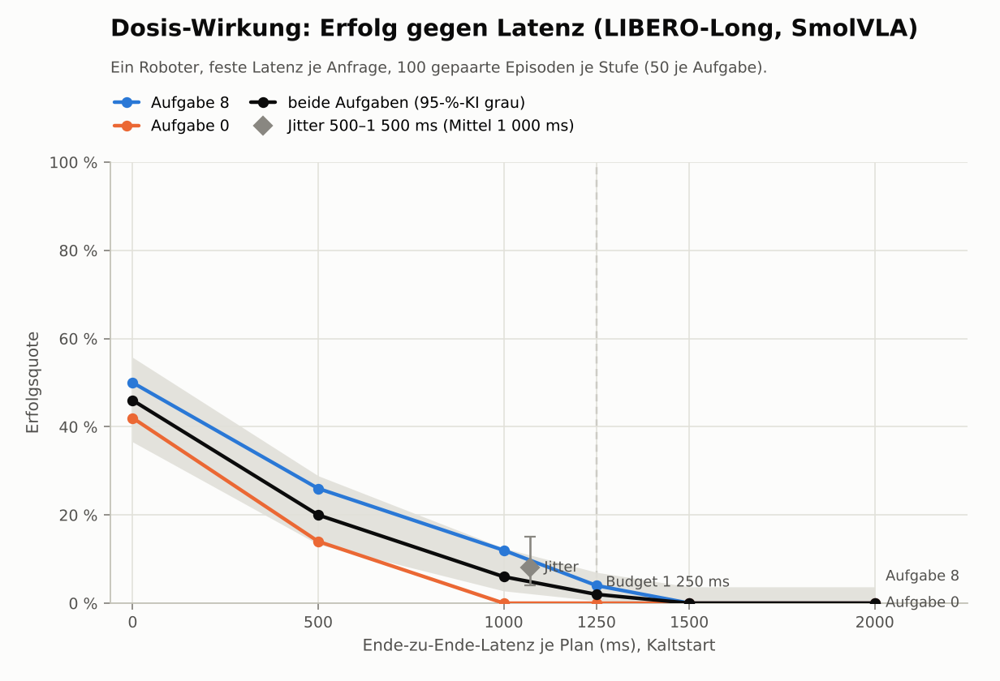

# Kortyn Phase 3 – Flotten-Brain: Wie viele Roboter bedient ein Brain?

**Zentrale Frage:** Wie viele Roboter kann ein Brain bedienen, ohne dass einer sein Latenzbudget reißt, und
welche Scheduling-Strategie maximiert diese Zahl?

## Ergebnis in Kürze

_Stand 25.10.2026, 22:48 UTC. Alles in Simulationszeit auf einer CPU-Maschine; GPU-Servicezeiten sind benannte
Annahmen (Abschnitt „Festlegung der Brain-Profile“), Erfolgsquoten echte LIBERO-Rollouts._

| Frage | Antwort |
|---|---|
| **Wie viele Roboter bedient ein Brain?** (präregistriert) | **Einen.** Das gilt für jede Strategie, jede GPU, jede Batching-Annahme und beide Netze. Schon der zweite Roboter verletzt Kriterium 2: Seine Wartezeit senkt den vorhergesagten Erfolg des schlechtesten Roboters signifikant, um 0,04 bis 3 pp. |
| **Warum?** | SmolVLA verliert auf LIBERO-Long schon weit unter dem Budget fast alles: **46 % bei 0 ms, 20 % bei 500 ms, 6 % bei 1 000 ms** (Budget 1 250 ms). Ursache ist der Planwechsel, nicht Stillstand. Bei so steiler Kurve ist jede Millisekunde Wartezeit ein signifikanter Verlust, und Kriterium 2 hat keine Toleranz. |
| **Welche Strategie?** | Nach dem präregistrierten Kriterium ist es egal. Nach Kriterium 1 allein (Budget-Verletzungen) entscheidet **Batching**: RTX 3060 Ti 23–25 Roboter mit Batching (b, d, e) gegen 5 ohne (a, c). EDF ohne Batching bringt nichts. d und b liegen gleichauf, e degradiert bei Überlast als einzige kontrolliert. |
| **Wie stark hängt das vom Batching ab?** | Stark: Die Warteschlangen-Kapazität der RTX 3060 Ti mit d liegt je nach Annahme bei 5, 9, 23 oder 50 Robotern (kein Gewinn bis optimistisch). Gemessen ist das für keine GPU; das Benchmark-Skript misst es auf deiner Karte. |
| **Was kostet ein Roboter?** | Präregistriert (1 Roboter je Brain): RTX 3060 Ti 53,85 € je Monat gegen 18,16 € für einen Jetson Orin Nano Super. **Ergänzung bei gleichem vorhergesagtem Erfolg** (nicht präregistriert): Eine RTX 3060 Ti mit Batching hält 16 Roboter auf dem Niveau des Orin Nano Super (18 %) für **9,22 € je Roboter und Monat** inkl. Raspberry Pi im Roboter (Faktor 2). Eine RTX 4090 kompiliert ersetzt 32 AGX Orin (9,44 € statt 118,83 €). Einen Thor (43 %) erreicht kein Brain. |
| **Stimmt die Vorhersage?** | Die Validierung mit echten Flotten (2 und 4 Roboter) besteht in allen vier Fällen. Das Warteschlangenmodell trifft die Latenzen auf wenige Millisekunden. Der Erfolg liegt aber durchgängig 5–7 pp unter der Vorhersage (je Fall nicht signifikant). Die Vorhersagen sind eher optimistisch. |
| **Reproduktion** | Kortyn reproduziert LeRobots eigene Evaluation (54 % gegen 52 %, p = 0,82). |
| **Nächster Schritt** | **Real-Time Chunking für SmolVLA**, dann die Dosis-Wirkung neu messen. Die Steilheit der Kurve bestimmt Kapazität, Erfolg und den Jetson-Vergleich. Parallel: Benchmark auf der RTX 3060 Ti. |

**Für die Geschäftsfrage:** Ob ein geteiltes Brain wirtschaftlich ist, entscheidet hier nicht der Scheduler,
sondern die Latenztoleranz der Policy. Mit SmolVLA ohne Real-Time Chunking senkt schon die Inferenzzeit einer
einzelnen GPU den Erfolg von 46 % auf 33–42 %. Ein Brain lohnt sich gegen Rechner im Roboter, die nicht schneller sind als
GPU plus Netz (Orin Nano Super mit 567 ms, AGX Orin mit 262 ms), und nur mit Batching. Gegen schnelle
Onboard-Hardware (Thor, 50 ms) gewinnt es beim Preis, nicht beim Erfolg.

## 0. Vorab festgelegt (Präregistrierung)

_Geschrieben am 25.10.2026 um 10:25 UTC, vor jedem Messlauf von Phase 3, und so committet. Dieser Abschnitt
wird nach den Läufen nicht mehr geändert. Jede Abweichung steht im Abschnitt „Abweichungen von der
Präregistrierung“ am Ende des Reports, mit Zeitpunkt und Grund._

### 0.1 Arbeitspunkt und Standards

| Größe | Festlegung | Begründung |
|---|---|---|
| Policy | `lerobot/smolvla_libero`, Revision `a24f1f38`, bf16 wie von LeRobot geladen, 10 Flow-Schritte, Chunk 50 | Vorgabe; einziger LeRobot-Checkpoint für LIBERO |
| Aufgabenbasis | LIBERO-Long (`libero_10`), Umgebung exakt wie `lerobot-eval`: 360×360-Kameras, feste Init-States, 10 Einschwing-Schritte, relative Endeffektor-Steuerung, 20 Hz, max. 520 Schritte | LeRobots Evaluationsprotokoll |
| Anfrage-Takt | Neue Anfrage, sobald ≤ 24 Aktionen übrig sind: alle 25 Takte (1,25 s), solange Pläne rechtzeitig kommen; höchstens eine Anfrage unterwegs | Standard aus Phase 3a (LeRobot Async: Schwelle 50 %) |
| **Latenzbudget B** | (24 + 1) × 50 ms = **1 250 ms** | Zeit, bis die Queue leerläuft |
| Starvation | Arm steht still (Endeffektor-Verschiebung 0, Greifer hält seinen Befehl), Zeitschritt-Ausrichtung | wie Phase 3a |
| **Episodenstart** | **Kaltstart**: Der erste Plan kommt mit derselben Latenz wie jeder andere; bis dahin steht der Arm | neuer Standard (Vorgabe) |
| Bildübertragung | roh, bis Schritt 1.5 entscheidet | Vorgabe |
| Stichprobe | 100 Episoden je Bedingung: 2 Aufgaben × Init-States 0–49, Seeds 1000–1099, gepaart über alle Bedingungen | Standard ab Phase 3a |
| Timeout einer Anfrage | 10 s (nur bei Überlast relevant) | – |

Der Takt von 25 Aktionen je Plan ist ein Arbeitspunkt, kein Optimum. LeRobot empfiehlt für diesen Checkpoint
10 Aktionen je Plan (höhere Erfolgsquote, aber 2,5-mal so viele Anfragen). Mit 2,8 s CPU-Inferenz je Plan
sprengt dieser Takt das Laufzeitbudget. Der Pilot misst deshalb, wie viel Erfolg der Arbeitspunkt kostet,
und die Warteschlangen-Simulation rechnet die Kapazität zusätzlich für 10 Aktionen je Plan.

### 0.2 Schritt 1: Aufgaben, Referenz, Kaltstart, JPEG

**1.1 Pilot und Reproduktion.**
- **Pilot:** alle zehn LIBERO-Long-Aufgaben × Init-States 0–9 = 100 Episoden. Synchron mit 50 (`sync50`,
  LeRobot-Protokoll wie ausgeliefert), 25 (`sync25`, Referenz-Takt der Latenz-Experimente) und 10 Aktionen
  je Plan (`sync10`, LeRobots Empfehlung).
- **LeRobots eigene Evaluation:** `lerobot-eval` auf denselben 100 Episoden (je Aufgabe 10 Episoden,
  Batch 1, Seed 1000, `n_action_steps` aus dem Checkpoint = 50, 360×360, ein CPU-Thread).
- **Reproduktionskriterium R1** (Gate für Abnahmekriterium 2): `sync50` gegen `lerobot-eval`, gepaart über
  die 100 Episoden. Reproduziert, wenn
  1. McNemar exakt p ≥ 0,05 **und**
  2. das 95-%-KI der gepaarten Differenz (Bootstrap, 10 000 Ziehungen) vollständig in [−15, +15] pp liegt.

  Gilt nur 1., lautet das Urteil „nicht unterscheidbar, Präzision unzureichend“. Gilt 1. nicht, stoppe ich
  die Hauptexperimente und kläre die Abweichung, bevor es weitergeht.
- **Publizierte Werte** (beschreibend, ohne Gate; für diese Checkpoint-Revision gibt es keinen
  publizierten LIBERO-Long-Wert):
  - SmolVLA-Paper: LIBERO-Long 71 % (eigenes Training).
  - Paper-Ablation: Mittel über die vier Suiten 51,8 % bei 50 und 82,8 % bei 10 Aktionen je Plan.
  - Community-Reproduktionen von `HuggingFaceVLA/smolvla_libero` auf LIBERO-Long mit `lerobot-eval`:
    43–56 %; Leaderboard: 60 %.

  Abweichungen werden erklärt.

**1.2 Aufgabenwahl** (Regel, angewandt auf `sync25` im Pilot, je 10 Episoden):
1. Zulässig sind Aufgaben mit 3–9 Erfolgen von 10.
2. Unter den zulässigen nehme ich die zwei mit der längsten medianen Episodenlänge der erfolgreichen
   Episoden (langer Horizont ist der Zweck). Bei Gleichstand gewinnt die höhere Erfolgsquote.
3. Gibt es weniger als zwei zulässige Aufgaben, erweitere ich das Band auf 2–10, dann auf 1–10 Erfolge.

**1.3 Kalt- gegen Warmstart:** bei fester Latenz 1 000 ms (0,8 B), 100 gepaarte Episoden. Berichtet werden
Differenz mit KI und McNemar; das Ergebnis entscheidet nichts.

**1.4 JPEG q90:** `sync25` roh gegen `sync25` mit JPEG q90 (beide Kameras), 100 gepaarte Episoden. JPEG q90
wird Standard für Schritt 2–4 genau dann, wenn
1. McNemar exakt p ≥ 0,05 **und**
2. die untere Grenze des 95-%-KI der Differenz (q90 − roh) ≥ −10 pp.

Sonst bleibt roh Standard.

### 0.3 Schritt 2: Dosis-Wirkungs-Kurven

- **Feste Ende-zu-Ende-Latenzen**, Kaltstart, ein Roboter, kein Netz: L ∈ {0, 250, 500, 1 000, 1 250,
  1 500, 2 000} ms, also bis 1,6 B.
- **Jitter-Variante:** L je Anfrage unabhängig gleichverteilt in [500, 1 500] ms (Mittel 1 000 ms).
- **Umfang:** je 100 Episoden auf denselben Seeds; Bildübertragung nach Schritt 1.4.
- **Ergebnis:** Erfolgsquote je Stufe und Aufgabe mit Wilson-95-%-KI, gepoolt und je Aufgabe. Dazu
  McNemar gegen 0 ms mit Holm-Korrektur über die sieben übrigen Bedingungen sowie Planalter, Starvation,
  Episodenlänge und Zeit bis zum Erfolg.
- LIBERO vergibt Reward nur bei Erfolg (spärlich). „Reward“ ist hier daher gleich Erfolg; als zusätzliches
  Maß berichte ich die Zeit bis zum Erfolg.

### 0.4 Schritt 3: Brain-Modell mit Batching

- **Servicezeit** eines Batches der Größe b auf einer GPU: s(b) = s₁ · g(b) · ε, mit ε lognormal
  (Mittel 1, Variationskoeffizient 5 %) je Batch.
  - s₁ ist die Einzel-Inferenzzeit der GPU für die LIBERO-Eingabe (zwei Kameras).
  - g(1) = 1; g kommt aus einem benannten Profil („kein Batching-Gewinn“ g(b) = b, „pessimistisch“,
    „realistisch“, „optimistisch“).
- **Festlegung der Profile:** Die Zahlen der Profile und s₁ je GPU lege ich nach der Recherche und vor der
  ersten Warteschlangen-Simulation fest, mit eigenem Commit und Zeitstempel. Das sind Modell-Eingaben,
  keine Erfolgskriterien.
- **Messtabellen** (JSON aus dem Benchmark-Skript) ersetzen ein Profil: lineare Interpolation zwischen
  gemessenen Batchgrößen, keine Extrapolation über die größte gemessene hinaus. Batchgrößen jenseits davon
  sind für die Scheduler gesperrt.

### 0.5 Schritt 4: Strategien und Flotten-Simulation

**Strategien** (Parameter fest):

| | Strategie | Parameter |
|---|---|---|
| a | FIFO ohne Batching (Baseline) | – |
| b | FIFO mit Batching | max. Batch 16, max. Wartezeit 25 ms ab der ältesten wartenden Anfrage |
| c | Deadline (EDF) ohne Batching | Priorität = Zeitpunkt, an dem die Queue des Roboters leerläuft (aus Füllstand bei der Anfrage) |
| d | EDF mit deadline-bewusstem Batching | max. Batch 16; größter Batch in EDF-Reihenfolge, der keine erreichbare Deadline reißt und die nächste wartende Anfrage nicht verdrängt |
| e | d + Zugangskontrolle | Neuer Roboter nur, wenn die Worst-Case-Vorhersage alle Budgets einhält (unten) |

**Einzelheiten der Strategien:**
- **Deadline-Schätzung des Brains:**
  - Deadline der Anfrage minus Rückweg-Marge (Einweg-Verzögerung des Netzes: Mittel + halbe Jitter-Breite;
    Büro-WLAN 15 ms, schlecht 60 ms).
  - Servicezeit-Schätzung für Entscheidungen: p90 des Profils.
- **Zugangskontrolle (e):** Worst Case = alle aufgenommenen Roboter fragen gleichzeitig an. Das Brain
  bedient sie in EDF-Batches zu höchstens 16. Ein neuer Roboter wird aufgenommen, wenn
  1. der letzte Batch innerhalb von B − Hinweg-Marge − Rückweg-Marge fertig ist (p90-Servicezeiten) **und**
  2. die Auslastung bei vollen Batches ≤ 0,9 beträgt.
- **Episodenstart-Anfragen** (leere Queue): EDF-Priorität = Anfragezeit, also sofort fällig.

**Flotten:**
- Größen 1, 2, 4, 8, 16 und 32; Startzeitpunkte gleichverteilt in den ersten 10 s.
- Je Konfiguration 10 Wiederholungen mit eigenen Startzeiten und Netz-Seeds.
- Messfenster 30 s bis 630 s nach dem ersten Start.
- Netz: Büro-WLAN (Standard), schlecht (Sensitivität).
- GPU-Profile: RTX 3060 Ti (Schätzung, bis eine Messung vorliegt), RTX 3090, RTX 4090.
- Batching-Profile: alle vier.

**Methode (zweistufig):**
1. **Warteschlange allein:**
   - Ereignisgesteuerte Zeit-Roboter mit genau den Anfrage-, Merge- und Starvation-Regeln des Agenten.
     Gleichheit mit dem echten Agenten prüft ein Test: gleiche Latenz-Ziehungen ergeben gleiche Anfrage- und
     Lieferzeiten.
   - Episodenlängen werden aus der 0-ms-Stufe von Schritt 2 gezogen; Reset-Zeit 0.
   - Dieselben Scheduler-Klassen wie in den echten Rollouts.
2. **Vorhersage je Roboter:** Mittel über die Latenzen seiner Anfragen (im Messfenster) von f(L), mit
   linearer Interpolation der Dosis-Wirkungs-Kurve zwischen den Stufen.
   - Jenseits von 2 000 ms bleibt f auf dem Wert der letzten Stufe (markiert als Extrapolation).
   - Die zwei Aufgaben gehen mit gleichem Gewicht ein.
   - Die Unsicherheit kommt aus einem gepaarten Bootstrap über die 100 Seeds der Kurve.
3. **Validierung:**
   - **Konfiguration:** RTX 3060 Ti (Schätzung), Batching „realistisch“, Büro-WLAN.
   - **Strategien:** die beste und die schlechteste nach Kapazität in dieser Konfiguration. Gleichstand
     entscheidet die niedrigere bzw. höhere Budget-Verletzungsrate bei der größten gemeinsamen Flotte.
   - **Flottengrößen:** n₁ = größte Rastergröße, bei der die schlechteste Strategie Kriterium (1) erfüllt;
     n₂ = nächste Rastergröße. Beide höchstens 8 (Arbeitsspeicher: eine Simulation je Flotte); erfüllt die
     schlechteste Strategie (1) noch bei 8, gilt n₁ = 4, n₂ = 8.
   - **Umfang:** je Fall etwa 100 Episoden (n Roboter × ⌈100/n⌉ Episoden) auf den Seeds von Schritt 2; die
     Seeds werden reihum verteilt; Startzeiten wie Wiederholung 0 der Warteschlangen-Simulation.
   - **Kriterium:** In allen vier Fällen enthält das Bonferroni-adjustierte 98,75-%-KI der mittleren
     gepaarten Differenz (gemessener Erfolg − vorhergesagter Erfolg derselben Episode) die Null.
     Familienweise ergibt das 95 %.
   - **Vorhersage einer Episode:** Mittel über die Latenzen ihres Roboters aus Stufe 1 von y(L), wobei y die
     zwischen den Stufen linear interpolierten Ausgänge desselben Seeds in Schritt 2 sind.
   - Verfehlt ein Fall das Kriterium, stoppe ich und erkläre.

### 0.6 Kapazität (Definition der Vorgabe, Schwellen unverändert)

Kapazität = größte Flottengröße n ∈ {1, 2, 4, 8, 16, 32}, bei der für n und alle kleineren Rastergrößen gilt:
1. **Budget-Verletzungen:** Höchstens 1 % aller Anfragen (aller Roboter und Wiederholungen, im Messfenster)
   reißen ihr Budget.
   - Eine Anfrage reißt ihr Budget, wenn ihr Plan nach dem Takt ankommt, an dem die Queue des Roboters
     leerläuft.
   - Für Episodenstart-Anfragen gilt das nominelle Budget B ab der Beobachtung.
2. **Schlechtester Roboter:** Seine vorhergesagte Erfolgsquote liegt nicht signifikant unter der eines
   einzelnen Roboters (n = 1) auf derselben Hardware.
   - Schlechtester Roboter = je Wiederholung der Roboter mit der niedrigsten Vorhersage, gemittelt über die
     Wiederholungen.
   - Signifikant darunter = die obere Grenze des 95-%-KI (Bootstrap über die Seeds der Kurve) der
     Differenz liegt unter 0.

Ergänzend, ohne Einfluss auf die Kapazität im Raster: dieselbe Rechnung für jede Flottengröße von 1 bis 128
(nur Warteschlange). Sie zeigt, wo zwischen den Rasterpunkten die Grenze liegt.

### 0.7 Wirtschaftlichkeit

- **Rechnung:** Hardwarekosten je Roboter = (Preis der GPU + Anteil des Rechners) / Kapazität, je Strategie
  und GPU-Profil. Dagegen steht ein Rechner im Roboter, der dasselbe Modell im Budget ausführen kann; seine
  Latenz geht über die Dosis-Wirkungs-Kurve in den Erfolg ein.
- **Preise und Abschreibung:** Alle Preise mit Quelle und Abrufdatum, als Annahmen gekennzeichnet.
  Abschreibung über 36 Monate; Strom mit ausgewiesenem Preis je kWh.

### 0.8 Abnahme (Vorgabe)

1. pytest, ruff und mypy grün (beide Umgebungen: Standard mit Meta-World und LIBERO).
2. LIBERO-Long reproduziert die Referenz (R1), oder die Abweichung ist erklärt.
3. Dosis-Wirkungs-Kurven liegen vor.
4. Die Validierung besteht, oder ich habe gestoppt und erklärt.
5. `reports/phase3.md`, README und die Benchmark-Anleitung sind fertig.

## Laufzeitschätzung und Kürzungen

_Stand 25.10.2026, 11:07 UTC (Commit-Zeit), nach dem Start des Piloten und vor allen Hauptläufen._

**Gemessene Kosten:** Eine Inferenz von SmolVLA auf der LIBERO-Eingabe kostet auf einem CPU-Kern 3,7 s,
einschließlich Simulator. Ein zweiter Torch-Thread beschleunigt sie nicht (4,0 s je Anfrage). Die Rechenzeit
skaliert also nur über Prozesse, und deren Zahl begrenzt der Arbeitsspeicher. Das Limit liegt bei 13,4 GB
(cgroup), nicht bei den 16 GB der Maschine.

| Block | Episoden | Anfragen (≈) | CPU-h |
|---|---:|---:|---:|
| Pilot `sync25` + `sync50` (Rest) | 186 | 2 450 | 2,5 |
| Hauptstichprobe `sync25` roh + JPEG q90 | 200 | 3 400 | 3,5 |
| Warmstart bei 1 000 ms | 100 | 1 600 | 1,6 |
| Dosis-Wirkung, 8 Bedingungen | 800 | 12 800 | 13,0 |
| Validierung, 4 Fälle | 400 | 6 800 | 6,9 |
| **Summe Kortyn-Rollouts** | **1 686** | **27 050** | **27,5** |
| `lerobot-eval` (Rest, parallel, ein Prozess) | ≈ 88 | – | ≈ 3,8 |

**Wandzeit:** Bis `lerobot-eval` fertig ist (≈ 13:45 UTC), laufen 2 Kortyn-Worker, danach 3–4. Das ergibt
≈ 8–9,5 h ab jetzt, also ≈ 11–12,5 h für Phase 3 insgesamt (Start 09:42 UTC). Der Pilot mit `sync10` käme mit
≈ 4,2 CPU-h (≈ 1,4 h) dazu. Damit läge die Gesamtzeit über 12 h.

**Kürzungen:**

| | Kürzung | Ersparnis | Was verloren geht | Status |
|---|---|---|---|---|
| 1 | Pilot ohne `sync10` | ≈ 1,4 h | Gemessener Erfolg bei 10 Aktionen je Plan. Der Report nennt stattdessen den Literaturwert; die Warteschlangen-Kapazität für 10 Aktionen je Plan bleibt erhalten, ohne Erfolgsvorhersage | **umgesetzt** |
| 2 | Dosis-Wirkung ohne 250 ms (6 Stufen + Jitter, Vorgabe ≥ 5) | ≈ 0,5 h | Ein Stützpunkt im flachen Bereich unter dem Budget | **umgesetzt** (siehe Abweichungen) |
| 3 | Validierung mit ≈ 60 statt ≈ 100 Episoden je Fall | ≈ 0,9 h | Teststärke der Validierung (breitere KI) | **umgesetzt** (siehe Abweichungen) |

Kürzungen 2 und 3 setze ich nur ein, wenn der Zeitplan um mehr als eine Stunde rutscht. Sie werden dann unten
als Abweichung mit Zeitpunkt ausgewiesen, bevor die betroffenen Läufe starten.

### Tatsächlicher Verlauf (UTC, 25.10.2026)

| Block | geplant | tatsächlich |
|---|---|---|
| Start Phase 3 (Präregistrierung) | – | 09:42 |
| Pilot `sync25` + `sync50` (mehrere Neustarts wegen Speicher) | ≈ 2,5 CPU-h | 10:33–13:08 |
| `lerobot-eval` auf denselben 100 Episoden | parallel | 10:41–13:25 |
| Hauptstichprobe `sync25` roh + JPEG q90 | ≈ 1,2 h | 13:20–14:45 |
| Dosis-Wirkung, 8 Bedingungen × 100 Episoden | ≈ 4,4 h | 14:45–20:02 (≈ 74 statt ≈ 55 s je Episode und Worker) |
| Stufe 1, Raster (7 020 Läufe) | parallel | 15:24–16:22 |
| Stufe 1, Scan 1–128 | parallel | 16:22–21:51 |
| Stufe 2 und Fallauswahl | Minuten | 20:02–20:03 |
| Validierung, 4 Fälle × 60 Episoden (Kürzung 3) | ≈ 2 h | 20:03–22:40 |
| **Gesamt bis Report** | ≈ 13 h | **09:42–23:15, ≈ 13,5 h (Kürzungen 1–3 umgesetzt)** |

## Festlegung der Brain-Profile (vor der ersten Warteschlangen-Simulation)

_Geschrieben am 25.10.2026 um 11:43 UTC (Commit-Zeit) nach der Recherche, vor jeder Warteschlangen-Simulation, mit eigenem
Commit. Modell-Eingaben, keine Erfolgskriterien._

**Was die Recherche ergab:**
- **SmolVLA:** Für SmolVLA selbst gibt es keine publizierte Kurve Servicezeit gegen Batchgröße. SmolVLA-Paper,
  LeRobot-Paper, LeRobot-Issues und vla.cpp messen nur Batch 1.
- **Eager-PyTorch ist bei Batch 1 vom Start-Overhead der Kernels dominiert, nicht von der GPU-Rechenzeit.**
  - LeRobot-Issue #4633 (RTX 4090, eine Kamera): eager 194 ms, davon 181 ms in den 10 Flow-Schritten;
    kompiliert 39,8 ms.
  - π0.5 eager: 150,5 ms auf einer RTX 4090, 333,8 ms auf einer RTX PRO 6000 (vLLM-Omni PR #9237).
  - Deshalb unterscheiden sich GPUs bei Batch 1 weniger, als ihre Rechenleistung erwarten ließe.
- **Rechenaufwand je Roboter:** etwa 590 GFLOP (zweimal SigLIP-512, Sprachmodell-Präfix, Action-Expert).
  Das sind ≈ 6–8 ms GPU-Zeit auf einer RTX 4090, ≈ 12–15 ms auf einer RTX 3090 und ≈ 27–34 ms auf einer
  RTX 3060 Ti. Solange die Rechenzeit klein gegen den Overhead ist, kostet jeder weitere Roboter im Batch
  wenig.
- **Gemessenes Batching vergleichbarer VLAs** (β = Zusatzkosten je weiterer Anfrage relativ zu einer
  Einzelinferenz):
  - GR00T N1.7 auf L40S: 0,07–0,10 (Armory, arXiv 2608.00337).
  - Graph-optimierte VLAs: 0,16–0,35 (GR00T/π0.5 auf H200, Rosa, arXiv 2607.01088; GR00T auf RTX 5090,
    PhyAI, arXiv 2608.03682).
  - π0.5 auf L40S, Hopper und Thor: 0,42–0,50 (Armory; PhyAI).
  - OpenVLA mit Stichproben-Schleife: ≈ 1 (RoboMonkey, arXiv 2506.17811).

**Servicezeit einer Einzelinferenz s₁** (LIBERO-Eingabe mit zwei Kameras, 10 Flow-Schritte, Chunk 50, eager
PyTorch, einschließlich Vor- und Nachverarbeitung):

| Profil | s₁ | Grundlage |
|---|---:|---|
| RTX 4090 | 115 ms | LeRobot-Paper (arXiv 2602.22818, Tab. 3): 99,2 ms fp32, Eingabe nicht angegeben; plus ≈ 15 ms für die zweite Kamera und die Vorverarbeitung. Eine zweite Messung (Issue #4633) ergab 194 ms; die Spanne zeigt die Host-Abhängigkeit |
| RTX 3090 | 180 ms | vla.cpp (arXiv 2606.08094 v2, Tab. IV): 174,1 ms eager, Benchmark LIBERO, ohne Tokenisierung und Serialisierung; plus ≈ 6 ms Vorverarbeitung |
| RTX 3060 Ti (Schätzung) | 220 ms | Keine Messung gefunden. Overhead wie RTX 3090, GPU-Rechenzeit ≈ 2,2-mal so lang (32,4 statt 71 BF16-TFLOPS, 448 statt 936 GB/s): ≈ 200 ms, aufgerundet für WSL2. Wird durch die Benchmark-Messung ersetzt |
| RTX 4090 kompiliert | 50 ms | Issue #4633: 39,8 ms mit `torch.compile` (eine Kamera); plus zweite Kamera und Vorverarbeitung |
| Validierung | 420 ms | Testprofil der Validierung (siehe Abweichungen): erzeugt Überlast schon bei 4 Robotern |

**Batching-Profile** s(b) = s₁ · (1 + β · (b − 1)) · ε, ε lognormal mit 5 % Variationskoeffizient:

| Profil | β | Begründung |
|---|---:|---|
| optimistisch | 0,05 | Die GPU-Rechenzeit je weiterem Roboter versteckt sich unter dem Overhead, bis b · g ≈ s₁; gemessen bis 0,07–0,10 (GR00T, L40S) |
| realistisch | 0,15 | β ≈ g / s₁ für eager: 0,06 (4090), 0,07 (3090), 0,14 (3060 Ti); aufgerundet, damit auch kompilierte Ausführung grob abgedeckt ist |
| pessimistisch | 0,45 | Obere Grenze gemessener VLA-Batching-Kurven (π0.5 auf L40S, Hopper, Thor) |
| kein Batching-Gewinn | 1,0 | b Anfragen kosten b Inferenzen, z. B. bei einer Schleife über die Stichproben |

Alle Profile gelten bis Batch 32 (`batch_limit`). Die Scheduler b, d und e begrenzen Batches auf 16.
Messtabellen aus `kortyn/bench_batch.py` ersetzen ein Profil vollständig.

## 1. Methode im Überblick

```
Schritt 1  Pilot (10 Aufgaben × 10 Init-States) ─► Aufgabenwahl (Regel 1.2) ─► Hauptstichprobe (2 Aufgaben × 50)
           lerobot-eval auf denselben Episoden ─► Reproduktion R1
           sync25 roh gegen JPEG q90 ─► Regel 1.4         Kalt- gegen Warmstart bei 1 000 ms ─► 1.3
Schritt 2  ein Roboter, feste Latenz L (0 … 2 000 ms) und Jitter ─► Dosis-Wirkungs-Kurve f(L), je Seed
Schritt 3  Servicezeit s(b) = s₁ · (1 + β(b − 1)) je GPU- und Batching-Profil (Recherche; Messtabelle ersetzbar)
Schritt 4  Stufe 1: Zeit-Roboter + Batching-Brain (Strategien a–e) ─► Latenzverteilung je Roboter
           Stufe 2: Mittel von f über diese Latenzen ─► Erfolg je Roboter ─► Kapazität (Kriterien 1 und 2)
           Stufe 3: echte LIBERO-Rollouts ganzer Flotten ─► gemessen gegen vorhergesagt
```

Stufe 1 und die Validierungs-Rollouts nutzen denselben Code: dieselben Scheduler, dasselbe Batching-Brain,
dieselben Netzmodelle und Startzeiten. Ein Test zeigt, dass drei Zeit-Roboter und drei echte Agenten an einem
gemeinsamen EDF-Batching-Brain identische Anfrage- und Lieferzeiten erzeugen. Alles läuft in Simulationszeit
(Phase 3a): Die Uhr ist virtuell, die Policy rechnet auf der CPU, die GPU-Servicezeit kommt aus dem Modell.

## 2. Schritt 1: Referenz, Aufgabenwahl, JPEG, Kaltstart

### 2.1 Pilot und Reproduktion (R1)

Pilot: alle zehn LIBERO-Long-Aufgaben × Init-States 0–9, synchron, dieselben 100 Episoden für alle Zeilen.

| Quelle | Aktionen je Plan | Erfolg | Bemerkung |
|---|---:|---:|---|
| Kortyn `sync50` | 50 | **54 %** | LeRobot-Protokoll wie ausgeliefert |
| `lerobot-eval` (LeRobots eigene Evaluation) | 50 | **52 %** | gleiche Episoden, ein CPU-Thread |
| Kortyn `sync25` (Arbeitspunkt der Latenz-Experimente) | 25 | **66 %** | +12 pp [+1, +23] gegen `sync50`, McNemar p = 0,058 |
| Community-Reproduktionen mit `lerobot-eval` | 50 | 43–56 % | publiziert, anderer Checkpoint-Stand |
| Leaderboard | – | 60 % | publiziert |
| SmolVLA-Paper | – | 71 % | eigenes Training, nicht dieser Checkpoint |

**R1 bestanden:** Kortyn `sync50` gegen `lerobot-eval` +2 pp, 95-%-KI [−7, +11] pp (innerhalb ±15 pp),
McNemar p = 0,82 (11 bzw. 9 diskordante Episoden). Die Kortyn-Pipeline (eigene Umgebung, eigene Vor- und
Nachverarbeitung, Simulationszeit) bildet LeRobots Evaluation also ab. Die diskordanten Episoden kommen vom
Rauschen der Flow-Matching-Policy: Kortyn zieht das Startrauschen aus einem eigenen, je Anfrage festen Seed,
LeRobot aus dem globalen Generator.

Die Lücke zum Paper (71 %) liegt nicht an der Pipeline, denn `lerobot-eval` liegt genauso darunter. Unser Wert
liegt im Bereich der Community-Reproduktionen (43–56 %). Bemerkenswert ist der Takt: 25 statt 50 Aktionen je
Plan bringen +12 pp. Das passt zur Ablation im Paper (Mittel über vier Suiten: 51,8 % bei 50, 82,8 % bei 10
Aktionen je Plan). Häufigeres Planen ist also Qualität, und Qualität kostet Brain-Kapazität.

### 2.2 Aufgabenwahl (Regel 1.2)

Zulässig waren Aufgaben mit 3–9 Erfolgen von 10 in `sync25`; das traf auf alle zehn zu. Gewählt wurden die zwei
mit der längsten medianen Dauer erfolgreicher Episoden:

| Aufgabe | Anweisung | Erfolg `sync25` (Pilot) | Median-Dauer erfolgreicher Episoden |
|---|---|---:|---:|
| 8 | put both moka pots on the stove | 6/10 | 418 Takte (20,9 s) |
| 0 | put both the alphabet soup and the tomato sauce in the basket | 4/10 | 265 Takte (13,3 s) |

Aufgabe 8 ist mit Abstand die längste Aufgabe der Suite (nächste nach Aufgabe 0: Aufgabe 6 mit 263 Takten). Beide sind
Zwei-Objekt-Aufgaben mit zwei Greifvorgängen; sie liegen bei 40–60 % Erfolg und messen Latenzschäden
deshalb mit hoher Teststärke (keine Boden- oder Deckeneffekte).

### 2.3 JPEG q90 (Regel 1.4): roh bleibt Standard

Hauptstichprobe, `sync25`, 100 gepaarte Episoden:

| Bildübertragung | Erfolg | Anfragegröße (Median) | Bandbreite je Roboter (1 Anfrage je 1,25 s) |
|---|---:|---:|---:|
| roh (2 × 360 × 360 × 3 Byte) | 53 % | 778 kB | ≈ 5,0 Mbit/s |
| JPEG q90 (beide Kameras) | 45 % | 42 kB | ≈ 0,27 Mbit/s |

Differenz q90 − roh: −8 pp, 95-%-KI [−19, +3] pp, McNemar p = 0,20 (19 bzw. 11 diskordante Episoden). Die
Regel verlangt p ≥ 0,05 **und** eine untere KI-Grenze ≥ −10 pp; die zweite Bedingung ist verletzt. Ein
Schaden bis 19 pp ist nicht ausgeschlossen, deshalb laufen Schritt 2–4 mit Rohbildern.

**Folge für das Netz:** Roh kostet ≈ 5 Mbit/s je Roboter, 32 Roboter also ≈ 160 Mbit/s Nutzdaten im Funknetz.
Das Netzmodell kennt keine Bandbreitengrenze; bei großen Flotten wird das WLAN vor der GPU knapp. Ein Codec,
der die Erfolgsquote nachweislich hält (JPEG q95, PNG, Bildausschnitt), ist deshalb eine Voraussetzung für
große Flotten und ein eigener nächster Schritt.

### 2.4 Kalt- gegen Warmstart (1.3)

Bei fester Latenz 1 000 ms, 100 gepaarte Episoden: kalt 6 %, warm 19 %, Differenz +13 pp [+4, +22] pp,
McNemar p = 0,011. Der Kaltstart (erster Plan erst nach 1 s, bis dahin steht der Arm) kostet also bei dieser
Latenz zwei Drittel des Restes. Für die Flotte heißt das: Episodenstart-Anfragen sind die teuersten Anfragen,
und ein Brain, das sie vorzieht (EDF mit sofort fälliger Start-Deadline, Strategien c–e), schützt genau sie.
Das Ergebnis entscheidet nichts; Phase-3-Standard bleibt der Kaltstart.

## 3. Schritt 2: Dosis-Wirkung

Ein Roboter, feste Ende-zu-Ende-Latenz je Plan, Kaltstart, Rohbilder, 100 gepaarte Episoden je Stufe:

| Latenz | Erfolg [95-%-KI] | Aufgabe 8 | Aufgabe 0 | gegen 0 ms (McNemar, Holm) | Starvation (Anteil Takte) |
|---|---:|---:|---:|---:|---:|
| 0 ms | **46 %** [37, 56] | 50 % | 42 % | Referenz | 0,2 % |
| 500 ms | **20 %** [13, 29] | 26 % | 14 % | p < 0,001 | 2,0 % |
| 1 000 ms | **6 %** [3, 12] | 12 % | 0 % | p < 0,001 | 3,9 % |
| 1 250 ms (= Budget) | **2 %** [1, 7] | 4 % | 0 % | p < 0,001 | 4,8 % |
| 1 500 ms | **0 %** [0, 4] | 0 % | 0 % | p < 0,001 | 36,5 % |
| 2 000 ms | **0 %** [0, 4] | 0 % | 0 % | p < 0,001 | 76,9 % |
| Jitter 500–1 500 ms | **8 %** [4, 15] | 14 % | 2 % | p < 0,001 | 7,7 % |



**Das ist der zentrale Befund dieser Phase: SmolVLA verliert auf LIBERO-Long schon weit unter dem Budget den
größten Teil seines Erfolgs.** 500 ms (40 % des Budgets) halbieren die Erfolgsquote; bei 1 000 ms bleibt fast
nichts. Der Verlust kommt nicht aus Stillstand: Bei 500 ms steht der Arm nur in 2 % der Takte, und das ist im
Wesentlichen der Kaltstart. Er kommt sehr wahrscheinlich aus dem Planwechsel (nicht isoliert gemessen): Ein Plan aus der Beobachtung zum Zeitpunkt k wird erst
ab k + L ausgeführt, nachdem der Arm unter dem alten Plan weitergefahren ist. Seine ersten Aktionen fehlen, und
die übrigen setzen einen Zustand voraus, den der Arm nie erreicht hat. Genau dieses Problem adressiert
Real-Time Chunking (RTC, [arXiv 2506.07339](https://arxiv.org/abs/2506.07339)): Der neue Plan wird so erzeugt, dass
er an die bereits festgelegten Aktionen anschließt. Schon die 0-ms-Stufe zeigt den Effekt im Kleinen: Echtzeit bei
0 ms liegt 7 pp unter `sync25` (KI [−17, +3] pp, p = 0,23), weil der neue Plan einen Takt später übernimmt.

Warum so viel stärker als in Phase 3a (Meta-World, im Budget: push −10 pp, coffee-push −1 pp)? Dort war eine
Episode nach 54–79 Takten entschieden, der latenzfreie Start-Plan deckte 50 davon ab, und die Latenz traf nur
ein bis zwei Pläne. Hier trifft sie jeden der rund 17 Pläne einer Episode, einschließlich des ersten (Kaltstart),
und die Aufgaben verlangen zwei präzise Greifvorgänge über 13–21 s. Der Verlust je Planwechsel summiert sich.

**Plausibilitätsprüfung der Vorhersagemethode** (Ergänzung, ohne Gate): Die Jitter-Stufe ist die einzige
Einzelroboter-Bedingung mit wechselnder Latenz. Aus den festen Stufen vorhergesagt, wie Stufe 2 jeden
Flotten-Roboter vorhersagt: 8 %, gemessen 8 %, Differenz +0 pp [−5, +5] pp. Das Mitteln der Kurve über die
Latenzverteilung trägt also, zumindest für diese Verteilung.

## 4. Schritt 3: Servicezeit und Batching

Für SmolVLA ist keine Kurve Servicezeit gegen Batchgröße publiziert (Recherche im Abschnitt „Festlegung der
Brain-Profile“). Das Modell rechnet deshalb mit benannten Profilen, festgelegt vor der ersten
Warteschlangen-Simulation:

| Profil | β | Servicezeit Batch 16 (relativ zu s₁) | Durchsatzgewinn bei Batch 16 |
|---|---:|---:|---:|
| optimistisch | 0,05 | 1,75 × | 9,1 × |
| realistisch | 0,15 | 3,25 × | 4,9 × |
| pessimistisch | 0,45 | 7,75 × | 2,1 × |
| kein Batching-Gewinn | 1,0 | 16 × | 1 × |

Der Durchsatzgewinn allein bestimmt die Kapazität nicht: Eine Anfrage, die auf einen laufenden Batch wartet und
dann im nächsten bedient wird, braucht bis zu zwei Batch-Dauern. Größere Batches erhöhen also den Durchsatz und
zugleich die Latenz; das Budget von 1 250 ms begrenzt, wie groß sie werden dürfen.

**Messung statt Annahme:** `kortyn/bench_batch.py` misst auf einer GPU die Servicezeit für Batch 1 bis 32
(Median und 90. Perzentil, Vor- und Nachverarbeitung eingeschlossen) und schreibt eine Tabelle
(`kortyn-batch-service-v1`). Das Flottenmodell liest sie direkt ein (`gpus: {name: {table: datei.json}}`),
interpoliert linear und sperrt Batchgrößen jenseits der größten gemessenen. Die Anleitung für die RTX 3060 Ti
unter Windows mit WSL2 steht in [`docs/benchmark_rtx3060ti.md`](../docs/benchmark_rtx3060ti.md).

Trockenlauf des Skripts hier auf der CPU (ein Thread): Batch 1 3,2 s, Batch 2 5,6 s. Batch 1 entspricht der
Inferenzzeit in den Rollouts (≈ 3 s), das Skript misst also dieselbe Pipeline. Auf der CPU ist β ≈ 0,75, weil
die CPU rechengebunden ist; auf einer GPU dominiert bei Batch 1 der Overhead der Kernel-Starts, deshalb ist dort
ein deutlich kleineres β zu erwarten. Mit vier Threads auf dieser geteilten VM dauerte Batch 1 22 s: Auf einer
belasteten Maschine sind CPU-Messungen wertlos. Auf der GPU wiegt die CPU-Last weniger; das Skript sollte trotzdem
auf einem sonst ruhigen PC laufen (Anleitung, Schritt 7).

## 5. Schritt 4: Kapazität je Strategie

### 5.1 Präregistriertes Ergebnis: Kapazität 1, in jeder Konfiguration

Nach der vorab festgelegten Definition (Abschnitt 0.6) bedient ein Brain **genau einen Roboter**: für alle fünf
Strategien, alle GPU-Profile (RTX 3060 Ti, 3090, 4090, 4090 kompiliert), alle vier Batching-Profile und beide
Netze. Kriterium 1 (≤ 1 % Budget-Verletzungen) hält bei 2 Robotern überall; Kriterium 2 (schlechtester Roboter
nicht signifikant unter einem einzelnen) scheitert überall schon bei 2 Robotern:

| Konfiguration (Büro-WLAN, Batching realistisch) | einzelner Roboter | schlechtester von 2 | Differenz [95-%-KI] |
|---|---:|---:|---|
| RTX 3060 Ti, a FIFO | 33,2 % | 32,0 % | −1,2 pp [−1,7, −0,7] |
| RTX 3060 Ti, d EDF + Batching | 33,2 % | 32,0 % | −1,2 pp [−1,7, −0,7] |
| RTX 4090, d EDF + Batching | 38,7 % | 38,3 % | −0,4 pp [−0,6, −0,3] |
| RTX 4090 kompiliert, b FIFO + Batching | 40,8 % | 40,7 % | −0,04 pp [−0,05, −0,02] |

**Warum:** Kriterium 2 fragt, ob der Verlust *signifikant* ist, nicht ob er *relevant* ist. Die Unsicherheit
der Vorhersage kommt nur aus der Kurve (Bootstrap über die Seeds), und die Kurve fällt zwischen 0 und 1 500 ms
zwischen allen Stufen signifikant. Damit ist jede systematische Zusatzlatenz ein signifikanter Verlust, auch
0,04 pp. Dem Kriterium fehlt eine Toleranz. Das ist eine Schwäche der Präregistrierung, nicht der Messung; ich
ändere sie nachträglich nicht. Für die nächste Phase gehört eine Toleranz vorab festgelegt (z. B. höchstens
3 pp unter einem einzelnen Roboter).

Die Fallauswahl der Validierung ist trotzdem eindeutig: Bei Gleichstand entscheidet die präregistrierte
Verletzungsrate bei der größten Flotte. Beste Strategie e, schlechteste a; Flotten 2 und 4 (Abschnitt 6).

### 5.2 Ergänzung (nicht präregistriert): Was das Teilen kostet

Vorhergesagter Erfolg des schlechtesten Roboters (Büro-WLAN, Batching realistisch; ✗ = mehr als 1 % der
Anfragen über Budget):

| GPU, Strategie | 1 | 2 | 4 | 8 | 16 | 32 Roboter |
|---|---:|---:|---:|---:|---:|---:|
| RTX 3060 Ti, a FIFO | 33 % | 32 % | 28 % | ✗ | ✗ | ✗ |
| RTX 3060 Ti, b FIFO + Batching | 32 % | 31 % | 28 % | 25 % | 19 % | ✗ |
| RTX 3060 Ti, d EDF + Batching | 33 % | 32 % | 29 % | 25 % | 19 % | ✗ |
| RTX 4090, d EDF + Batching | 39 % | 38 % | 38 % | 36 % | 34 % | 29 % |
| RTX 4090 kompiliert, d EDF + Batching | 42 % | 42 % | 42 % | 42 % | 41 % | 40 % |

Und die Kapazität nach Kriterium 1 allein (Budget-Verletzungen, jeder Roboter aufgenommen):

| Strategie | RTX 3060 Ti | RTX 3090 | RTX 4090 | RTX 4090 kompiliert |
|---|---:|---:|---:|---:|
| a FIFO | 4 | 4 | 8 | 16 |
| b FIFO + Batching | 16 | 32 | 32 | 32 |
| c Deadline (EDF) | 4 | 4 | 8 | 16 |
| d EDF + Batching | 16 | 16 | 32 | 32 |
| e d + Zugangskontrolle | 16 | 16 | 32 | 32 |

**Was die Strategien unterscheidet:**
- **Batching ist der Hebel, nicht die Reihenfolge.** Mit Batching (b, d, e) hält eine RTX 3060 Ti viermal so
  viele Roboter im Budget wie ohne (im Raster 16 statt 4, im Scan 23–25 statt 5). EDF ohne Batching (c) bringt gegenüber FIFO nichts: Alle
  Roboter haben denselben Takt und dasselbe Budget, die Reihenfolge ändert im Mittel nichts.
- **d gegen b:** gleich auf RTX 3060 Ti und 4090. Auf der RTX 3090 hält FIFO-Batching 32 Roboter (0,11 % über
  Budget), d nur 16 (bei 32: 41 % über Budget). Die gierige Vorausschau von d wählt unter hoher Last kleinere
  Batches, um wartende Deadlines zu schützen, und verliert dabei Durchsatz. Bei gleicher Flottengröße liegt d
  dafür leicht vorn, weil b bis zu 25 ms auf weitere Anfragen wartet (einzelner Roboter: 33 % gegen 32 %).
- **e** verhält sich wie d, solange alle aufgenommen werden. Bei 32 Interessenten auf der RTX 3060 Ti nimmt e
  23 auf und hält sie ohne eine einzige Budget-Verletzung. e ist damit die einzige Strategie, die bei Überlast
  kontrolliert degradiert. Im überlasteten Validierungsprofil war ihre Worst-Case-Annahme dagegen zu optimistisch
  (Befund aus dem Probelauf, Abweichungen 12:07).
- **Netz:** „schlecht“ ändert fast nichts (nur b auf der RTX 3090: 32 → 16). Das Budget von 1 250 ms ist
  gegenüber 15–60 ms Netzverzögerung groß; die Zeit verliert man im Brain.

**Abhängigkeit vom Batching-Profil** (Kriterium 1, RTX 3060 Ti, Strategie d): kein Gewinn 4, pessimistisch 8,
realistisch 16, optimistisch 32 Roboter im Raster (Scan: 5, 9, 23, 50). Die Batching-Annahme verschiebt die
Warteschlangen-Kapazität also um den Faktor 8 bis 10. Ohne Messung auf der echten GPU ist die Zahl 16 eine Annahme, keine Eigenschaft der Karte.

### 5.3 Ergänzung: jede Flottengröße 1–128 (Scan, Büro-WLAN, 3 Wiederholungen)

Nach beiden Kriterien ebenfalls überall 1. Nach Kriterium 1 allein (jeder Roboter im Budget, alle aufgenommen):

| GPU | Batching | a FIFO | b FIFO + Batching | d EDF + Batching | e d + Zugangskontrolle | schlechtester Roboter bei dieser Größe (d) |
|---|---|---:|---:|---:|---:|---:|
| RTX 3060 Ti | realistisch | 5 | 25 | 23 | 23 | 12 % |
| RTX 3060 Ti | optimistisch / pessimistisch / kein Gewinn | 5 | 51 / 9 / 5 | 50 / 9 / 5 | 46 / 9 / 5 | – |
| RTX 3090 | realistisch | 6 | 32 | 31 | 30 | – |
| RTX 4090 | realistisch | 10 | 52 | 52 | 48 | 16 % |
| RTX 4090 kompiliert | realistisch | 24 | 122 | 121 | 110 | 18 % |

Batching verfünffacht die Warteschlangen-Kapazität (RTX 3060 Ti: 23–25 statt 5). Die Batching-Annahme spannt
für dieselbe Karte 5 bis 50 Roboter auf. An der Warteschlangengrenze ist der vorhergesagte Erfolg aber niedrig
(RTX 3060 Ti: 12 % statt 33 % bei einem Roboter): Die Grenze nach Kriterium 1 ist keine sinnvolle Betriebsgröße,
solange die Dosis-Wirkung so steil ist.

## 6. Validierung mit echten Flotten (Stufe 3)

Echte LIBERO-Rollouts ganzer Flotten an einem gemeinsamen Brain: gleiche Scheduler, gleiches Netzmodell, gleiche
Startzeiten wie Wiederholung 0 der Warteschlangen-Simulation. Testprofil „Validierung“ (s₁ = 420 ms, Batching
realistisch, Büro-WLAN), damit 4 Roboter ohne Batching überlasten. Fälle nach der präregistrierten Regel:
schlechteste Strategie a, beste e, Flotten 2 und 4; je Fall 60 gezählte Episoden (Kürzung 3).

### 6.1 Ergebnis: Kriterium in allen vier Fällen erfüllt, Vorhersage aber systematisch 5–7 pp zu hoch

| Fall | Roboter | Episoden | gemessen | vorhergesagt | Differenz [98,75-%-KI] | Kriterium |
|---|---:|---:|---:|---:|---|---|
| a FIFO | 2 | 60 | 16,7 % | 22,1 % | −5,4 pp [−20,7, +10,1] | ✓ |
| a FIFO (Überlast) | 4 | 60 | 0,0 % | 0,0 % | ±0 pp [0, 0] | ✓ |
| e d + Zugangskontrolle | 2 | 60 | 15,0 % | 22,1 % | −7,1 pp [−21,0, +7,2] | ✓ |
| e d + Zugangskontrolle | 4 | 60 | 10,0 % | 17,0 % | −7,0 pp [−19,3, +5,5] | ✓ |

Kriterium (präregistriert): In allen vier Fällen enthält das Bonferroni-adjustierte KI die Null. Das gilt für alle vier Fälle: **Die Validierung ist bestanden.** Abnahmekriterium 4 ist erfüllt. Aber: In allen drei Fällen mit Erfolg über 0 liegt die Messung 5–7 pp unter der Vorhersage. Einzeln ist das nicht signifikant, die Richtung ist jedoch einheitlich. Die Vorhersagen dieses Reports sind deshalb eher optimistisch zu lesen.

### 6.2 Diagnose (Ergänzung, ohne Gate)

| Fall | Latenz Stufe 1 (Median / p95) | Latenz Rollouts (Median / p95) | vorhergesagt aus eigenen Latenzen | gemessen − vorhergesagt [98,75-%-KI] |
|---|---:|---:|---:|---|
| a, 2 Roboter | 465 / 795 ms | 459 / 797 ms | 24,5 % | −7,8 pp [−23,2, +7,5] |
| a, 4 Roboter | 1 655 / 1 735 ms | 1 662 / 1 738 ms | 0,5 % | −0,5 pp [−1,6, 0] |
| e, 2 Roboter | 465 / 795 ms | 458 / 758 ms | 22,8 % | −7,8 pp [−21,3, +6,2] |
| e, 4 Roboter | 725 / 945 ms | 675 / 917 ms | 16,7 % | −6,7 pp [−19,3, +6,2] |

**Lesart:**
- **Das Warteschlangenmodell stimmt.** Die Latenzen der Zeit-Roboter treffen die der echten Flotten auf wenige
  Millisekunden (größte Abweichung: e mit 4 Robotern, 50 ms im Median), in Normal- wie in Überlast (a mit 4 Robotern: geschlossener Kreis, jede Anfrage wartet auf drei
  andere, ≈ 1,7 s).
- **Die Abweichung kommt aus der Dosis-Wirkungs-Regel, nicht aus der Warteschlange:** Mit den in den Rollouts
  gemessenen Latenzen sagt dieselbe Regel praktisch dasselbe vorher (17–25 %) und liegt genauso 7–8 pp zu hoch.
  Die drei Fälle nutzen dieselben Seeds, sind also keine unabhängigen Belege. Plausible Ursache: lineare
  Interpolation einer konvexen Kurve. Zwischen 500 und 1 000 ms, wo diese Latenzen liegen, liegt die wahre Kurve
  vermutlich unter der Sehne (46 → 20 → 6 %: Die Steigung halbiert sich). Eine Stufe bei 750 ms würde das prüfen.
  Die Jitter-Prüfung (Abschnitt 3) zeigte keine Abweichung; ihre Latenzen streuen aber gleichmäßig über
  500–1 500 ms, wo die Kurve flacher ist.
- **Teststärke:** Mit 60 Episoden je Fall ist das KI ±14–15 pp breit. Die Validierung schließt grobe Fehler aus,
  nicht Abweichungen von 5 pp.

## 7. Wirtschaftlichkeit

Alle Preise sind Annahmen mit Quelle und Abrufdatum (`kortyn/experiments/phase3/economics.yaml`), netto,
Abschreibung 36 Monate, Betrieb rund um die Uhr, Gewerbestrom 23,66 ct/kWh (Destatis, H1 2026). GPUs gebraucht
(eBay-Medianpreise), Host-PC ohne GPU 950 €, Jetson-Preise reichelt (nach der Preiserhöhung vom Juli 2026).

### 7.1 Präregistrierte Rechnung

Mit Kapazität 1 trägt ein Roboter das ganze Brain:

| Variante | Hardware je Roboter | Kosten je Roboter und Monat | vorhergesagter Erfolg |
|---|---:|---:|---:|
| Brain RTX 3060 Ti (gebraucht 255 € + PC 950 €) | 1 205 € | 53,85 € (58,07 € mit Roboter-Rechner) | 33 % |
| Brain RTX 3090 | 2 207 € | 85,91 € | 35 % |
| Brain RTX 4090 | 3 135 € | 110,34 € | 39 % |
| Jetson Orin Nano Super im Roboter (567 ms) | 498 € | 18,16 € | 18 % |
| Jetson AGX Orin 64 GB im Roboter (262 ms) | 3 967 € | 118,83 € | 32 % |
| Jetson AGX Thor im Roboter (50 ms) | 5 714 € | 170,80 € | 43 % |

Erfolg der Jetsons: Dosis-Wirkungs-Kurve bei ihrer publizierten SmolVLA-Latenz (vla.cpp bzw. Robion, andere
Laufzeit als PyTorch; Abschnitt 9). Break-even, ab dem ein Brain je Roboter billiger ist als ein Orin Nano
Super (GPU zu 90 % ausgelastet): RTX 3060 Ti 5 Roboter (6 mit Roboter-Rechner), RTX 3090 8 (10), RTX 4090
10 (13). Nach der präregistrierten Kapazität wird keiner davon erreicht.

### 7.2 Ergänzung (nicht präregistriert): gleicher Erfolg wie der Rechner im Roboter

Die ökonomisch relevante Frage ist nicht „verliert der schlechteste Roboter gegenüber einem einzelnen am selben
Brain?“, sondern „erreicht er, was die Alternative im Roboter erreicht?“. Dafür: größte Rasterflotte, deren
schlechtester Roboter mindestens den vorhergesagten Erfolg des Jetsons erreicht, mit Kriterium 1; Kosten je
Roboter inklusive Roboter-Rechner (Raspberry Pi 5):

| Alternative im Roboter (Erfolg, Kosten/Monat) | Brain | Roboter je Brain | Kosten je Roboter/Monat | Faktor billiger |
|---|---|---:|---:|---:|
| Orin Nano Super (18 %, 18,16 €) | RTX 3060 Ti, d | 16 | 9,22 € | 2,0 × |
| Orin Nano Super (18 %, 18,16 €) | RTX 3060 Ti, a (ohne Batching) | 4 | 21,95 € | 0,8 × (teurer) |
| Orin Nano Super (18 %, 18,16 €) | RTX 4090, d | 32 | 9,74 € | 1,9 × |
| AGX Orin (32 %, 118,83 €) | RTX 3060 Ti, d | 1 | 58,07 € | 2,0 × |
| AGX Orin (32 %, 118,83 €) | RTX 4090, d | 16 | 14,90 € | 8,0 × |
| AGX Orin (32 %, 118,83 €) | RTX 4090 kompiliert, d | 32 | 9,44 € | 12,6 × |
| Thor (43 %, 170,80 €) | jede GPU | nicht erreichbar | – | – |

**Lesart:**
- Gegen den billigsten Jetson halbiert ein geteiltes Brain die Kosten je Roboter bei gleichem Erfolg, aber
  **nur mit Batching**. Ohne Batching ist es teurer als der Jetson.
- Gegen den mittleren Jetson (AGX Orin) ist das Brain eine Größenordnung billiger, sobald die GPU schnell genug
  ist (RTX 4090, besser kompiliert).
- Gegen einen Thor verliert das Brain beim Erfolg immer: Netz und Warteschlange addieren mehr als die 50 ms des
  Thor. Der Abstand ist klein (40–42 % gegen 43 %), der Preisabstand groß (≈ 10 € gegen 171 € je Monat).
- **Diese Zahlen sind Vorhersagen über 4 Roboter hinaus** (validiert bis 4, Abschnitt 6) und hängen an zwei
  ungemessenen Annahmen: s₁ und β der GPU. Ohne Batching-Gewinn (β = 1) fällt die RTX 3060 Ti auf 4 Roboter und
  ist teurer als der Orin Nano Super.
- **Verzerrung:** Die Validierung zeigt, dass die Vorhersage für Flotten 5–7 pp zu hoch liegt. Der Jetson-Wert
  kommt aus derselben Kurve (bei 567 ms ebenfalls zwischen 500 und 1 000 ms interpoliert) und ist vermutlich
  ähnlich zu hoch. Der Vergleich ist deshalb belastbarer als die absoluten Erfolgsquoten, aber nicht gemessen.

### 7.3 Nicht in der Rechnung

- **WLAN:** Rohbilder brauchen ≈ 5 Mbit/s je Roboter (JPEG q90 kostete hier möglicherweise Erfolg, Abschnitt
  2.3). 16 Roboter ≈ 80 Mbit/s, 32 ≈ 160 Mbit/s Nutzdaten. Ein Access Point je 10–20 Roboter ist realistisch.
- **Redundanz:** Ein zweites Brain als Reserve verdoppelt den Brain-Anteil (RTX 3060 Ti, 16 Roboter: 14,23 statt
  9,22 € je Roboter und Monat). Der Vorteil gegen den Orin Nano Super schrumpft dann auf ≈ 1,3 ×.
- **Betrieb:** Software-Pflege, Updates, Überwachung. Beim Brain zentral, beim Jetson je Roboter.

## 8. Einordnung: Robion und der Burggraben

Robion (Adamopoulos et al., MPI-SWS, [arXiv 2609.12075](https://arxiv.org/abs/2609.12075), 10.09.2026) ist ein
Forschungssystem für genau diese Frage: VLA-Serving für viele Roboter mit SLO-bewusstem Batching, paralleler
Ausführung von VLM und Aktionsmodell auf einer GPU und Platzierung mehrerer Modelle. Ergebnis dort: im Mittel
≈ 20 Roboter je RTX 6000 Pro bei 2 Anfragen/s je Roboter und ≥ 98 % SLO-Einhaltung, Deadline = Latenz eines
Jetson Thor (50 ms für SmolVLA); ≈ 6,8-mal geringere Hardwarekosten je Roboter als ein Thor im Roboter.

| | Robion | Kortyn Phase 3 |
|---|---|---|
| Deadline | 50 ms (Thor-Latenz) | 1 250 ms (Queue läuft leer) |
| Anfragen je Roboter | 2 / s | 0,8 / s |
| Laufzeit | optimiert (≈ 20 ms SmolVLA auf RTX 6000 Pro, aus Abb. 2 abgelesen) | eager PyTorch (115–220 ms), kompiliert als Sensitivität |
| Erfolgsmaß | SLO-Einhaltung | Aufgabenerfolg über die Dosis-Wirkungs-Kurve, validiert mit echten Rollouts |

Für Kortyn heißt das:
- **Das Scheduling selbst ist kein Burggraben.** Deadline-bewusstes Batching ist publiziert und wird in
  Open-Source-Serving-Stacks landen.
- **Was Robion nicht misst**, ist der Erfolg der Aufgabe unter der Latenz, die die Flotte erzeugt. Genau das
  liefert die Dosis-Wirkungs-Kurve mit Validierung. Das ist eine Methode, kein Produkt, aber sie beantwortet die
  Frage, die ein Kunde stellt: „Wie viele Roboter je GPU, ohne dass die Arbeit schlechter wird?“
- Ein Burggraben müsste woanders liegen: Betrieb und Integration (Flottenmanagement, Ausfallsicherheit,
  Updates), Daten aus dem Betrieb oder eine Kombination mit Robotern, die Latenz tolerieren (Phase 2/3a: Budget
  und Präzisionsanforderung entscheiden).

## 9. Einschränkungen

- **Keine GPU-Messung.** Alle GPU-Servicezeiten stammen aus Publikationen oder sind abgeleitet; für die RTX 3060 Ti
  ist s₁ eine Schätzung, β ist für keine GPU gemessen. Bis das Benchmark-Skript auf deiner Karte gelaufen ist,
  sind die Kapazitäten Modellrechnungen mit benannten Annahmen.
- **Eager PyTorch als Basis.** Mit `torch.compile` oder einer eigenen Laufzeit (vla.cpp: 55,8 statt 174,1 ms auf der
  RTX 3090) sinkt s₁ um den Faktor 3–4. Das Profil „RTX 4090 kompiliert“ zeigt die Richtung; β steigt dann
  vermutlich, weil weniger Overhead übrig ist, hinter dem sich zusätzliche Anfragen verstecken.
- **Policy auf der CPU.** Die Rollouts rechnen SmolVLA auf der CPU; auf einer GPU weichen die Zahlen in den letzten
  Bits ab. Die Erfolgsquoten verschiebt das nicht systematisch (gleiche Gewichte, gleiche Eingaben).
- **Zwei Aufgaben.** Die Dosis-Wirkung stammt aus zwei LIBERO-Long-Aufgaben mit je 50 Init-States. Andere Aufgaben
  und echte Roboter können empfindlicher sein (Phase 3a: Präzisionsaufgaben verlieren über dem Budget bis zu
  30 pp); die Kapazität hängt über Kriterium 2 direkt daran.
- **Validierung bis 4 Roboter.** Mehr Simulatoren passen nicht in den Arbeitsspeicher (≈ 1,7–2,3 GB je
  LIBERO-Umgebung). Größere Flotten sind vorhergesagt, nicht validiert.
- **Vorhersage eher optimistisch.** In der Validierung liegt der gemessene Erfolg in allen drei Fällen mit Erfolg
  über 0 um 5–7 pp unter der Vorhersage (je Fall nicht signifikant, Abschnitt 6). Die Kurve hat nur sechs Stufen;
  zwischen ihnen wird linear interpoliert.
- **Netz ohne Bandbreite.** Das Netzmodell kennt Verzögerung, Jitter und Stalls, aber keine Bandbreitengrenze und
  keine Kollisionen im WLAN. Rohbilder kosten 778 kB je Anfrage, also ≈ 5 Mbit/s je Roboter; 32 Roboter
  bräuchten ≈ 160 Mbit/s. JPEG q90 senkt das auf 42 kB je Anfrage (≈ 0,27 Mbit/s je Roboter).
- **Ein Brain ist ein Ausfallpunkt.** Die Kostenrechnung enthält keine Redundanz. Fällt die GPU aus, stehen alle
  Roboter; ein Rechner im Roboter fällt einzeln aus. Ein zweites Brain als Reserve verdoppelt die Hardware.
- **Preise 2026.** GPU-Straßenpreise sind durch die Speicherknappheit 2026 stark erhöht, Jetson-Preise wurden im Juli
  2026 um bis zu 101 % angehoben. Gebrauchte GPUs (eBay) sind günstig, aber ohne Gewährleistung.
- **Onboard-Latenzen aus anderer Laufzeit.** Die Jetson-Latenzen für SmolVLA stammen aus vla.cpp (C++, GGUF), nicht
  aus PyTorch. Ob diese Laufzeit dieselben Erfolgsquoten erreicht, ist hier nicht geprüft.

## 10. Abnahme

| # | Kriterium (Vorgabe) | Stand | Beleg |
|---|---|---|---|
| 1 | pytest, ruff, mypy grün (beide Umgebungen) | **erfüllt**: Standardumgebung 415 bestanden, 9 übersprungen (nur in der LIBERO-Umgebung lauffähig); LIBERO-Umgebung 43 bestanden (LIBERO-, Referenz-, Flotten- und Simulationszeit-Tests); ruff und mypy strict ohne Befund | Kommandos im README, Abschnitt „Entwicklung“ |
| 2 | LIBERO-Long reproduziert die Referenz oder die Abweichung ist erklärt | **erfüllt**: R1 bestanden (+2 pp, KI [−7, +11] pp, p = 0,82); Lücke zum Paper erklärt | Abschnitt 2.1 |
| 3 | Dosis-Wirkungs-Kurven liegen vor | **erfüllt**: 6 feste Stufen (0–2 000 ms) und Jitter, je 100 gepaarte Episoden, je Aufgabe und gepoolt mit KI | Abschnitt 3 |
| 4 | Validierung besteht, oder gestoppt und erklärt | **erfüllt**: alle vier Fälle bestanden (mit 60 statt 100 Episoden je Fall, Kürzung 3); Vorhersage systematisch 5–7 pp zu hoch, ausgewiesen | Abschnitt 6 |
| 5 | `reports/phase3.md`, README und Benchmark-Anleitung fertig | **erfüllt** | dieser Report, README, `docs/benchmark_rtx3060ti.md` |

## 11. Nächste Schritte

| Priorität | Schritt | Warum | Aufwand |
|---|---|---|---|
| 1 | **Real-Time Chunking (Inpainting) für SmolVLA** und Dosis-Wirkung neu messen | Die Steilheit der Kurve bestimmt alles: Kapazität, Erfolg je Roboter und den Vergleich mit dem Jetson. RTC ist trainingsfrei (Guidance beim Flow-Sampling); Protokoll und Brain-Schnittstelle für Inpainting gibt es seit Phase 2 (Diffusion), der Flow-Sampler von SmolVLA braucht eine eigene Guidance. Wird die Kurve unter dem Budget flach, steigt die Kapazität bei gleichem Erfolg um ein Vielfaches | 1–2 Tage Code, ≈ 10 h Rechenzeit |
| 2 | **Benchmark auf der RTX 3060 Ti** (`docs/benchmark_rtx3060ti.md`) | s₁ und β sind die zwei ungemessenen Eingaben jeder Kapazitätszahl; zwischen „kein Gewinn“ und „optimistisch“ liegt Faktor 8–10 | 1 h für dich, danach Neuberechnung in Minuten |
| 3 | **Kriterium 2 mit Toleranz präregistrieren** (z. B. ≤ 3 pp unter einem einzelnen Roboter) | Ohne Toleranz ist jede Flotte > 1 „signifikant schlechter“ | Minuten |
| 4 | Bildübertragung, die den Erfolg hält (JPEG q95, PNG, Ausschnitt) | Rohbilder kosten ≈ 5 Mbit/s je Roboter; ab ≈ 20 Robotern wird das WLAN knapp | ≈ 3 h Rechenzeit |
| 5 | Validierung größerer Flotten auf einer Maschine mit mehr RAM (≈ 2 GB je Simulator) | Vorhersagen über 4 Roboter sind nicht validiert | Cloud-Maschine mit 64 GB, kostenpflichtig, deshalb nicht hier |

## Abweichungen und Präzisierungen der Präregistrierung

Alle Einträge sind vor der Auswertung der jeweils betroffenen Ergebnisse geschrieben und committet. Einzige Ausnahme ist der ausdrücklich als „nach Sichtung“ markierte Eintrag: Er führt nur beschreibende Ergänzungen ohne Gate ein und ändert keine präregistrierte Zahl.

| Zeit (UTC) | Punkt | Abweichung oder Präzisierung | Grund | Auswirkung |
|---|---|---|---|---|
| 11:07 | 1.1 Pilot | `sync10` entfällt (Kürzung 1) | Laufzeit; `sync10` entscheidet nichts | Kein Gate betroffen |
| 11:07 | Durchführung | Parallelität 2–4 Worker statt 4. Das Modell wird im Hauptprozess geladen und per Fork an die Worker vererbt (`--share-model`); jeder Worker gibt freien Heap nach dem Laden und nach jedem Seed zurück | Speicherlimit 13,4 GB; drei Abbrüche durch den OOM-Killer | Keine auf Ergebnisse: Fork-Worker liefern bit-gleiche Episoden wie Spawn-Worker (Test mit PushT, Stichprobe LIBERO Seed 1000 `sync50`: 1/1 Episoden-, 11/11 Anfrage-Records identisch) |
| 11:07 | Durchführung | Alle Kortyn-Rollouts mit genau einem Torch-Thread je Prozess | Fließkomma-Ergebnisse hängen von der Threadzahl ab (Seed 1001 `sync50` endet mit 2 Threads anders als mit 1) | Gepaarte Vergleiche bleiben sauber gepaart |
| 11:07 | 0.5 Strategie d | „Größter Batch, der keine erreichbare Deadline reißt und die nächste wartende Anfrage nicht verdrängt“ ist umgesetzt als gierige Vorausschau: Gewählt wird der größte EDF-Präfix, nach dem die übrigen wartenden Anfragen in EDF-Reihenfolge (jeweils größter passender Batch, p90-Servicezeit, ohne neue Ankünfte) keine Deadline reißen, die jetzt noch erreichbar ist. Passt keine Größe (Überlast), nimmt der Scheduler den größten Präfix, dessen eigene erreichbare Mitglieder rechtzeitig fertig werden | Präzisierung vor der ersten Warteschlangen-Simulation: Die wörtliche Regel prüft nur die nächste Anfrage und bedient unter Überlast weniger Roboter rechtzeitig als möglich | Gilt für d und e |
| 11:07 | 0.6 Kapazität, Strategie e | Ein abgewiesener Roboter gilt als nicht bedient (vorhergesagter Erfolg 0). Kapazität von e ist damit die größte Flotte, die vollständig aufgenommen wird und (1) und (2) erfüllt. Die Zahl der aufgenommenen Roboter wird zusätzlich berichtet | Die Definition ließ offen, wie abgewiesene Roboter zählen | Nur Strategie e |
| 11:07 | 0.5 Validierung | KI der mittleren gepaarten Differenz: Perzentil-Bootstrap über die Episoden eines Falls, 10 000 Ziehungen, Niveau 98,75 % | Die Methode war offen | – |
| 11:07 | 0.5 Episodenlängen | Episodenlängen der Warteschlangen-Simulation: alle Episoden der 0-ms-Stufe beider Aufgaben, gleich gewichtet gezogen | Präzisierung | – |
| 11:21 | 0.5 Validierung, Flottengrößen | Validierungsflotten höchstens 4 statt 8 Roboter: n₁ = größte Rastergröße ≤ 4, bei der die schlechteste Strategie Kriterium (1) erfüllt, n₂ = nächste Rastergröße; erfüllt sie (1) noch bei 4, gilt n₁ = 2, n₂ = 4. Die Policy-Inferenz der Validierung läuft in per Fork geteilten Worker-Prozessen (Ergebnis je Anfrage unabhängig vom rechnenden Prozess) | Gemessen: Eine LIBERO-Umgebung belegt ≈ 2,3 GB (Szene und Modell ≈ 1,1 GB, Software-Renderer ≈ 1 GB, Texturen 185 MB); 8 Roboter bräuchten ≈ 20 GB bei 13,4 GB Limit. Festgelegt vor der ersten Warteschlangen-Simulation | Die Validierung deckt Flotten bis 4 Roboter ab; größere Flotten bleiben unvalidierte Vorhersage (im Report so gekennzeichnet) |
| 11:21 | Durchführung | Bis `lerobot-eval` fertig ist, rechnet ein Kortyn-Worker statt zwei | Zwei Worker neben `lerobot-eval` liegen am Speicherlimit (zwei weitere OOM-Abbrüche um 11:14) | Nur Laufzeit |
| 11:43 | 0.5 Validierung, Konfiguration | Die Validierung läuft auf einem eigenen GPU-Profil „Validierung“ mit s₁ = 420 ms statt auf „RTX 3060 Ti (Schätzung)“; Batching „realistisch“ und Büro-WLAN bleiben | Die Recherche (unten) senkt die 3060-Ti-Schätzung von den eingeplanten ≈ 420 ms auf 220 ms. Damit überlastet keine Strategie das Brain mit ≤ 4 Robotern, und die Validierung prüfte nur den flachen Teil der Kurve. 420 ms ist die ursprünglich eingeplante Schätzung (Skalierung mit der Rechenleistung) und erzeugt bei 4 Robotern ohne Batching Überlast. Festgelegt vor der ersten Warteschlangen-Simulation | Die Validierung prüft die Methode (Warteschlange × Dosis-Wirkung), nicht eine bestimmte GPU |
| 11:43 | 0.5 GPU-Profile | Zusätzliches Profil „RTX 4090 kompiliert“ (`torch.compile`) als Sensitivität | Eager-PyTorch ist bei Batch 1 vom Kernel-Start-Overhead dominiert; kompiliert sinkt s₁ auf etwa ein Viertel. Zeigt, wie stark die Kapazität von der Software abhängt | Ein weiteres Modell-Profil, keine geänderte Schwelle |
| 11:47 | Transparenz | Vor der Festlegung der Profile lief ein Geschwindigkeitstest des Simulators (9 Läufe mit Platzhalterwerten s₁ = 160 ms, β = 0,25, Strategien a, b, d). Er diente nur der Laufzeitplanung und floss nicht in die Profile ein | Vollständigkeit | Keine |
| 11:47 | Durchführung | Zeitangaben dieses Abschnitts sind die Commit-Zeiten (vorher geschätzte Uhrzeiten korrigiert) | Genauigkeit | Keine |
| 11:51 | 0.6 Ergänzung 1–128 | Der Scan über alle Flottengrößen 1–128 läuft nur im Standardnetz Büro-WLAN, mit 3 Wiederholungen je Größe, ohne das Validierungsprofil, und bricht je Konfiguration ab, sobald Kriterium (1) bei 3 aufeinanderfolgenden Größen verletzt ist. Das Raster 1–32 mit 10 Wiederholungen bleibt unverändert | Laufzeit: ohne Abbruch wären es > 16 000 Läufe | Ergänzung ohne Einfluss auf die Kapazität im Raster |
| 11:52 | 0.1 Kapazität bei 10 Aktionen je Plan | Nur Kriterium (1), Büro-WLAN, 3 Wiederholungen je Rastergröße; Episodenlängen der 0-ms-Stufe bei 25 Aktionen je Plan | Ohne `sync10` gibt es keine Dosis-Wirkungskurve für diesen Takt; die Episodenlängen sind eine Näherung | Sensitivität, ohne Einfluss auf die Hauptergebnisse |
| 11:54 | 0.3 Dosis-Wirkung | Kürzung 2 umgesetzt: Stufen 0, 500, 1 000, 1 250, 1 500, 2 000 ms und Jitter (6 feste Stufen statt 7; Vorgabe ≥ 5); die Vorhersage interpoliert zwischen 0 und 500 ms linear. Holm-Korrektur über 6 statt 7 Vergleiche | Neue Laufzeitrechnung mit den gemessenen 2,3 GB je LIBERO-Umgebung: ≈ 13,8 h statt ≈ 12 h für Phase 3 (höchstens 3 Worker, Validierung nur sequenziell) | Ein Stützpunkt weniger im Bereich unter dem Budget |
| 12:07 | Transparenz | Probelauf der Warteschlangen-Simulation mit den festgelegten Profilen, aber Platzhalter-Episodenlängen (40 Läufe: RTX 3090 und Validierungsprofil, beide Netze, Batching realistisch, 2 und 16 Roboter, 1 Wiederholung), um Netz mit Stalls, alle Strategien und die Zugangskontrolle vor den echten Läufen zu prüfen. Befund: Die präregistrierte Zugangskontrolle (e) nimmt bei Überlast zu viele Roboter auf (Validierungsprofil, 16 Interessenten: 12 aufgenommen, 99,6 % ihrer Anfragen über Budget), weil ihr Worst Case gleichzeitige Anfragen in vollen Batches annimmt; tatsächlich kommen die Anfragen verteilt, warten auf einen laufenden, nicht unterbrechbaren Batch und werden in kleinen, teuren Batches bedient. Strategie e bleibt unverändert; der Befund wird berichtet. Die Ergebnisse des Probelaufs fließen nirgends ein | Vollständigkeit | Keine auf Profile, Schwellen oder Strategien |
| 13:27 | 0.7 Wirtschaftlichkeit | Ergänzung: Rechner im Roboter neben dem Brain (Raspberry Pi 5 4 GB, 114,62 € netto, 6 W) als zusätzliche Spalte und zusätzlicher Break-even. Die präregistrierte Rechnung bleibt unverändert und wird zuerst berichtet | Mit einem geteilten Brain braucht jeder Roboter weiterhin einen Rechner für Kameras, Netz und Motorbefehle; im Onboard-Fall erledigt das der Jetson selbst. Ohne diese Zeile wäre der Vergleich zugunsten des Brains verzerrt | Nur Wirtschaftlichkeit; geschrieben vor jeder Kapazitätsberechnung |
| 13:49 | 0.5 Vorhersage, Ergänzung | Plausibilitätsprüfung ohne Gate: Die Jitter-Stufe (Latenz je Anfrage gleichverteilt in [500, 1 500] ms) wird aus den festen Stufen genauso vorhergesagt wie ein Flotten-Roboter in Stufe 2 (Mittel der interpolierten Kurve über die Latenzen) und der Messung gegenübergestellt (Differenz mit 95-%-KI, Bootstrap über die Seeds je Aufgabe) | Die Jitter-Stufe ist die einzige Einzelroboter-Bedingung mit wechselnder Latenz und prüft damit die Kernannahme von Stufe 2 schon vor der Validierung | Keine auf Kapazität oder Validierungskriterium; geschrieben vor jedem Ergebnis der Dosis-Wirkung |
| 13:49 | Durchführung | Die Validierung kann mehr Inferenz-Prozesse nutzen als die eingeplanten zwei (`--workers`, protokolliert in `meta.json`) | Gemessen: Eine LIBERO-Umgebung belegt in den laufenden Workern ≈ 1,7 GB statt der früher gemessenen 2,3 GB; damit passen bei 4 Robotern 3 Inferenz-Prozesse in den Speicher | Nur Laufzeit: Das Ergebnis einer Anfrage hängt nicht vom rechnenden Prozess ab (Test) |
| 13:52 | 0.5 Validierung, Ergänzung | Diagnose ohne Gate neben dem präregistrierten Kriterium: dieselbe Vorhersageregel mit den in den Rollouts gemessenen Latenzen jeder Episode statt der Latenzen aus Stufe 1, und Median/95. Perzentil der Latenz aus beiden Quellen | Trennt im Fehlerfall Fehler des Warteschlangenmodells (Stufe 1) von Fehlern der Dosis-Wirkungs-Regel | Keine auf das Kriterium; geschrieben vor jedem Validierungslauf |
| 20:03 | 0.5 Validierung, Umfang | **Kürzung 3 umgesetzt:** je Fall 60 statt ≈ 100 gezählte Episoden (`validation.episodes: 60`), drei Inferenz-Prozesse | Zeitplan um mehr als eine Stunde gerutscht (Regel im Abschnitt „Kürzungen“): Die Dosis-Wirkung endete um 20:02 statt ≈ 19:05 (≈ 74 statt ≈ 55 s je Episode und Worker); mit 100 Episoden je Fall läge das Ende bei ≈ 00:00 statt ≈ 22:45 | Breiteres KI der Validierung (etwa ±13 statt ±10 pp), also geringere Teststärke. Fälle (a und e mit 2 und 4 Robotern, nach der präregistrierten Regel gewählt) und Kriterium bleiben unverändert |
| 20:08 | 0.6/0.7 Ergänzung **nach** Sichtung der Kapazität | Drei Auswertungen ohne Gate, als „nicht präregistriert“ markiert: (1) Kapazität nach Kriterium 1 allein, (2) vorhergesagter Erfolg des schlechtesten Roboters je Flottengröße, (3) größte Flotte, deren schlechtester Roboter mindestens den vorhergesagten Erfolg eines Rechners im Roboter erreicht, mit Kosten | Die präregistrierte Kapazität ist für jede Konfiguration 1: Kriterium 2 hat keine Toleranz, und bei der steilen Dosis-Wirkung ist jede zusätzliche Wartezeit signifikant (z. B. −0,04 pp bei 2 Robotern, RTX 4090 kompiliert, b). Die Ergänzungen zeigen, wie groß der Verlust ist und was er wirtschaftlich bedeutet | Keine auf die präregistrierte Kapazität, die zuerst berichtet wird; post hoc, deshalb nur beschreibend |
