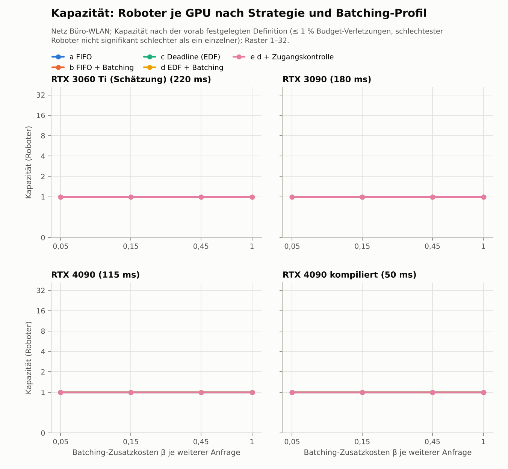
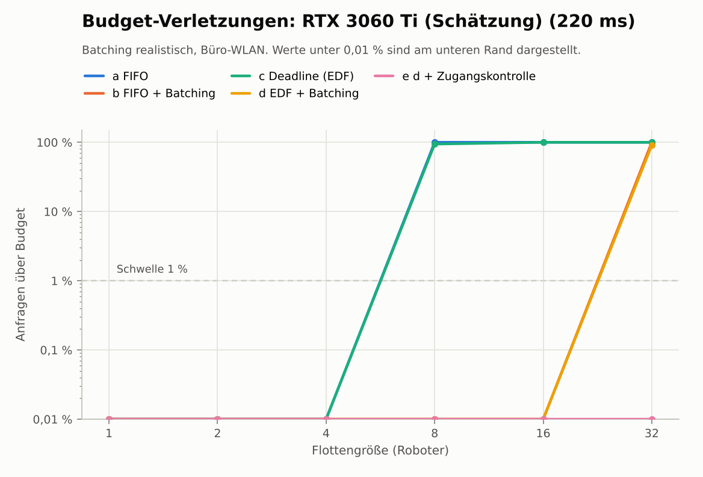
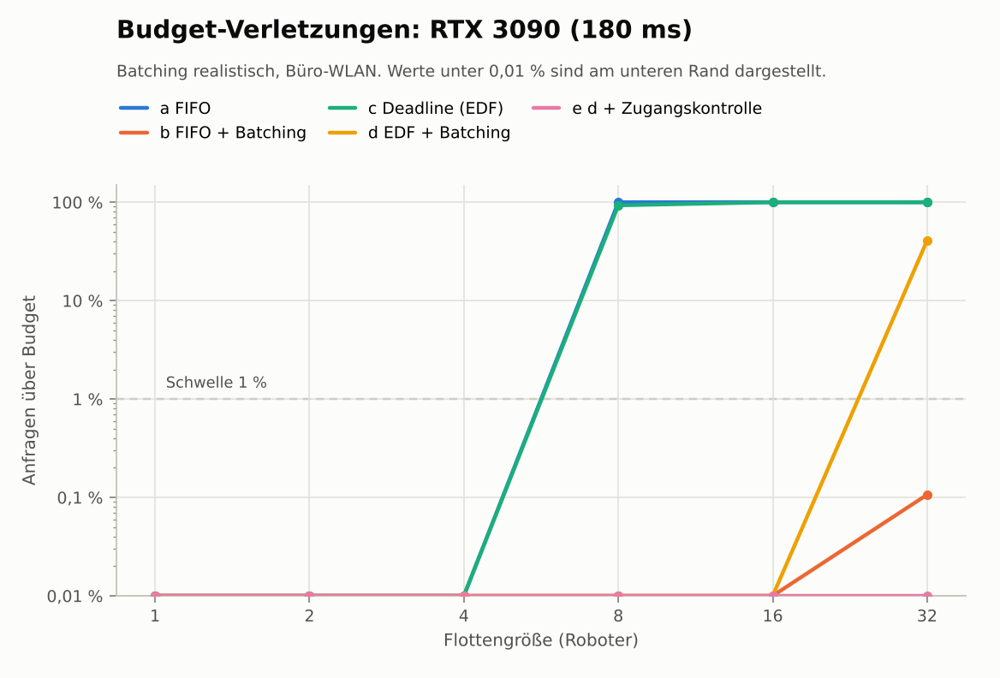
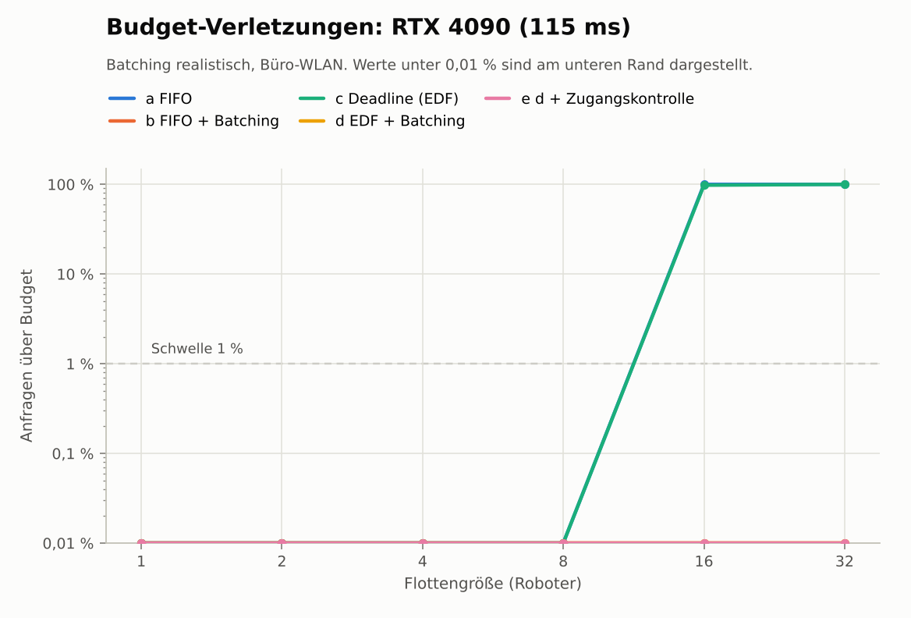
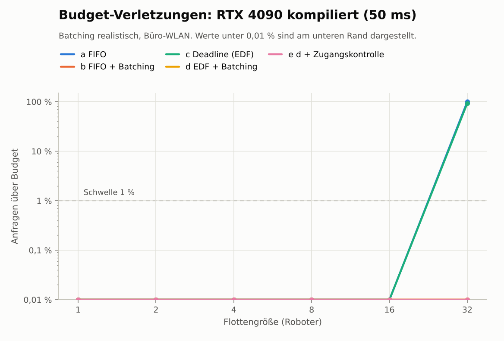

# Phase 3: Daten (automatisch erzeugt)

_Erzeugt am 25.10.2026 22:40 UTC mit `python -m kortyn.report_phase3`._

## Schritt 1

### Pilot: zehn LIBERO-Long-Aufgaben × Init-States 0–9

| Aufgabe | sync25 | sync50 | lerobot-eval | Median-Länge erfolgreicher Episoden (sync25) |
|---|---:|---:|---:|---:|
| 0: put both the alphabet soup and the tomato sauce in the basket | 4/10 | 2/10 | 1/10 | 265 Takte |
| 1: put both the cream cheese box and the butter in the basket | 8/10 | 6/10 | 6/10 | 245 Takte |
| 2: turn on the stove and put the moka pot on it | 8/10 | 7/10 | 7/10 | 240 Takte |
| 3: put the black bowl in the bottom drawer of the cabinet and close it | 9/10 | 7/10 | 6/10 | 219 Takte |
| 4: put the white mug on the left plate and put the yellow and white mug on the right plate | 4/10 | 4/10 | 3/10 | 230 Takte |
| 5: pick up the book and place it in the back compartment of the caddy | 8/10 | 9/10 | 8/10 | 162 Takte |
| 6: put the white mug on the plate and put the chocolate pudding to the right of the plate | 5/10 | 2/10 | 2/10 | 263 Takte |
| 7: put both the alphabet soup and the cream cheese box in the basket | 8/10 | 3/10 | 4/10 | 251 Takte |
| 8: put both moka pots on the stove | 6/10 | 5/10 | 6/10 | 418 Takte |
| 9: put the yellow and white mug in the microwave and close it | 6/10 | 9/10 | 9/10 | 255 Takte |
| **alle** | **66/100 (66 %)** | **54/100 (54 %)** | **52/100 (52 %)** | |

**Aufgabenwahl (Regel 1.2):** Band 3–9 Erfolge; gewählt: Aufgabe 8 („put both moka pots on the stove“), Aufgabe 0 („put both the alphabet soup and the tomato sauce in the basket“).

**Reproduktion R1** (`sync50` gegen `lerobot-eval` auf denselben Episoden; A = lerobot-eval, B = Kortyn `sync50`):

| Vergleich | Paare | Erfolg A | Erfolg B | B − A [95-%-KI] | nur A / nur B | McNemar p |
|---|---:|---:|---:|---|---:|---:|
| R1 | 100 | 52 % | 54 % | +2 pp [-7, +11] pp | 9 / 11 | 0,824 |

Urteil nach Kriterium R1: **reproduziert** (100 von 100 Episoden ausgewertet).

### Hauptstichprobe: JPEG und Kaltstart

| Vergleich | Paare | Erfolg A | Erfolg B | B − A [95-%-KI] | nur A / nur B | McNemar p |
|---|---:|---:|---:|---|---:|---:|
| 1.4 JPEG q90 (A roh, B q90), sync25 | 100 | 53 % | 45 % | -8 pp [-19, +3] pp | 19 / 11 | 0,200 |
| 1.3 Kalt- gegen Warmstart bei 1 000 ms (A kalt, B warm) | 100 | 6 % | 19 % | +13 pp [+4, +22] pp | 5 / 18 | 0,011 |

Regel 1.4: JPEG q90 bleibt aus, roh bleibt Standard (100 von 100 Episodenpaaren ausgewertet).

## Schritt 2: Dosis-Wirkung

| Bedingung | Erfolg (beide) [95-%-KI] | Aufgabe 8 | Aufgabe 0 | McNemar p gegen 0 ms (Holm) | Starvation (Anteil Takte) | Median Zeit bis Erfolg |
|---|---:|---:|---:|---:|---:|---:|
| fest_0ms | 46 % [37, 56] % | 50 % | 42 % | Referenz | 0.2 % | 18.7 s |
| fest_500ms | 20 % [13, 29] % | 26 % | 14 % | < 0,001 (< 0,001) | 2.0 % | 19.3 s |
| fest_1000ms | 6 % [3, 12] % | 12 % | 0 % | < 0,001 (< 0,001) | 3.9 % | 20.3 s |
| fest_1250ms | 2 % [1, 7] % | 4 % | 0 % | < 0,001 (< 0,001) | 4.8 % | 20.7 s |
| fest_1500ms | 0 % [0, 4] % | 0 % | 0 % | < 0,001 (< 0,001) | 36.5 % | – |
| fest_2000ms | 0 % [0, 4] % | 0 % | 0 % | < 0,001 (< 0,001) | 76.9 % | – |
| jitter_500_1500ms | 8 % [4, 15] % | 14 % | 2 % | < 0,001 (< 0,001) | 7.7 % | 20.4 s |

**Plausibilitätsprüfung der Vorhersage** (Ergänzung, nicht präregistriert, ohne Gate): Die Jitter-Stufe (Latenz je Anfrage gleichverteilt in [500, 1500] ms) ist die einzige Bedingung mit wechselnder Latenz. Aus den festen Stufen vorhergesagt wie in Stufe 2: 8 %, gemessen 8 %, Differenz +0 pp [-5, +5] pp (100 Seeds).

## Schritt 4: Kapazität

### Büro-WLAN, Batching realistisch

| Strategie | RTX 3060 Ti (Schätzung) (220 ms) | RTX 3090 (180 ms) | RTX 4090 (115 ms) | RTX 4090 kompiliert (50 ms) |
|---|---:|---:|---:|---:|
| a FIFO | 1 | 1 | 1 | 1 |
| b FIFO + Batching | 1 | 1 | 1 | 1 |
| c Deadline (EDF) | 1 | 1 | 1 | 1 |
| d EDF + Batching | 1 | 1 | 1 | 1 |
| e d + Zugangskontrolle | 1 | 1 | 1 | 1 |

#### RTX 3060 Ti (Schätzung) (220 ms): Abhängigkeit vom Batching-Profil

| Strategie | optimistisch (β 0.05) | realistisch (β 0.15) | pessimistisch (β 0.45) | kein Gewinn (β 1) |
|---|---:|---:|---:|---:|
| a FIFO | 1 | 1 | 1 | 1 |
| b FIFO + Batching | 1 | 1 | 1 | 1 |
| c Deadline (EDF) | 1 | 1 | 1 | 1 |
| d EDF + Batching | 1 | 1 | 1 | 1 |
| e d + Zugangskontrolle | 1 | 1 | 1 | 1 |

#### RTX 3090 (180 ms): Abhängigkeit vom Batching-Profil

| Strategie | optimistisch (β 0.05) | realistisch (β 0.15) | pessimistisch (β 0.45) | kein Gewinn (β 1) |
|---|---:|---:|---:|---:|
| a FIFO | 1 | 1 | 1 | 1 |
| b FIFO + Batching | 1 | 1 | 1 | 1 |
| c Deadline (EDF) | 1 | 1 | 1 | 1 |
| d EDF + Batching | 1 | 1 | 1 | 1 |
| e d + Zugangskontrolle | 1 | 1 | 1 | 1 |

#### RTX 4090 (115 ms): Abhängigkeit vom Batching-Profil

| Strategie | optimistisch (β 0.05) | realistisch (β 0.15) | pessimistisch (β 0.45) | kein Gewinn (β 1) |
|---|---:|---:|---:|---:|
| a FIFO | 1 | 1 | 1 | 1 |
| b FIFO + Batching | 1 | 1 | 1 | 1 |
| c Deadline (EDF) | 1 | 1 | 1 | 1 |
| d EDF + Batching | 1 | 1 | 1 | 1 |
| e d + Zugangskontrolle | 1 | 1 | 1 | 1 |

#### RTX 4090 kompiliert (50 ms): Abhängigkeit vom Batching-Profil

| Strategie | optimistisch (β 0.05) | realistisch (β 0.15) | pessimistisch (β 0.45) | kein Gewinn (β 1) |
|---|---:|---:|---:|---:|
| a FIFO | 1 | 1 | 1 | 1 |
| b FIFO + Batching | 1 | 1 | 1 | 1 |
| c Deadline (EDF) | 1 | 1 | 1 | 1 |
| d EDF + Batching | 1 | 1 | 1 | 1 |
| e d + Zugangskontrolle | 1 | 1 | 1 | 1 |

### schlechtes Netz, Batching realistisch

| Strategie | RTX 3060 Ti (Schätzung) (220 ms) | RTX 3090 (180 ms) | RTX 4090 (115 ms) | RTX 4090 kompiliert (50 ms) |
|---|---:|---:|---:|---:|
| a FIFO | 1 | 1 | 1 | 1 |
| b FIFO + Batching | 1 | 1 | 1 | 1 |
| c Deadline (EDF) | 1 | 1 | 1 | 1 |
| d EDF + Batching | 1 | 1 | 1 | 1 |
| e d + Zugangskontrolle | 1 | 1 | 1 | 1 |

#### RTX 3060 Ti (Schätzung) (220 ms): Abhängigkeit vom Batching-Profil

| Strategie | optimistisch (β 0.05) | realistisch (β 0.15) | pessimistisch (β 0.45) | kein Gewinn (β 1) |
|---|---:|---:|---:|---:|
| a FIFO | 1 | 1 | 1 | 1 |
| b FIFO + Batching | 1 | 1 | 1 | 1 |
| c Deadline (EDF) | 1 | 1 | 1 | 1 |
| d EDF + Batching | 1 | 1 | 1 | 1 |
| e d + Zugangskontrolle | 1 | 1 | 1 | 1 |

#### RTX 3090 (180 ms): Abhängigkeit vom Batching-Profil

| Strategie | optimistisch (β 0.05) | realistisch (β 0.15) | pessimistisch (β 0.45) | kein Gewinn (β 1) |
|---|---:|---:|---:|---:|
| a FIFO | 1 | 1 | 1 | 1 |
| b FIFO + Batching | 1 | 1 | 1 | 1 |
| c Deadline (EDF) | 1 | 1 | 1 | 1 |
| d EDF + Batching | 1 | 1 | 1 | 1 |
| e d + Zugangskontrolle | 1 | 1 | 1 | 1 |

#### RTX 4090 (115 ms): Abhängigkeit vom Batching-Profil

| Strategie | optimistisch (β 0.05) | realistisch (β 0.15) | pessimistisch (β 0.45) | kein Gewinn (β 1) |
|---|---:|---:|---:|---:|
| a FIFO | 1 | 1 | 1 | 1 |
| b FIFO + Batching | 1 | 1 | 1 | 1 |
| c Deadline (EDF) | 1 | 1 | 1 | 1 |
| d EDF + Batching | 1 | 1 | 1 | 1 |
| e d + Zugangskontrolle | 1 | 1 | 1 | 1 |

#### RTX 4090 kompiliert (50 ms): Abhängigkeit vom Batching-Profil

| Strategie | optimistisch (β 0.05) | realistisch (β 0.15) | pessimistisch (β 0.45) | kein Gewinn (β 1) |
|---|---:|---:|---:|---:|
| a FIFO | 1 | 1 | 1 | 1 |
| b FIFO + Batching | 1 | 1 | 1 | 1 |
| c Deadline (EDF) | 1 | 1 | 1 | 1 |
| d EDF + Batching | 1 | 1 | 1 | 1 |
| e d + Zugangskontrolle | 1 | 1 | 1 | 1 |

### Ergänzung (nicht präregistriert): Kapazität nach Kriterium 1 allein

Größte Rasterflotte, bei der höchstens 1 % der Anfragen ihr Budget reißen und jeder Roboter aufgenommen wird; Kriterium 2 (Erfolg des schlechtesten Roboters) bleibt hier außen vor.

**Büro-WLAN, Batching realistisch:**

| Strategie | RTX 3060 Ti (Schätzung) (220 ms) | RTX 3090 (180 ms) | RTX 4090 (115 ms) | RTX 4090 kompiliert (50 ms) |
|---|---:|---:|---:|---:|
| a FIFO | 4 | 4 | 8 | 16 |
| b FIFO + Batching | 16 | 32 | 32 | 32 |
| c Deadline (EDF) | 4 | 4 | 8 | 16 |
| d EDF + Batching | 16 | 16 | 32 | 32 |
| e d + Zugangskontrolle | 16 | 16 | 32 | 32 |

**schlechtes Netz, Batching realistisch:**

| Strategie | RTX 3060 Ti (Schätzung) (220 ms) | RTX 3090 (180 ms) | RTX 4090 (115 ms) | RTX 4090 kompiliert (50 ms) |
|---|---:|---:|---:|---:|
| a FIFO | 4 | 4 | 8 | 16 |
| b FIFO + Batching | 16 | 16 | 32 | 32 |
| c Deadline (EDF) | 4 | 4 | 8 | 16 |
| d EDF + Batching | 16 | 16 | 32 | 32 |
| e d + Zugangskontrolle | 16 | 16 | 32 | 32 |

**RTX 3060 Ti (Schätzung) (220 ms), Büro-WLAN: Abhängigkeit vom Batching-Profil (Kriterium 1):**

| Strategie | optimistisch (β 0.05) | realistisch (β 0.15) | pessimistisch (β 0.45) | kein Gewinn (β 1) |
|---|---:|---:|---:|---:|
| a FIFO | 4 | 4 | 4 | 4 |
| b FIFO + Batching | 32 | 16 | 8 | 4 |
| c Deadline (EDF) | 4 | 4 | 4 | 4 |
| d EDF + Batching | 32 | 16 | 8 | 4 |
| e d + Zugangskontrolle | 32 | 16 | 8 | 4 |

**RTX 3090 (180 ms), Büro-WLAN: Abhängigkeit vom Batching-Profil (Kriterium 1):**

| Strategie | optimistisch (β 0.05) | realistisch (β 0.15) | pessimistisch (β 0.45) | kein Gewinn (β 1) |
|---|---:|---:|---:|---:|
| a FIFO | 4 | 4 | 4 | 4 |
| b FIFO + Batching | 32 | 32 | 8 | 4 |
| c Deadline (EDF) | 4 | 4 | 4 | 4 |
| d EDF + Batching | 32 | 16 | 8 | 4 |
| e d + Zugangskontrolle | 32 | 16 | 8 | 4 |

**RTX 4090 (115 ms), Büro-WLAN: Abhängigkeit vom Batching-Profil (Kriterium 1):**

| Strategie | optimistisch (β 0.05) | realistisch (β 0.15) | pessimistisch (β 0.45) | kein Gewinn (β 1) |
|---|---:|---:|---:|---:|
| a FIFO | 8 | 8 | 8 | 8 |
| b FIFO + Batching | 32 | 32 | 16 | 8 |
| c Deadline (EDF) | 8 | 8 | 8 | 8 |
| d EDF + Batching | 32 | 32 | 16 | 8 |
| e d + Zugangskontrolle | 32 | 32 | 16 | 8 |

**RTX 4090 kompiliert (50 ms), Büro-WLAN: Abhängigkeit vom Batching-Profil (Kriterium 1):**

| Strategie | optimistisch (β 0.05) | realistisch (β 0.15) | pessimistisch (β 0.45) | kein Gewinn (β 1) |
|---|---:|---:|---:|---:|
| a FIFO | 16 | 16 | 16 | 16 |
| b FIFO + Batching | 32 | 32 | 32 | 16 |
| c Deadline (EDF) | 16 | 16 | 16 | 16 |
| d EDF + Batching | 32 | 32 | 32 | 16 |
| e d + Zugangskontrolle | 32 | 32 | 32 | 16 |

### Ergänzung (nicht präregistriert): vorhergesagter Erfolg je Flottengröße

Schlechtester Roboter (Ø der Flotte), Büro-WLAN, Batching realistisch; ✗ = Kriterium 1 verletzt oder nicht alle Roboter aufgenommen.

**RTX 3060 Ti (Schätzung) (220 ms):**

| Strategie | 1 Roboter | 2 Roboter | 4 Roboter | 8 Roboter | 16 Roboter | 32 Roboter |
|---|---:|---:|---:|---:|---:|---:|
| a FIFO | 33 % (Ø 33 %) | 32 % (Ø 32 %) | 28 % (Ø 29 %) | ✗ (100 % über Budget) | ✗ (100 % über Budget) | ✗ (100 % über Budget) |
| b FIFO + Batching | 32 % (Ø 32 %) | 31 % (Ø 31 %) | 28 % (Ø 29 %) | 25 % (Ø 26 %) | 19 % (Ø 20 %) | ✗ (100 % über Budget) |
| c Deadline (EDF) | 33 % (Ø 33 %) | 32 % (Ø 32 %) | 28 % (Ø 29 %) | ✗ (94 % über Budget) | ✗ (100 % über Budget) | ✗ (100 % über Budget) |
| d EDF + Batching | 33 % (Ø 33 %) | 32 % (Ø 32 %) | 29 % (Ø 30 %) | 25 % (Ø 26 %) | 19 % (Ø 20 %) | ✗ (91 % über Budget) |
| e d + Zugangskontrolle | 33 % (Ø 33 %) | 32 % (Ø 32 %) | 29 % (Ø 30 %) | 25 % (Ø 26 %) | 19 % (Ø 20 %) | ✗ (23 von 32 aufgenommen) |

**RTX 3090 (180 ms):**

| Strategie | 1 Roboter | 2 Roboter | 4 Roboter | 8 Roboter | 16 Roboter | 32 Roboter |
|---|---:|---:|---:|---:|---:|---:|
| a FIFO | 35 % (Ø 35 %) | 34 % (Ø 35 %) | 32 % (Ø 33 %) | ✗ (100 % über Budget) | ✗ (100 % über Budget) | ✗ (100 % über Budget) |
| b FIFO + Batching | 34 % (Ø 34 %) | 33 % (Ø 33 %) | 32 % (Ø 32 %) | 29 % (Ø 30 %) | 25 % (Ø 25 %) | 11 % (Ø 11 %) |
| c Deadline (EDF) | 35 % (Ø 35 %) | 34 % (Ø 35 %) | 32 % (Ø 33 %) | ✗ (93 % über Budget) | ✗ (100 % über Budget) | ✗ (100 % über Budget) |
| d EDF + Batching | 35 % (Ø 35 %) | 34 % (Ø 35 %) | 33 % (Ø 33 %) | 29 % (Ø 30 %) | 25 % (Ø 25 %) | ✗ (41 % über Budget) |
| e d + Zugangskontrolle | 35 % (Ø 35 %) | 34 % (Ø 35 %) | 33 % (Ø 33 %) | 29 % (Ø 30 %) | 25 % (Ø 25 %) | ✗ (30 von 32 aufgenommen) |

**RTX 4090 (115 ms):**

| Strategie | 1 Roboter | 2 Roboter | 4 Roboter | 8 Roboter | 16 Roboter | 32 Roboter |
|---|---:|---:|---:|---:|---:|---:|
| a FIFO | 39 % (Ø 39 %) | 38 % (Ø 38 %) | 37 % (Ø 38 %) | 34 % (Ø 35 %) | ✗ (100 % über Budget) | ✗ (100 % über Budget) |
| b FIFO + Batching | 37 % (Ø 37 %) | 37 % (Ø 37 %) | 37 % (Ø 37 %) | 36 % (Ø 36 %) | 34 % (Ø 34 %) | 29 % (Ø 30 %) |
| c Deadline (EDF) | 39 % (Ø 39 %) | 38 % (Ø 38 %) | 37 % (Ø 38 %) | 34 % (Ø 35 %) | ✗ (98 % über Budget) | ✗ (100 % über Budget) |
| d EDF + Batching | 39 % (Ø 39 %) | 38 % (Ø 38 %) | 38 % (Ø 38 %) | 36 % (Ø 37 %) | 34 % (Ø 34 %) | 29 % (Ø 30 %) |
| e d + Zugangskontrolle | 39 % (Ø 39 %) | 38 % (Ø 38 %) | 38 % (Ø 38 %) | 36 % (Ø 37 %) | 34 % (Ø 34 %) | 29 % (Ø 30 %) |

**RTX 4090 kompiliert (50 ms):**

| Strategie | 1 Roboter | 2 Roboter | 4 Roboter | 8 Roboter | 16 Roboter | 32 Roboter |
|---|---:|---:|---:|---:|---:|---:|
| a FIFO | 42 % (Ø 42 %) | 42 % (Ø 42 %) | 42 % (Ø 42 %) | 41 % (Ø 42 %) | 40 % (Ø 40 %) | ✗ (100 % über Budget) |
| b FIFO + Batching | 41 % (Ø 41 %) | 41 % (Ø 41 %) | 41 % (Ø 41 %) | 41 % (Ø 41 %) | 40 % (Ø 40 %) | 40 % (Ø 40 %) |
| c Deadline (EDF) | 42 % (Ø 42 %) | 42 % (Ø 42 %) | 42 % (Ø 42 %) | 41 % (Ø 42 %) | 40 % (Ø 40 %) | ✗ (93 % über Budget) |
| d EDF + Batching | 42 % (Ø 42 %) | 42 % (Ø 42 %) | 42 % (Ø 42 %) | 42 % (Ø 42 %) | 41 % (Ø 41 %) | 40 % (Ø 40 %) |
| e d + Zugangskontrolle | 42 % (Ø 42 %) | 42 % (Ø 42 %) | 42 % (Ø 42 %) | 42 % (Ø 42 %) | 41 % (Ø 41 %) | 40 % (Ø 40 %) |

### Ergänzung: jede Flottengröße 1–128 (Büro-WLAN, 3 Wiederholungen)

Kapazität nach beiden Kriterien: 1 (wie im Raster). Nach Kriterium 1 allein (Budget-Verletzungen, jeder Roboter aufgenommen; nicht präregistriert als Kapazität):

**Batching optimistisch:**

| Strategie | RTX 3060 Ti (Schätzung) (220 ms) | RTX 3090 (180 ms) | RTX 4090 (115 ms) | RTX 4090 kompiliert (50 ms) |
|---|---:|---:|---:|---:|
| a FIFO | 5 | 6 | 10 | 24 |
| b FIFO + Batching | 51 | 62 | 98 | 128 |
| c Deadline (EDF) | 5 | 6 | 10 | 24 |
| d EDF + Batching | 50 | 62 | 98 | 128 |
| e d + Zugangskontrolle | 46 | 51 | 85 | 128 |

**Batching realistisch:**

| Strategie | RTX 3060 Ti (Schätzung) (220 ms) | RTX 3090 (180 ms) | RTX 4090 (115 ms) | RTX 4090 kompiliert (50 ms) |
|---|---:|---:|---:|---:|
| a FIFO | 5 | 6 | 10 | 24 |
| b FIFO + Batching | 25 | 32 | 52 | 122 |
| c Deadline (EDF) | 5 | 6 | 10 | 24 |
| d EDF + Batching | 23 | 31 | 52 | 121 |
| e d + Zugangskontrolle | 23 | 30 | 48 | 110 |

**Batching pessimistisch:**

| Strategie | RTX 3060 Ti (Schätzung) (220 ms) | RTX 3090 (180 ms) | RTX 4090 (115 ms) | RTX 4090 kompiliert (50 ms) |
|---|---:|---:|---:|---:|
| a FIFO | 5 | 6 | 10 | 24 |
| b FIFO + Batching | 9 | 12 | 21 | 51 |
| c Deadline (EDF) | 5 | 6 | 10 | 24 |
| d EDF + Batching | 9 | 12 | 20 | 50 |
| e d + Zugangskontrolle | 9 | 12 | 19 | 46 |

**Batching kein Gewinn:**

| Strategie | RTX 3060 Ti (Schätzung) (220 ms) | RTX 3090 (180 ms) | RTX 4090 (115 ms) | RTX 4090 kompiliert (50 ms) |
|---|---:|---:|---:|---:|
| a FIFO | 5 | 6 | 10 | 24 |
| b FIFO + Batching | 5 | 6 | 10 | 24 |
| c Deadline (EDF) | 5 | 6 | 10 | 24 |
| d EDF + Batching | 5 | 6 | 10 | 24 |
| e d + Zugangskontrolle | 5 | 6 | 9 | 22 |

### Sensitivität: 10 Aktionen je Plan (nur Kriterium 1, Büro-WLAN)

| Strategie | RTX 3060 Ti (Schätzung) (220 ms) | RTX 3090 (180 ms) | RTX 4090 (115 ms) | RTX 4090 kompiliert (50 ms) |
|---|---:|---:|---:|---:|
| a FIFO | 4 | 4 | 8 | 16 |
| b FIFO + Batching | 16 | 32 | 32 | 32 |
| c Deadline (EDF) | 4 | 4 | 8 | 16 |
| d EDF + Batching | 16 | 16 | 32 | 32 |
| e d + Zugangskontrolle | 4 | 8 | 16 | 32 |

## Wirtschaftlichkeit

Annahmen: Abschreibung über 36 Monate, Betrieb 730 h/Monat, Strom 0.2366 €/kWh (Destatis, Pressemitteilung Nr. 345 vom 30.09.2026: Gewerbe 20-500 MWh/Jahr, 1. Halbjahr 2026 (vorläufig), ohne MwSt.; https://www.destatis.de/DE/Presse/Pressemitteilungen/2026/09/PD26_345_61243.html, 2026-09-30). Host: PC ohne GPU (Ryzen 7 7700, 32 GB, 1 TB, 750 W) (950 €, 70 W). Netz buero_wlan, Batching realistisch.
Ergänzung (nicht präregistriert): Rechner, den jeder Roboter neben dem Brain braucht: Raspberry Pi 5 4 GB (Kameras, WLAN, Motorbefehle) (115 €, 6 W, 4.22 € je Monat; reichelt elektronik, Raspberry Pi 5 B 4 GB (RASP PI 5 B 4GB), inkl. MwSt., lieferbar ab 24.11.2026; https://www.reichelt.com/de/de/shop/search/raspberry%20pi%205%204gb, 2026-10-25).

| GPU (Preis) | Strategie | Kapazität | Hardware je Roboter | Kosten je Roboter und Monat | mit Roboter-Rechner (Ergänzung) |
|---|---|---:|---:|---:|---:|
| RTX 3060 Ti 8 GB (255 €, used) | a FIFO | 1 | 1 205 € | 53.85 € | 58.07 € |
| RTX 3060 Ti 8 GB (255 €, used) | b FIFO + Batching | 1 | 1 205 € | 53.85 € | 58.07 € |
| RTX 3060 Ti 8 GB (255 €, used) | c Deadline (EDF) | 1 | 1 205 € | 53.85 € | 58.07 € |
| RTX 3060 Ti 8 GB (255 €, used) | d EDF + Batching | 1 | 1 205 € | 53.85 € | 58.07 € |
| RTX 3060 Ti 8 GB (255 €, used) | e d + Zugangskontrolle | 1 | 1 205 € | 53.85 € | 58.07 € |
| RTX 3090 24 GB (1 257 €, used) | a FIFO | 1 | 2 207 € | 85.91 € | 90.13 € |
| RTX 3090 24 GB (1 257 €, used) | b FIFO + Batching | 1 | 2 207 € | 85.91 € | 90.13 € |
| RTX 3090 24 GB (1 257 €, used) | c Deadline (EDF) | 1 | 2 207 € | 85.91 € | 90.13 € |
| RTX 3090 24 GB (1 257 €, used) | d EDF + Batching | 1 | 2 207 € | 85.91 € | 90.13 € |
| RTX 3090 24 GB (1 257 €, used) | e d + Zugangskontrolle | 1 | 2 207 € | 85.91 € | 90.13 € |
| RTX 4090 24 GB (2 185 €, used) | a FIFO | 1 | 3 135 € | 110.34 € | 114.56 € |
| RTX 4090 24 GB (2 185 €, used) | b FIFO + Batching | 1 | 3 135 € | 110.34 € | 114.56 € |
| RTX 4090 24 GB (2 185 €, used) | c Deadline (EDF) | 1 | 3 135 € | 110.34 € | 114.56 € |
| RTX 4090 24 GB (2 185 €, used) | d EDF + Batching | 1 | 3 135 € | 110.34 € | 114.56 € |
| RTX 4090 24 GB (2 185 €, used) | e d + Zugangskontrolle | 1 | 3 135 € | 110.34 € | 114.56 € |
| RTX 4090 24 GB, kompiliert (2 185 €, used) | a FIFO | 1 | 3 135 € | 106.47 € | 110.69 € |
| RTX 4090 24 GB, kompiliert (2 185 €, used) | b FIFO + Batching | 1 | 3 135 € | 106.47 € | 110.69 € |
| RTX 4090 24 GB, kompiliert (2 185 €, used) | c Deadline (EDF) | 1 | 3 135 € | 106.47 € | 110.69 € |
| RTX 4090 24 GB, kompiliert (2 185 €, used) | d EDF + Batching | 1 | 3 135 € | 106.47 € | 110.69 € |
| RTX 4090 24 GB, kompiliert (2 185 €, used) | e d + Zugangskontrolle | 1 | 3 135 € | 106.47 € | 110.69 € |

| Rechner im Roboter | Preis | Leistung | Latenz je Plan | Erfolg f(L) | Kosten je Roboter und Monat | Quelle Latenz |
|---|---:|---:|---:|---:|---:|---|
| Jetson Orin Nano Super 8 GB (Dev Kit) | 498 € | 25 W | 567 ms | 18 % | 18.16 € | vla.cpp, arXiv 2606.08094 v2: 141,8 ms je ausgeführter Aktion bei 4 Aktionen je Aufruf (≈ 567 ms je Aufruf), LIBERO (vla.cpp, C++/GGUF, nicht PyTorch) |
| Jetson AGX Orin 64 GB (Dev Kit) | 3 967 € | 50 W | 262 ms | 32 % | 118.83 € | vla.cpp, arXiv 2606.08094 v2: 65,4 ms je ausgeführter Aktion bei 4 Aktionen je Aufruf (≈ 262 ms je Aufruf), Leistungsmodus nicht angegeben (vla.cpp, C++/GGUF, nicht PyTorch) |
| Jetson AGX Thor (Dev Kit) | 5 714 € | 70 W | 50 ms | 43 % | 170.80 € | Robion, arXiv 2609.12075: SmolVLA 50 ms auf Thor bei 70 W (Laufzeitumgebung nicht angegeben) |

Break-even (ab dieser Flottengröße ist das Brain je Roboter und Monat günstiger; GPU zu 90 % ausgelastet; in Klammern mit Roboter-Rechner, Ergänzung):

- RTX 3060 Ti 8 GB: Jetson Orin Nano Super 8 GB (Dev Kit): 5 (6); Jetson AGX Orin 64 GB (Dev Kit): 1 (1); Jetson AGX Thor (Dev Kit): 1 (1)
- RTX 3090 24 GB: Jetson Orin Nano Super 8 GB (Dev Kit): 8 (10); Jetson AGX Orin 64 GB (Dev Kit): 2 (2); Jetson AGX Thor (Dev Kit): 1 (1)
- RTX 4090 24 GB: Jetson Orin Nano Super 8 GB (Dev Kit): 10 (13); Jetson AGX Orin 64 GB (Dev Kit): 2 (2); Jetson AGX Thor (Dev Kit): 1 (2)
- RTX 4090 24 GB, kompiliert: Jetson Orin Nano Super 8 GB (Dev Kit): 10 (13); Jetson AGX Orin 64 GB (Dev Kit): 2 (2); Jetson AGX Thor (Dev Kit): 1 (2)

### Ergänzung (nicht präregistriert): Flotten bei gleichem Erfolg wie ein Rechner im Roboter

Größte Rasterflotte, deren schlechtester Roboter mindestens den vorhergesagten Erfolg des Rechners im Roboter erreicht (f(L) bei dessen Latenz), mit Kriterium 1. Kosten je Roboter und Monat nach der präregistrierten Formel plus Roboter-Rechner; Büro-WLAN, Batching realistisch.

| Rechner im Roboter (Latenz, Erfolg f(L), Kosten je Monat) | Brain-GPU | a FIFO: Roboter, Kosten je Roboter | b FIFO + Batching: Roboter, Kosten je Roboter | d EDF + Batching: Roboter, Kosten je Roboter |
|---|---|---|---|---|
| Jetson Orin Nano Super 8 GB (Dev Kit) (567 ms, 18 %, 18.16 €) | RTX 3060 Ti 8 GB | 4, 21.95 € | 16, 9.22 € | 16, 9.22 € |
| Jetson Orin Nano Super 8 GB (Dev Kit) (567 ms, 18 %, 18.16 €) | RTX 3090 24 GB | 4, 31.83 € | 16, 12.54 € | 16, 12.55 € |
| Jetson Orin Nano Super 8 GB (Dev Kit) (567 ms, 18 %, 18.16 €) | RTX 4090 24 GB | 8, 24.00 € | 32, 9.74 € | 32, 9.74 € |
| Jetson Orin Nano Super 8 GB (Dev Kit) (567 ms, 18 %, 18.16 €) | RTX 4090 24 GB, kompiliert | 16, 13.66 € | 32, 9.23 € | 32, 9.44 € |
| Jetson AGX Orin 64 GB (Dev Kit) (262 ms, 32 %, 118.83 €) | RTX 3060 Ti 8 GB | 1, 58.07 € | nicht erreichbar | 1, 58.07 € |
| Jetson AGX Orin 64 GB (Dev Kit) (262 ms, 32 %, 118.83 €) | RTX 3090 24 GB | 2, 51.25 € | 2, 51.18 € | 4, 31.50 € |
| Jetson AGX Orin 64 GB (Dev Kit) (262 ms, 32 %, 118.83 €) | RTX 4090 24 GB | 8, 24.00 € | 16, 14.75 € | 16, 14.90 € |
| Jetson AGX Orin 64 GB (Dev Kit) (262 ms, 32 %, 118.83 €) | RTX 4090 24 GB, kompiliert | 16, 13.66 € | 32, 9.23 € | 32, 9.44 € |
| Jetson AGX Thor (Dev Kit) (50 ms, 43 %, 170.80 €) | RTX 3060 Ti 8 GB | nicht erreichbar | nicht erreichbar | nicht erreichbar |
| Jetson AGX Thor (Dev Kit) (50 ms, 43 %, 170.80 €) | RTX 3090 24 GB | nicht erreichbar | nicht erreichbar | nicht erreichbar |
| Jetson AGX Thor (Dev Kit) (50 ms, 43 %, 170.80 €) | RTX 4090 24 GB | nicht erreichbar | nicht erreichbar | nicht erreichbar |
| Jetson AGX Thor (Dev Kit) (50 ms, 43 %, 170.80 €) | RTX 4090 24 GB, kompiliert | nicht erreichbar | nicht erreichbar | nicht erreichbar |

## Validierung

| Fall | Roboter (aufgenommen) | Episoden | gemessen | vorhergesagt | Differenz [98,75-%-KI] | Ergebnis |
|---|---:|---:|---:|---:|---|---|
| a_n2 | 2 (2) | 60 | 17 % | 22 % | -5 pp [-21, +10] pp | ✓ KI enthält 0 |
| a_n4 | 4 (4) | 60 | 0 % | 0 % | +0 pp [+0, +0] pp | ✓ KI enthält 0 |
| e_n2 | 2 (2) | 60 | 15 % | 22 % | -7 pp [-21, +7] pp | ✓ KI enthält 0 |
| e_n4 | 4 (4) | 60 | 10 % | 17 % | -7 pp [-19, +5] pp | ✓ KI enthält 0 |

Diagnose (Ergänzung, ohne Gate): dieselbe Regel mit den in den Rollouts gemessenen Latenzen jeder Episode statt der aus Stufe 1, und die Latenzen beider Quellen (Median / 95. Perzentil).

| Fall | vorhergesagt aus eigenen Latenzen | gemessen − vorhergesagt [98,75-%-KI] | Latenz Stufe 1 | Latenz Rollouts |
|---|---:|---|---:|---:|
| a_n2 | 24 % | -8 pp [-23, +7] pp | 465 / 795 ms | 459 / 797 ms |
| a_n4 | 0 % | -0 pp [-2, +0] pp | 1655 / 1735 ms | 1662 / 1738 ms |
| e_n2 | 23 % | -8 pp [-21, +6] pp | 465 / 795 ms | 458 / 758 ms |
| e_n4 | 17 % | -7 pp [-19, +6] pp | 725 / 945 ms | 675 / 917 ms |
