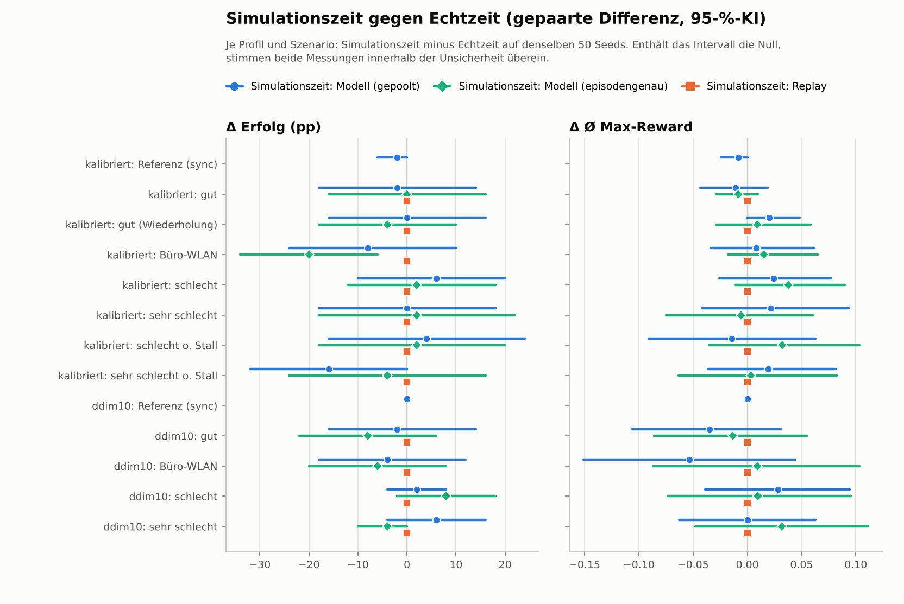
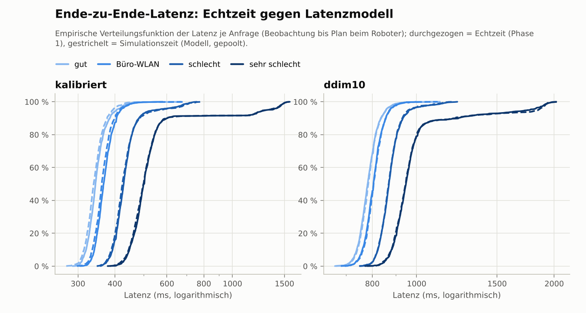
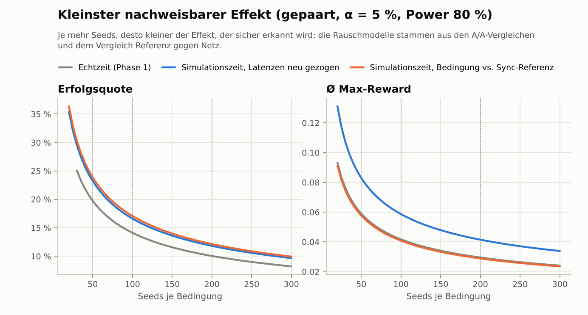
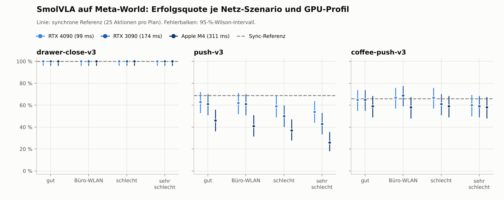
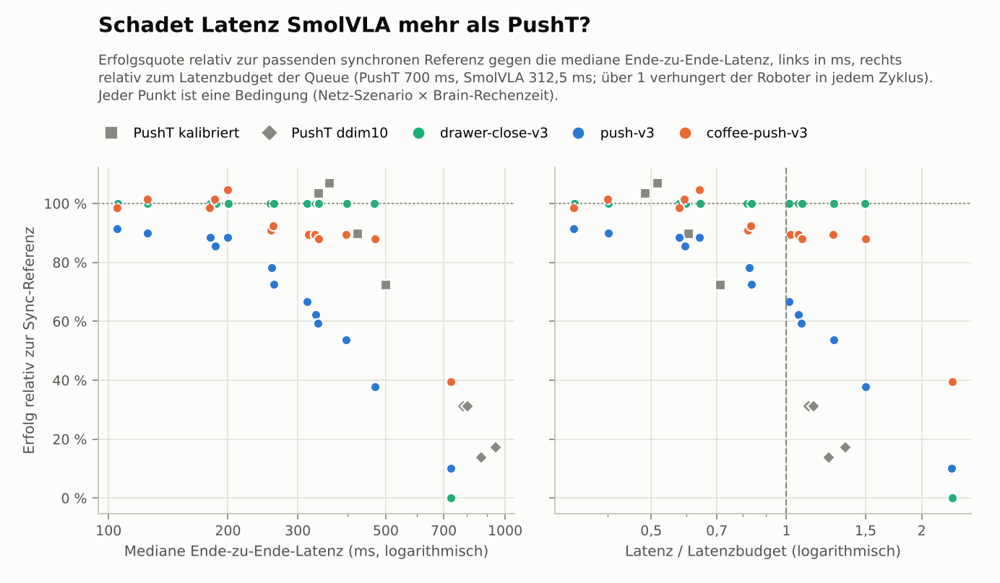

# Phase 3a: Simulationszeit-Modus und SmolVLA-Baseline

_Erzeugt am 25.10.2026 08:44 UTC mit `python -m kortyn.report_phase3a`._

## Validierung: Simulationszeit gegen Echtzeit

Gepaarte Vergleiche je Profil, Szenario und Metrik (Erfolg, Ø Max-Reward, Planalter, Starvation): Zahl der 95-%-Intervalle der Differenz, die die Null enthalten, und der nach Holm signifikanten Differenzen.

| Quelle | Vergleiche | KI der Differenz enthält 0 | Wert im KI der Echtzeitmessung | Holm-signifikant |
|---|---:|---:|---:|---:|
| Simulationszeit: Modell (gepoolt) | 52 | 49 | 48 | 2 |
| Simulationszeit: Modell (episodengenau) | 44 | 41 | 40 | 0 |
| Simulationszeit: Replay | 44 | 42 | 44 | 2 |

Intervalle ohne die Null (Simulationszeit: Modell (gepoolt)): kalibriert/gut: Planalter; kalibriert/schlecht o. Stall: Planalter; kalibriert/sehr schlecht o. Stall: Planalter.

Intervalle ohne die Null (Simulationszeit: Modell (episodengenau)): kalibriert/Büro-WLAN: Erfolg; kalibriert/Büro-WLAN: Planalter; kalibriert/sehr schlecht o. Stall: Planalter.

Intervalle ohne die Null (Simulationszeit: Replay): kalibriert/gut: Planalter; ddim10/gut: Planalter.

Replay-Treue: von 550 Phase-1-Episoden sind 441 bitgleich reproduziert, 109 gleich bis auf die letzten Float-Bits der Abdeckung, 0 abweichend; 0 Anfragen ohne Log-Gegenstück.

| Profil | Szenario | Episoden | bitgleich | gleich bis auf letzte Float-Bits | abweichend | Fallbacks |
|---|---|---:|---:|---:|---:|---:|
| kalibriert | gut | 50 | 37 | 13 | 0 | 0 |
| kalibriert | gut (Wiederholung) | 50 | 44 | 6 | 0 | 0 |
| kalibriert | Büro-WLAN | 50 | 41 | 9 | 0 | 0 |
| kalibriert | schlecht | 50 | 41 | 9 | 0 | 0 |
| kalibriert | sehr schlecht | 50 | 40 | 10 | 0 | 0 |
| kalibriert | schlecht o. Stall | 50 | 41 | 9 | 0 | 0 |
| kalibriert | sehr schlecht o. Stall | 50 | 35 | 15 | 0 | 0 |
| ddim10 | gut | 50 | 39 | 11 | 0 | 0 |
| ddim10 | Büro-WLAN | 50 | 38 | 12 | 0 | 0 |
| ddim10 | schlecht | 50 | 42 | 8 | 0 | 0 |
| ddim10 | sehr schlecht | 50 | 43 | 7 | 0 | 0 |
| **Summe** | | **550** | **441** | **109** | **0** | **0** |

### Profil kalibriert

| Szenario | Messung | Erfolg [95-%-KI] | Ø Max-Reward [KI] | Planalter [KI] | Starvation [KI] |
|---|---|---:|---:|---:|---:|
| **Referenz (sync)** | Echtzeit (Phase 1) | 60 % [46–72] | 0.952 [0.914–0.983] | 0.348 s [0.347–0.348] | 0.0 % [0.0–0.0] |
|  | Simulationszeit: Modell (gepoolt) | 58 % [44–71] | 0.944 [0.894–0.982] | 0.348 s [0.347–0.348] | 0.0 % [0.0–0.0] |
| **gut** | Echtzeit (Phase 1) | 62 % [48–74] | 0.969 [0.938–0.994] | 0.743 s [0.740–0.746] | 0.0 % [0.0–0.0] |
|  | Simulationszeit: Modell (gepoolt) | 60 % [46–72] | 0.958 [0.918–0.987] | 0.740 s [0.738–0.742] | 0.0 % [0.0–0.0] |
|  | Simulationszeit: Modell (episodengenau) | 62 % [48–74] | 0.960 [0.926–0.988] | 0.742 s [0.739–0.745] | 0.0 % [0.0–0.0] |
|  | Simulationszeit: Replay | 62 % [48–74] | 0.969 [0.938–0.994] | 0.743 s [0.740–0.746] | 0.0 % [0.0–0.0] |
| **gut (Wiederholung)** | Echtzeit (Phase 1) | 60 % [46–72] | 0.937 [0.879–0.980] | 0.742 s [0.739–0.744] | 0.0 % [0.0–0.0] |
|  | Simulationszeit: Modell (gepoolt) | 60 % [46–72] | 0.958 [0.918–0.987] | 0.740 s [0.738–0.742] | 0.0 % [0.0–0.0] |
|  | Simulationszeit: Modell (episodengenau) | 56 % [42–69] | 0.947 [0.905–0.981] | 0.743 s [0.740–0.745] | 0.0 % [0.0–0.0] |
|  | Simulationszeit: Replay | 60 % [46–72] | 0.937 [0.879–0.980] | 0.742 s [0.739–0.744] | 0.0 % [0.0–0.0] |
| **Büro-WLAN** | Echtzeit (Phase 1) | 70 % [56–81] | 0.946 [0.891–0.985] | 0.748 s [0.745–0.751] | 0.0 % [0.0–0.0] |
|  | Simulationszeit: Modell (gepoolt) | 62 % [48–74] | 0.954 [0.911–0.987] | 0.747 s [0.745–0.749] | 0.0 % [0.0–0.0] |
|  | Simulationszeit: Modell (episodengenau) | 50 % [37–63] | 0.961 [0.927–0.987] | 0.752 s [0.748–0.756] | 0.0 % [0.0–0.0] |
|  | Simulationszeit: Replay | 70 % [56–81] | 0.946 [0.891–0.985] | 0.748 s [0.745–0.751] | 0.0 % [0.0–0.0] |
| **schlecht** | Echtzeit (Phase 1) | 46 % [33–60] | 0.876 [0.798–0.939] | 0.832 s [0.828–0.836] | 0.1 % [0.1–0.2] |
|  | Simulationszeit: Modell (gepoolt) | 52 % [39–65] | 0.900 [0.822–0.962] | 0.830 s [0.826–0.832] | 0.2 % [0.1–0.3] |
|  | Simulationszeit: Modell (episodengenau) | 48 % [35–61] | 0.914 [0.838–0.973] | 0.833 s [0.828–0.837] | 0.2 % [0.1–0.3] |
|  | Simulationszeit: Replay | 46 % [33–60] | 0.876 [0.798–0.939] | 0.832 s [0.828–0.836] | 0.1 % [0.1–0.2] |
| **sehr schlecht** | Echtzeit (Phase 1) | 42 % [29–56] | 0.863 [0.790–0.926] | 1.004 s [0.996–1.013] | 10.7 % [10.2–11.2] |
|  | Simulationszeit: Modell (gepoolt) | 42 % [29–56] | 0.885 [0.818–0.944] | 1.003 s [0.995–1.011] | 10.7 % [10.1–11.2] |
|  | Simulationszeit: Modell (episodengenau) | 44 % [31–58] | 0.858 [0.781–0.928] | 1.012 s [1.001–1.023] | 11.0 % [10.5–11.6] |
|  | Simulationszeit: Replay | 42 % [29–56] | 0.863 [0.790–0.926] | 1.004 s [0.996–1.013] | 10.7 % [10.2–11.2] |
| **schlecht o. Stall** | Echtzeit (Phase 1) | 50 % [37–63] | 0.904 [0.835–0.962] | 0.804 s [0.801–0.807] | 0.0 % [0.0–0.0] |
|  | Simulationszeit: Modell (gepoolt) | 54 % [40–67] | 0.890 [0.808–0.955] | 0.818 s [0.815–0.821] | 0.0 % [0.0–0.0] |
|  | Simulationszeit: Modell (episodengenau) | 52 % [39–65] | 0.936 [0.886–0.976] | 0.805 s [0.802–0.808] | 0.0 % [0.0–0.0] |
|  | Simulationszeit: Replay | 50 % [37–63] | 0.904 [0.835–0.962] | 0.804 s [0.801–0.807] | 0.0 % [0.0–0.0] |
| **sehr schlecht o. Stall** | Echtzeit (Phase 1) | 50 % [37–63] | 0.876 [0.791–0.944] | 0.864 s [0.861–0.867] | 0.0 % [0.0–0.1] |
|  | Simulationszeit: Modell (gepoolt) | 34 % [22–48] | 0.896 [0.826–0.950] | 0.881 s [0.878–0.883] | 0.0 % [0.0–0.1] |
|  | Simulationszeit: Modell (episodengenau) | 46 % [33–60] | 0.880 [0.801–0.946] | 0.868 s [0.864–0.871] | 0.0 % [0.0–0.1] |
|  | Simulationszeit: Replay | 50 % [37–63] | 0.876 [0.791–0.944] | 0.864 s [0.861–0.867] | 0.0 % [0.0–0.1] |

| Szenario | Quelle | Δ Erfolg [KI] | Δ Ø Max-Reward [KI] | Δ Planalter [KI] | Δ Starvation [KI] |
|---|---|---:|---:|---:|---:|
| Referenz (sync) | Modell | ✓ -2 pp [-6, +0] | ✓ -0.008 [-0.024, +0.000] | ✓ -0 ms [-0, +0] | ✓ +0.0 pp [+0.0, +0.0] |
| gut | Modell | ✓ -2 pp [-18, +14] | ✓ -0.011 [-0.043, +0.019] | ✗ -3 ms [-6, -0] | ✓ +0.0 pp [+0.0, +0.0] |
| gut | Modell episodengenau | ✓ +0 pp [-16, +16] | ✓ -0.008 [-0.029, +0.010] | ✓ -1 ms [-3, +1] | ✓ +0.0 pp [+0.0, +0.0] |
| gut | Replay | ✓ +0 pp [+0, +0] | ✓ +0.000 [+0.000, +0.000] | ✗ +0 ms [+0, +0] | ✓ +0.0 pp [+0.0, +0.0] |
| gut (Wiederholung) | Modell | ✓ +0 pp [-16, +16] | ✓ +0.020 [-0.000, +0.048] | ✓ -2 ms [-4, +1] | ✓ +0.0 pp [+0.0, +0.0] |
| gut (Wiederholung) | Modell episodengenau | ✓ -4 pp [-18, +10] | ✓ +0.009 [-0.029, +0.058] | ✓ +1 ms [-1, +3] | ✓ +0.0 pp [+0.0, +0.0] |
| gut (Wiederholung) | Replay | ✓ +0 pp [+0, +0] | ✓ +0.000 [-0.000, +0.000] | ✓ +0 ms [-0, +0] | ✓ +0.0 pp [+0.0, +0.0] |
| Büro-WLAN | Modell | ✓ -8 pp [-24, +10] | ✓ +0.008 [-0.033, +0.062] | ✓ -1 ms [-4, +2] | ✓ +0.0 pp [+0.0, +0.0] |
| Büro-WLAN | Modell episodengenau | ✗ -20 pp [-34, -6] | ✓ +0.015 [-0.018, +0.065] | ✗ +3 ms [+0, +6] | ✓ +0.0 pp [+0.0, +0.0] |
| Büro-WLAN | Replay | ✓ +0 pp [+0, +0] | ✓ +0.000 [+0.000, +0.000] | ✓ -0 ms [-0, +0] | ✓ +0.0 pp [+0.0, +0.0] |
| schlecht | Modell | ✓ +6 pp [-10, +20] | ✓ +0.024 [-0.026, +0.077] | ✓ -2 ms [-7, +2] | ✓ +0.0 pp [-0.0, +0.1] |
| schlecht | Modell episodengenau | ✓ +2 pp [-12, +18] | ✓ +0.038 [-0.011, +0.090] | ✓ +1 ms [-2, +4] | ✓ +0.0 pp [-0.0, +0.1] |
| schlecht | Replay | ✓ +0 pp [+0, +0] | ✓ +0.000 [-0.000, +0.000] | ✓ -0 ms [-0, +0] | ✓ +0.0 pp [+0.0, +0.0] |
| sehr schlecht | Modell | ✓ +0 pp [-18, +18] | ✓ +0.022 [-0.042, +0.093] | ✓ -1 ms [-12, +9] | ✓ -0.1 pp [-0.7, +0.5] |
| sehr schlecht | Modell episodengenau | ✓ +2 pp [-18, +22] | ✓ -0.006 [-0.075, +0.060] | ✓ +7 ms [-2, +17] | ✓ +0.3 pp [-0.2, +0.9] |
| sehr schlecht | Replay | ✓ +0 pp [+0, +0] | ✓ +0.000 [+0.000, +0.000] | ✓ +0 ms [-0, +0] | ✓ +0.0 pp [+0.0, +0.0] |
| schlecht o. Stall | Modell | ✓ +4 pp [-16, +24] | ✓ -0.014 [-0.091, +0.063] | ✗ +14 ms [+10, +17] | ✓ +0.0 pp [+0.0, +0.0] |
| schlecht o. Stall | Modell episodengenau | ✓ +2 pp [-18, +20] | ✓ +0.032 [-0.035, +0.103] | ✓ +1 ms [-2, +4] | ✓ +0.0 pp [+0.0, +0.0] |
| schlecht o. Stall | Replay | ✓ +0 pp [+0, +0] | ✓ +0.000 [+0.000, +0.000] | ✓ -0 ms [-0, +0] | ✓ +0.0 pp [+0.0, +0.0] |
| sehr schlecht o. Stall | Modell | ✓ -16 pp [-32, +0] | ✓ +0.019 [-0.037, +0.082] | ✗ +17 ms [+14, +20] | ✓ +0.0 pp [-0.1, +0.1] |
| sehr schlecht o. Stall | Modell episodengenau | ✓ -4 pp [-24, +16] | ✓ +0.003 [-0.063, +0.083] | ✗ +4 ms [+1, +6] | ✓ +0.0 pp [+0.0, +0.1] |
| sehr schlecht o. Stall | Replay | ✓ +0 pp [+0, +0] | ✓ +0.000 [-0.000, +0.000] | ✓ +0 ms [-0, +0] | ✓ +0.0 pp [+0.0, +0.0] |

Servicezeit der Echtzeit-Maschine in Phase 1 (Serverzeit je Anfrage in ms: Median des Laufs, Mittel je Block aus zehn Seeds):

| Lauf | Median | Seeds 1000–1009 | Seeds 1010–1019 | Seeds 1020–1029 | Seeds 1030–1039 | Seeds 1040–1049 |
|---|---:|---:|---:|---:|---:|---:|
| gut | 340 | 353 | 344 | 344 | 342 | 344 |
| gut (Wiederholung) | 340 | 346 | 351 | 346 | 341 | 344 |
| Büro-WLAN | 341 | 351 | 350 | 342 | 344 | 338 |
| schlecht | 339 | 347 | 341 | 341 | 342 | 340 |
| sehr schlecht | 338 | 355 | 341 | 339 | 338 | 342 |
| schlecht o. Stall | 325 | 327 | 329 | 328 | 327 | 326 |
| sehr schlecht o. Stall | 324 | 326 | 329 | 329 | 327 | 327 |

### Profil ddim10

| Szenario | Messung | Erfolg [95-%-KI] | Ø Max-Reward [KI] | Planalter [KI] | Starvation [KI] |
|---|---|---:|---:|---:|---:|
| **Referenz (sync)** | Echtzeit (Phase 1) | 58 % [44–71] | 0.934 [0.891–0.970] | 0.348 s [0.347–0.348] | 0.0 % [0.0–0.0] |
|  | Simulationszeit: Modell (gepoolt) | 58 % [44–71] | 0.934 [0.891–0.970] | 0.348 s [0.347–0.348] | 0.0 % [0.0–0.0] |
| **gut** | Echtzeit (Phase 1) | 20 % [11–33] | 0.793 [0.704–0.871] | 1.173 s [1.166–1.179] | 18.8 % [18.0–19.7] |
|  | Simulationszeit: Modell (gepoolt) | 18 % [10–31] | 0.759 [0.676–0.832] | 1.173 s [1.169–1.177] | 18.9 % [18.4–19.4] |
|  | Simulationszeit: Modell (episodengenau) | 12 % [6–24] | 0.780 [0.689–0.860] | 1.175 s [1.168–1.182] | 19.1 % [18.1–20.0] |
|  | Simulationszeit: Replay | 20 % [11–33] | 0.793 [0.704–0.871] | 1.173 s [1.166–1.179] | 18.8 % [18.0–19.7] |
| **Büro-WLAN** | Echtzeit (Phase 1) | 22 % [13–35] | 0.760 [0.674–0.841] | 1.207 s [1.200–1.213] | 23.6 % [22.8–24.5] |
|  | Simulationszeit: Modell (gepoolt) | 18 % [10–31] | 0.707 [0.614–0.788] | 1.211 s [1.207–1.214] | 24.1 % [23.6–24.6] |
|  | Simulationszeit: Modell (episodengenau) | 16 % [8–29] | 0.770 [0.678–0.850] | 1.206 s [1.198–1.213] | 23.4 % [22.5–24.4] |
|  | Simulationszeit: Replay | 22 % [13–35] | 0.760 [0.674–0.841] | 1.207 s [1.200–1.213] | 23.6 % [22.8–24.5] |
| **schlecht** | Echtzeit (Phase 1) | 6 % [2–16] | 0.651 [0.545–0.744] | 1.307 s [1.301–1.313] | 36.1 % [35.4–36.7] |
|  | Simulationszeit: Modell (gepoolt) | 8 % [3–19] | 0.679 [0.581–0.769] | 1.307 s [1.302–1.311] | 36.1 % [35.6–36.6] |
|  | Simulationszeit: Modell (episodengenau) | 14 % [7–26] | 0.661 [0.562–0.749] | 1.310 s [1.303–1.317] | 36.5 % [35.7–37.2] |
|  | Simulationszeit: Replay | 6 % [2–16] | 0.651 [0.545–0.744] | 1.307 s [1.301–1.313] | 36.1 % [35.4–36.7] |
| **sehr schlecht** | Echtzeit (Phase 1) | 4 % [1–13] | 0.591 [0.501–0.680] | 1.584 s [1.565–1.604] | 54.0 % [53.2–54.8] |
|  | Simulationszeit: Modell (gepoolt) | 10 % [4–21] | 0.592 [0.493–0.687] | 1.590 s [1.573–1.607] | 53.7 % [53.1–54.4] |
|  | Simulationszeit: Modell (episodengenau) | 0 % [0–7] | 0.623 [0.528–0.713] | 1.597 s [1.578–1.617] | 54.2 % [53.4–55.0] |
|  | Simulationszeit: Replay | 4 % [1–13] | 0.591 [0.501–0.680] | 1.584 s [1.565–1.604] | 54.0 % [53.2–54.8] |

| Szenario | Quelle | Δ Erfolg [KI] | Δ Ø Max-Reward [KI] | Δ Planalter [KI] | Δ Starvation [KI] |
|---|---|---:|---:|---:|---:|
| Referenz (sync) | Modell | ✓ +0 pp [+0, +0] | ✓ +0.000 [-0.000, +0.001] | ✓ +0 ms [+0, +0] | ✓ +0.0 pp [+0.0, +0.0] |
| gut | Modell | ✓ -2 pp [-16, +14] | ✓ -0.035 [-0.107, +0.031] | ✓ +0 ms [-8, +8] | ✓ +0.1 pp [-1.0, +1.1] |
| gut | Modell episodengenau | ✓ -8 pp [-22, +6] | ✓ -0.013 [-0.086, +0.055] | ✓ +2 ms [-2, +6] | ✓ +0.2 pp [-0.3, +0.7] |
| gut | Replay | ✓ +0 pp [+0, +0] | ✓ +0.000 [-0.000, +0.000] | ✗ +0 ms [+0, +0] | ✓ +0.0 pp [+0.0, +0.0] |
| Büro-WLAN | Modell | ✓ -4 pp [-18, +12] | ✓ -0.053 [-0.151, +0.045] | ✓ +4 ms [-4, +12] | ✓ +0.5 pp [-0.5, +1.5] |
| Büro-WLAN | Modell episodengenau | ✓ -6 pp [-20, +8] | ✓ +0.009 [-0.087, +0.103] | ✓ -1 ms [-6, +4] | ✓ -0.2 pp [-0.9, +0.4] |
| Büro-WLAN | Replay | ✓ +0 pp [+0, +0] | ✓ +0.000 [-0.000, +0.000] | ✓ +0 ms [-0, +0] | ✓ +0.0 pp [+0.0, +0.0] |
| schlecht | Modell | ✓ +2 pp [-4, +8] | ✓ +0.028 [-0.039, +0.094] | ✓ -0 ms [-7, +6] | ✓ +0.0 pp [-0.8, +0.8] |
| schlecht | Modell episodengenau | ✓ +8 pp [-2, +18] | ✓ +0.010 [-0.073, +0.095] | ✓ +3 ms [-2, +9] | ✓ +0.4 pp [-0.2, +1.0] |
| schlecht | Replay | ✓ +0 pp [+0, +0] | ✓ +0.000 [-0.000, +0.000] | ✓ +0 ms [-0, +0] | ✓ +0.0 pp [+0.0, +0.0] |
| sehr schlecht | Modell | ✓ +6 pp [-4, +16] | ✓ +0.000 [-0.063, +0.063] | ✓ +5 ms [-22, +31] | ✓ -0.2 pp [-1.4, +0.8] |
| sehr schlecht | Modell episodengenau | ✓ -4 pp [-10, +0] | ✓ +0.032 [-0.048, +0.111] | ✓ +12 ms [-2, +28] | ✓ +0.2 pp [-0.3, +0.7] |
| sehr schlecht | Replay | ✓ +0 pp [+0, +0] | ✓ +0.000 [-0.000, +0.000] | ✓ +0 ms [-0, +0] | ✓ +0.0 pp [+0.0, +0.0] |

Servicezeit der Echtzeit-Maschine in Phase 1 (Serverzeit je Anfrage in ms: Median des Laufs, Mittel je Block aus zehn Seeds):

| Lauf | Median | Seeds 1000–1009 | Seeds 1010–1019 | Seeds 1020–1029 | Seeds 1030–1039 | Seeds 1040–1049 |
|---|---:|---:|---:|---:|---:|---:|
| gut | 777 | 795 | 784 | 775 | 778 | 778 |
| Büro-WLAN | 778 | 791 | 787 | 774 | 780 | 773 |
| schlecht | 782 | 791 | 789 | 782 | 790 | 779 |
| sehr schlecht | 782 | 795 | 789 | 781 | 785 | 774 |

### Latenzen

| Profil | Szenario | E2E p50 Echtzeit / Modell | E2E p95 Echtzeit / Modell | Netzanteil Ø Echtzeit / Modell |
|---|---|---:|---:|---:|
| kalibriert | gut | 344 ms / 339 ms | 405 ms / 394 ms | 3.5 / 3.4 ms |
| kalibriert | Büro-WLAN | 366 ms / 361 ms | 419 ms / 414 ms | 25.4 / 25.4 ms |
| kalibriert | schlecht | 428 ms / 424 ms | 548 ms / 564 ms | 97.2 / 98.3 ms |
| kalibriert | sehr schlecht | 503 ms / 500 ms | 1307 ms / 1308 ms | 227.8 / 227.7 ms |
| kalibriert | schlecht o. Stall | 412 ms / 422 ms | 456 ms / 482 ms | 85.4 / 85.1 ms |
| kalibriert | sehr schlecht o. Stall | 482 ms / 494 ms | 548 ms / 569 ms | 155.3 / 155.2 ms |
| ddim10 | gut | 781 ms / 784 ms | 857 ms / 857 ms | 3.3 / 3.4 ms |
| ddim10 | Büro-WLAN | 805 ms / 805 ms | 872 ms / 875 ms | 25.4 / 25.5 ms |
| ddim10 | schlecht | 870 ms / 869 ms | 965 ms / 960 ms | 91.6 / 92.8 ms |
| ddim10 | sehr schlecht | 948 ms / 946 ms | 1766 ms / 1845 ms | 230.7 / 234.8 ms |

### Determinismus

Wiederholte Ausführungen derselben Läufe (andere Worker-Zahl, andere Reihenfolge der Seeds, frische Prozesse). Episoden: bitgleich = Erfolg, Länge, alle Takt-Serien, Abdeckung und Reward identisch; „letzte Float-Bits“ = alles identisch bis auf |Δ Abdeckung| < 1e-9. Anfragen: alle Felder.

| Vergleich | Profil | Lauf | Episoden | bitgleich | gleich bis auf letzte Float-Bits | abweichend | Anfragen identisch |
|---|---|---|---:|---:|---:|---:|---:|
| 1. gegen 2. Ausführung (4 statt 1 Worker; Code-Stand der Validierung gegen aktuellen) | kalibriert | modell__gut | 10 | 6 | 4 | 0 | 248 / 248 |
| 1. gegen 2. Ausführung (4 statt 1 Worker; Code-Stand der Validierung gegen aktuellen) | kalibriert | modell__sehr_schlecht | 10 | 8 | 2 | 0 | 318 / 318 |
| 2. gegen 3. Ausführung (1 statt 2 Worker, gleicher Code) | kalibriert | modell__gut | 10 | 7 | 3 | 0 | 248 / 248 |
| 2. gegen 3. Ausführung (1 statt 2 Worker, gleicher Code) | kalibriert | modell__sehr_schlecht | 10 | 7 | 3 | 0 | 318 / 318 |
| SmolVLA/Meta-World: 1 gegen 2 Worker (gleicher Code) | smolvla | langsam__sehr_schlecht | 3 | 3 | 0 | 0 | 11 / 11 |
| SmolVLA/Meta-World: 1 gegen 2 Worker (gleicher Code) | smolvla | mittel__gut | 3 | 3 | 0 | 0 | 12 / 12 |

## Restrauschen und Power

| Vergleich (gleiche Seeds) | n | Erfolg A / B | diskordante Paare | SD der Reward-Differenz | identische Episoden |
|---|---:|---:|---:|---:|---:|
| Echtzeit A/A: gut vs. gut (Wiederholung), kalibriert | 50 | 62 % / 60 % | 26 % | 0.149 | 9 |
| Simulationszeit A/A, neue Latenzen: gut, kalibriert | 50 | 60 % / 60 % | 32 % | 0.099 | 7 |
| Simulationszeit A/A, neue Latenzen: sehr schlecht, kalibriert | 50 | 42 % / 50 % | 48 % | 0.235 | 2 |
| Simulationszeit A/A, neue Latenzen: gut, ddim10 | 50 | 18 % / 22 % | 28 % | 0.258 | 0 |
| Echtzeit: gut vs. Büro-WLAN, kalibriert | 50 | 62 % / 70 % | 32 % | 0.167 | 3 |
| Simulationszeit: gut vs. Büro-WLAN, kalibriert | 50 | 60 % / 62 % | 26 % | 0.068 | 9 |
| Echtzeit: Referenz (sync) vs. gut, kalibriert | 50 | 60 % / 62 % | 42 % | 0.132 | 0 |
| Simulationszeit: Referenz (sync) vs. gut, kalibriert | 50 | 58 % / 60 % | 38 % | 0.146 | 0 |
| Echtzeit: gut vs. sehr schlecht, kalibriert | 50 | 62 % / 42 % | 32 % | 0.270 | 0 |
| Simulationszeit: gut vs. sehr schlecht, kalibriert | 50 | 60 % / 42 % | 46 % | 0.259 | 0 |

| Rauschmodell | diskordant | SD Reward-Diff. | MDE Erfolg (n = 50 | n = 100 | n = 200) | MDE Ø Max-Reward (n = 50 | n = 100 | n = 200) |
|---|---:|---:|---|---|
| Echtzeit (Phase 1) (identische Bedingung zweimal gemessen) | 26 % | 0.149 | 20 % / 14 % / 10 % | 0.059 / 0.042 / 0.029 |
| Simulationszeit, Latenzen neu gezogen (Mittel der A/A-Replikationen) | 36 % | 0.209 | 23 % / 17 % / 12 % | 0.083 / 0.059 / 0.041 |
| Simulationszeit, Bedingung vs. Sync-Referenz (Planungswert für Schritt 3 (Referenz vs. gut)) | 38 % | 0.146 | 24 % / 17 % / 12 % | 0.058 / 0.041 / 0.029 |

## Verzögerungstoleranz der Meta-World-Experten

| Aufgabe | 0 ms | 50 ms | 100 ms | 200 ms | 300 ms | 500 ms |
|---|---:|---:|---:|---:|---:|---:|
| **drawer-close-v3** | 100 % | 100 % | 100 % | 100 % | 97 % | 83 % |
| hammer-v3 | 100 % | 100 % | 70 % | 10 % | 17 % | 33 % |
| plate-slide-v3 | 100 % | 100 % | 100 % | 13 % | 0 % | 0 % |
| **push-v3** | 100 % | 93 % | 97 % | 3 % | 3 % | 0 % |
| door-open-v3 | 93 % | 90 % | 83 % | 3 % | 0 % | 3 % |
| pick-place-v3 | 100 % | 90 % | 27 % | 27 % | 13 % | 10 % |
| **coffee-push-v3** | 100 % | 73 % | 43 % | 0 % | 3 % | 0 % |
| stick-push-v3 | 100 % | 97 % | 10 % | 7 % | 3 % | 0 % |
| soccer-v3 | 97 % | 50 % | 13 % | 13 % | 23 % | 7 % |
| sweep-into-v3 | 87 % | 43 % | 10 % | 10 % | 10 % | 10 % |
| basketball-v3 | 97 % | 33 % | 3 % | 0 % | 0 % | 0 % |
| button-press-v3 | 100 % | 0 % | 0 % | 0 % | 0 % | 0 % |

## SmolVLA

| Aufgabe | Gruppe | Kortyn Sync-50 (LeRobot-Protokoll) | Kortyn Sync-25 | publiziert (dieser Checkpoint) | Δ Sync-50 − publiziert [KI] | Sync-50, Seeds 1000–1029 | Δ auf diesen Seeds [KI] |
|---|---|---:|---:|---:|---:|---:|---:|
| drawer-close-v3 | easy | 100 % [96–100] | 100 % [96–100] | 100 % (n = 30) | ✓ +0 pp [-4, +11] | 30/30 (100 %) | ✓ +0 pp [-11, +11] |
| push-v3 | hard | 57 % [47–66] | 69 % [59–77] | 70 % (n = 30) | ✓ -13 pp [-30, +7] | 23/30 (77 %) | ✓ +7 pp [-15, +28] |
| coffee-push-v3 | medium | 60 % [50–69] | 66 % [56–75] | 90 % (n = 30) | ✗ -30 pp [-42, -12] | 22/30 (73 %) | ✓ -17 pp [-36, +3] |

Gegenprobe mit LeRobots offizieller Evaluation (`lerobot-eval`, synchron, 50 Aktionen je Plan, ein CPU-Thread) auf derselben Maschine und denselben Seeds:

| Aufgabe | Seeds | lerobot-eval (diese Maschine) | Kortyn Sync-50 (gleiche Seeds) | gleicher Ausgang | nur lerobot-eval / nur Kortyn | McNemar p |
|---|---:|---:|---:|---:|---:|---:|
| coffee-push-v3 | 1000–1049 | 60 % (30/50) | 66 % (33/50) | 43/50 | 2 / 5 | 0,453 |

### drawer-close-v3

| Bedingung | Erfolg [95-%-KI] | Δ vs. Sync-25 [KI] (p) | Ø Max-Reward | E2E p50 / p95 | Planalter | Starvation | Bandbreite/Roboter |
|---|---:|---:|---:|---:|---:|---:|---:|
| Sync, 50 Aktionen/Plan (LeRobot-Eval) | 100 % [96–100] | +0 pp [+0, +0] (1,000) | 10.00 | – | 0.26 s | – | 11.2 Mbit/s |
| Sync, 25 Aktionen/Plan (Referenz) | 100 % [96–100] | – | 10.00 | – | 0.14 s | – | 21.9 Mbit/s |
| RTX 4090 (99 ms), gut | 100 % [96–100] | +0 pp [+0, +0] (1,000) | 10.00 | 105 ms / 114 ms | 0.23 s | 0.0 % | 16.8 Mbit/s |
| RTX 4090 (99 ms), Büro-WLAN | 100 % [96–100] | +0 pp [+0, +0] (1,000) | 10.00 | 125 ms / 137 ms | 0.24 s | 0.0 % | 16.7 Mbit/s |
| RTX 4090 (99 ms), schlecht | 100 % [96–100] | +0 pp [+0, +0] (1,000) | 10.00 | 187 ms / 225 ms | 0.29 s | 0.8 % | 16.4 Mbit/s |
| RTX 4090 (99 ms), sehr schlecht | 100 % [96–100] | +0 pp [+0, +0] (1,000) | 10.00 | 256 ms / 373 ms | 0.33 s | 9.2 % | 15.2 Mbit/s |
| RTX 3090 (174 ms), gut | 100 % [96–100] | +0 pp [+0, +0] (1,000) | 10.00 | 181 ms / 196 ms | 0.28 s | 0.0 % | 16.7 Mbit/s |
| RTX 3090 (174 ms), Büro-WLAN | 100 % [96–100] | +0 pp [+0, +0] (1,000) | 10.00 | 201 ms / 218 ms | 0.29 s | 0.0 % | 16.6 Mbit/s |
| RTX 3090 (174 ms), schlecht | 100 % [96–100] | +0 pp [+0, +0] (1,000) | 10.00 | 261 ms / 313 ms | 0.33 s | 2.0 % | 16.1 Mbit/s |
| RTX 3090 (174 ms), sehr schlecht | 100 % [96–100] | +0 pp [+0, +0] (1,000) | 10.00 | 332 ms / 937 ms | 0.36 s | 17.3 % | 13.5 Mbit/s |
| Apple M4 (311 ms), gut | 100 % [96–100] | +0 pp [+0, +0] (1,000) | 10.00 | 317 ms / 346 ms | 0.36 s | 4.0 % | 15.6 Mbit/s |
| Apple M4 (311 ms), Büro-WLAN | 100 % [96–100] | +0 pp [+0, +0] (1,000) | 10.00 | 338 ms / 364 ms | 0.36 s | 9.3 % | 14.5 Mbit/s |
| Apple M4 (311 ms), schlecht | 100 % [96–100] | +0 pp [+0, +0] (1,000) | 10.00 | 399 ms / 446 ms | 0.37 s | 25.2 % | 12.7 Mbit/s |
| Apple M4 (311 ms), sehr schlecht | 100 % [96–100] | +0 pp [+0, +0] (1,000) | 10.00 | 467 ms / 1233 ms | 0.38 s | 48.0 % | 10.3 Mbit/s |
| Apple M1 (722 ms), gut | 0 % [0–4] | -100 pp [-100, -100] (< 0,001) | 0.51 | 730 ms / 789 ms | 0.31 s | 90.0 % | 7.7 Mbit/s |

### push-v3

| Bedingung | Erfolg [95-%-KI] | Δ vs. Sync-25 [KI] (p) | Ø Max-Reward | E2E p50 / p95 | Planalter | Starvation | Bandbreite/Roboter |
|---|---:|---:|---:|---:|---:|---:|---:|
| Sync, 50 Aktionen/Plan (LeRobot-Eval) | 57 % [47–66] | -12 pp [-23, -1] (0,050) | 6.75 | – | 0.30 s | – | 9.5 Mbit/s |
| Sync, 25 Aktionen/Plan (Referenz) | 69 % [59–77] | – | 7.43 | – | 0.15 s | – | 18.6 Mbit/s |
| RTX 4090 (99 ms), gut | 63 % [53–72] | -6 pp [-15, +2] (0,238) | 7.05 | 105 ms / 114 ms | 0.25 s | 0.0 % | 16.4 Mbit/s |
| RTX 4090 (99 ms), Büro-WLAN | 62 % [52–71] | -7 pp [-16, +2] (0,210) | 6.76 | 125 ms / 136 ms | 0.27 s | 0.0 % | 16.4 Mbit/s |
| RTX 4090 (99 ms), schlecht | 59 % [49–68] | -10 pp [-19, +0] (0,064) | 6.67 | 186 ms / 221 ms | 0.33 s | 1.6 % | 16.4 Mbit/s |
| RTX 4090 (99 ms), sehr schlecht | 54 % [44–63] | -15 pp [-26, -4] (0,014) | 6.92 | 258 ms / 326 ms | 0.39 s | 10.4 % | 15.3 Mbit/s |
| RTX 3090 (174 ms), gut | 61 % [51–70] | -8 pp [-17, +1] (0,134) | 6.94 | 180 ms / 195 ms | 0.32 s | 0.0 % | 16.4 Mbit/s |
| RTX 3090 (174 ms), Büro-WLAN | 61 % [51–70] | -8 pp [-17, +1] (0,152) | 7.02 | 200 ms / 216 ms | 0.34 s | 0.0 % | 16.4 Mbit/s |
| RTX 3090 (174 ms), schlecht | 50 % [40–60] | -19 pp [-29, -9] (0,001) | 6.56 | 261 ms / 299 ms | 0.40 s | 3.1 % | 16.5 Mbit/s |
| RTX 3090 (174 ms), sehr schlecht | 43 % [34–53] | -26 pp [-36, -16] (< 0,001) | 6.30 | 333 ms / 404 ms | 0.44 s | 23.3 % | 14.2 Mbit/s |
| Apple M4 (311 ms), gut | 46 % [37–56] | -23 pp [-34, -12] (< 0,001) | 6.49 | 317 ms / 345 ms | 0.44 s | 6.6 % | 16.4 Mbit/s |
| Apple M4 (311 ms), Büro-WLAN | 41 % [32–51] | -28 pp [-39, -17] (< 0,001) | 6.28 | 337 ms / 362 ms | 0.45 s | 15.7 % | 15.7 Mbit/s |
| Apple M4 (311 ms), schlecht | 37 % [28–47] | -32 pp [-42, -21] (< 0,001) | 5.99 | 398 ms / 446 ms | 0.46 s | 40.9 % | 13.1 Mbit/s |
| Apple M4 (311 ms), sehr schlecht | 26 % [18–35] | -43 pp [-54, -32] (< 0,001) | 5.55 | 469 ms / 1129 ms | 0.46 s | 63.4 % | 10.6 Mbit/s |
| Apple M1 (722 ms), gut | 7 % [3–14] | -62 pp [-71, -52] (< 0,001) | 4.54 | 730 ms / 789 ms | 0.31 s | 89.6 % | 7.7 Mbit/s |

### coffee-push-v3

| Bedingung | Erfolg [95-%-KI] | Δ vs. Sync-25 [KI] (p) | Ø Max-Reward | E2E p50 / p95 | Planalter | Starvation | Bandbreite/Roboter |
|---|---:|---:|---:|---:|---:|---:|---:|
| Sync, 50 Aktionen/Plan (LeRobot-Eval) | 60 % [50–69] | -6 pp [-13, +1] (0,180) | 2.90 | – | 0.30 s | – | 9.8 Mbit/s |
| Sync, 25 Aktionen/Plan (Referenz) | 66 % [56–75] | – | 3.18 | – | 0.15 s | – | 18.7 Mbit/s |
| RTX 4090 (99 ms), gut | 65 % [55–74] | -1 pp [-8, +6] (1,000) | 2.90 | 105 ms / 113 ms | 0.25 s | 0.0 % | 16.6 Mbit/s |
| RTX 4090 (99 ms), Büro-WLAN | 67 % [57–75] | +1 pp [-6, +8] (1,000) | 2.89 | 125 ms / 136 ms | 0.27 s | 0.0 % | 16.6 Mbit/s |
| RTX 4090 (99 ms), schlecht | 67 % [57–75] | +1 pp [-6, +7] (1,000) | 2.91 | 185 ms / 219 ms | 0.32 s | 1.4 % | 16.6 Mbit/s |
| RTX 4090 (99 ms), sehr schlecht | 60 % [50–69] | -6 pp [-13, +0] (0,146) | 2.88 | 256 ms / 326 ms | 0.38 s | 10.5 % | 15.5 Mbit/s |
| RTX 3090 (174 ms), gut | 65 % [55–74] | -1 pp [-9, +6] (1,000) | 2.93 | 180 ms / 194 ms | 0.31 s | 0.0 % | 16.6 Mbit/s |
| RTX 3090 (174 ms), Büro-WLAN | 69 % [59–77] | +3 pp [-4, +10] (0,581) | 2.93 | 200 ms / 215 ms | 0.33 s | 0.0 % | 16.6 Mbit/s |
| RTX 3090 (174 ms), schlecht | 61 % [51–70] | -5 pp [-12, +2] (0,267) | 2.89 | 260 ms / 302 ms | 0.39 s | 3.1 % | 16.6 Mbit/s |
| RTX 3090 (174 ms), sehr schlecht | 59 % [49–68] | -7 pp [-14, +0] (0,118) | 2.79 | 332 ms / 405 ms | 0.42 s | 22.4 % | 14.2 Mbit/s |
| Apple M4 (311 ms), gut | 59 % [49–68] | -7 pp [-14, +0] (0,118) | 2.82 | 319 ms / 348 ms | 0.43 s | 6.9 % | 16.4 Mbit/s |
| Apple M4 (311 ms), Büro-WLAN | 58 % [48–67] | -8 pp [-15, -1] (0,077) | 2.79 | 338 ms / 363 ms | 0.43 s | 15.2 % | 15.7 Mbit/s |
| Apple M4 (311 ms), schlecht | 59 % [49–68] | -7 pp [-14, +0] (0,092) | 2.74 | 398 ms / 447 ms | 0.44 s | 38.2 % | 13.1 Mbit/s |
| Apple M4 (311 ms), sehr schlecht | 58 % [48–67] | -8 pp [-15, -1] (0,057) | 2.71 | 469 ms / 1207 ms | 0.43 s | 58.1 % | 10.6 Mbit/s |
| Apple M1 (722 ms), gut | 26 % [18–35] | -40 pp [-50, -30] (< 0,001) | 2.41 | 731 ms / 790 ms | 0.31 s | 87.1 % | 7.6 Mbit/s |

### Erfolgsverlust gegen die Sync-Referenz je Aufgabe

| Bedingung | Δ drawer-close-v3 | Δ push-v3 | Δ coffee-push-v3 | coffee-push − push [KI] |
|---|---:|---:|---:|---:|
| RTX 4090 (99 ms), gut | +0 pp [+0, +0] | -6 pp [-15, +2] | -1 pp [-8, +6] | ✓ +5 pp [-6, +17] |
| RTX 4090 (99 ms), Büro-WLAN | +0 pp [+0, +0] | -7 pp [-16, +2] | +1 pp [-6, +8] | ✓ +8 pp [-4, +20] |
| RTX 4090 (99 ms), schlecht | +0 pp [+0, +0] | -10 pp [-19, +0] | +1 pp [-6, +7] | ✓ +11 pp [-1, +23] |
| RTX 4090 (99 ms), sehr schlecht | +0 pp [+0, +0] | -15 pp [-26, -4] | -6 pp [-13, +0] | ✓ +9 pp [-4, +22] |
| RTX 3090 (174 ms), gut | +0 pp [+0, +0] | -8 pp [-17, +1] | -1 pp [-9, +6] | ✓ +7 pp [-5, +19] |
| RTX 3090 (174 ms), Büro-WLAN | +0 pp [+0, +0] | -8 pp [-17, +1] | +3 pp [-4, +10] | ✓ +11 pp [+0, +23] |
| RTX 3090 (174 ms), schlecht | +0 pp [+0, +0] | -19 pp [-29, -9] | -5 pp [-12, +2] | ✗ +14 pp [+1, +26] |
| RTX 3090 (174 ms), sehr schlecht | +0 pp [+0, +0] | -26 pp [-36, -16] | -7 pp [-14, +0] | ✗ +19 pp [+7, +32] |
| Apple M4 (311 ms), gut | +0 pp [+0, +0] | -23 pp [-34, -12] | -7 pp [-14, +0] | ✗ +16 pp [+3, +29] |
| Apple M4 (311 ms), Büro-WLAN | +0 pp [+0, +0] | -28 pp [-39, -17] | -8 pp [-15, -1] | ✗ +20 pp [+7, +33] |
| Apple M4 (311 ms), schlecht | +0 pp [+0, +0] | -32 pp [-42, -21] | -7 pp [-14, +0] | ✗ +25 pp [+13, +38] |
| Apple M4 (311 ms), sehr schlecht | +0 pp [+0, +0] | -43 pp [-54, -32] | -8 pp [-15, -1] | ✗ +35 pp [+22, +48] |
| Apple M1 (722 ms), gut | -100 pp [-100, -100] | -62 pp [-71, -52] | -40 pp [-50, -30] | ✗ +22 pp [+8, +36] |

### Realisierte Power (Rauschen der SmolVLA-Vergleiche)

Je Aufgabe über die zwölf GPU-Bedingungen gemittelt (ohne den M1-Grenzfall, der konstruktionsbedingt scheitert): Anteil der Seeds mit verschiedenem Ausgang gegenüber Sync-25 und Streuung der Reward-Differenzen; daraus der kleinste Effekt, den die gemessene Seed-Zahl mit 80 % Power (α = 5 %, zweiseitig) erkennt.

| Aufgabe | Bedingungen | Seeds | diskordante Paare Ø [min–max] | SD Reward-Diff. Ø | MDE Erfolg | MDE Ø Max-Reward |
|---|---:|---:|---:|---:|---:|---:|
| drawer-close-v3 | 12 | 100 | 0 % [0 %–0 %] | 0.00 | – | 0.00 |
| push-v3 | 12 | 100 | 31 % [18 %–49 %] | 3.91 | 15 % | 1.09 |
| coffee-push-v3 | 12 | 100 | 14 % [12 %–16 %] | 1.51 | 10 % | 0.42 |

### Bildübertragung

**push-v3** (synchrone Referenz, 25 Aktionen pro Plan, Seeds 1000–1049, n = 50):

| Bildübertragung | KB pro Anfrage | Bandbreite/Roboter bei 3,2 Anfragen/s | Erfolg [KI] | Δ vs. roh [KI] (p) |
|---|---:|---:|---:|---:|
| roh, 480×480 (LeRobot-Eval) | 691.4 | 17.7 Mbit/s | 76 % [63–86] | – |
| JPEG q75, 240×240 (im Brain auf 480×480 skaliert) | 7.7 | 0.2 Mbit/s | 56 % [42–69] | -20 pp [-36, -4] (0,031) |
| JPEG q90, 480×480 | 41.3 | 1.1 Mbit/s | 72 % [58–83] | -4 pp [-12, +4] (0,625) |

### Echte Inferenzzeit auf dieser Maschine (CPU)

Brain-Pfad (Vorverarbeitung, Modell, Nachverarbeitung) mit Beobachtungen der Evaluations-Seeds, auf der sonst leeren Maschine gemessen. Die Experimente ersetzen diese Zeiten durch die publizierten GPU-Profile.

| Policy | Sampler | CPU | Threads | Median | p90 | Minimum |
|---|---|---|---:|---:|---:|---:|
| smolvla | flow-10 | Intel(R) Xeon(R) Processor @ 2.10GHz | 1 | 1744 ms | 1849 ms | 1674 ms |
| smolvla | flow-10 | Intel(R) Xeon(R) Processor @ 2.10GHz | 2 | 1178 ms | 1291 ms | 1034 ms |
| smolvla | flow-10 | Intel(R) Xeon(R) Processor @ 2.10GHz | 4 | 907 ms | 1085 ms | 787 ms |

## Latenzwirkung: SmolVLA gegen PushT

Mittlerer gepaarter Erfolgsverlust gegen die eigene Sync-Referenz, gemittelt über die Bedingungen einer Aufgabe (ohne den M1-Grenzfall); Bootstrap über Seeds. Budget = Latenz, die die Queue ohne Starvation überbrückt (PushT 700 ms, SmolVLA 312,5 ms); maßgeblich ist die mediane Latenz der Bedingung.

| Aufgabe | Bedingungen | Anzahl | Seeds | Sync-Referenz | Ø Δ Erfolg gegen Sync [95-%-KI] |
|---|---|---:|---:|---:|---:|
| PushT kalibriert | alle Bedingungen | 4 | 50 | 58 % | ✓ -4 pp [-17, +9] |
| PushT kalibriert | Latenz im Budget | 4 | 50 | 58 % | ✓ -4 pp [-17, +9] |
| PushT ddim10 | alle Bedingungen | 4 | 50 | 58 % | ✗ -44 pp [-57, -31] |
| PushT ddim10 | Latenz über Budget | 4 | 50 | 58 % | ✗ -44 pp [-57, -31] |
| drawer-close-v3 | alle Bedingungen | 12 | 100 | 100 % | ✓ +0 pp [+0, +0] |
| drawer-close-v3 | Latenz im Budget | 7 | 100 | 100 % | ✓ +0 pp [+0, +0] |
| drawer-close-v3 | Latenz über Budget | 5 | 100 | 100 % | ✓ +0 pp [+0, +0] |
| push-v3 | alle Bedingungen | 12 | 100 | 69 % | ✗ -19 pp [-26, -11] |
| push-v3 | Latenz im Budget | 7 | 100 | 69 % | ✗ -10 pp [-18, -3] |
| push-v3 | Latenz über Budget | 5 | 100 | 69 % | ✗ -30 pp [-39, -21] |
| coffee-push-v3 | alle Bedingungen | 12 | 100 | 66 % | ✓ -4 pp [-10, +2] |
| coffee-push-v3 | Latenz im Budget | 7 | 100 | 66 % | ✓ -1 pp [-8, +5] |
| coffee-push-v3 | Latenz über Budget | 5 | 100 | 66 % | ✗ -7 pp [-14, -0] |

| Unterschied der Verluste (zweite minus erste Aufgabe) | Bedingungen | Δ [95-%-KI] |
|---|---|---:|
| coffee-push-v3 − drawer-close-v3 | alle Bedingungen | ✓ -4 pp [-10, +3] |
| push-v3 − drawer-close-v3 | alle Bedingungen | ✗ -19 pp [-26, -11] |
| coffee-push-v3 − push-v3 | alle Bedingungen | ✗ +15 pp [+5, +25] |
| coffee-push-v3 − drawer-close-v3 | Latenz im Budget | ✓ -1 pp [-8, +5] |
| push-v3 − drawer-close-v3 | Latenz im Budget | ✗ -10 pp [-18, -3] |
| coffee-push-v3 − push-v3 | Latenz im Budget | ✓ +9 pp [-1, +20] |
| coffee-push-v3 − drawer-close-v3 | Latenz über Budget | ✗ -7 pp [-14, -0] |
| push-v3 − drawer-close-v3 | Latenz über Budget | ✗ -30 pp [-40, -21] |
| coffee-push-v3 − push-v3 | Latenz über Budget | ✗ +23 pp [+12, +35] |

| Aufgabe | Bedingung | Mediane Latenz | Latenz / Budget | Ø Planalter | Starvation | Erfolg | relativ zur Sync-Referenz | Δ Erfolg |
|---|---|---:|---:|---:|---:|---:|---:|---:|
| PushT ddim10 | gut | 784 ms | 1.12 | 1.17 s | 18.9 % | 18 % | 31 % | -40 pp |
| PushT ddim10 | Büro-WLAN | 805 ms | 1.15 | 1.21 s | 24.1 % | 18 % | 31 % | -40 pp |
| PushT ddim10 | schlecht | 869 ms | 1.24 | 1.31 s | 36.1 % | 8 % | 14 % | -50 pp |
| PushT ddim10 | sehr schlecht | 946 ms | 1.35 | 1.59 s | 53.7 % | 10 % | 17 % | -48 pp |
| PushT kalibriert | gut | 339 ms | 0.48 | 0.74 s | 0.0 % | 60 % | 103 % | +2 pp |
| PushT kalibriert | Büro-WLAN | 361 ms | 0.52 | 0.75 s | 0.0 % | 62 % | 107 % | +4 pp |
| PushT kalibriert | schlecht | 424 ms | 0.61 | 0.83 s | 0.2 % | 52 % | 90 % | -6 pp |
| PushT kalibriert | sehr schlecht | 500 ms | 0.71 | 1.00 s | 10.7 % | 42 % | 72 % | -16 pp |
| coffee-push-v3 | RTX 4090 (99 ms), gut | 105 ms | 0.34 | 0.25 s | 0.0 % | 65 % | 98 % | -1 pp |
| coffee-push-v3 | RTX 4090 (99 ms), Büro-WLAN | 125 ms | 0.40 | 0.27 s | 0.0 % | 67 % | 102 % | +1 pp |
| coffee-push-v3 | RTX 3090 (174 ms), gut | 180 ms | 0.58 | 0.31 s | 0.0 % | 65 % | 98 % | -1 pp |
| coffee-push-v3 | RTX 4090 (99 ms), schlecht | 185 ms | 0.59 | 0.32 s | 1.4 % | 67 % | 102 % | +1 pp |
| coffee-push-v3 | RTX 3090 (174 ms), Büro-WLAN | 200 ms | 0.64 | 0.33 s | 0.0 % | 69 % | 105 % | +3 pp |
| coffee-push-v3 | RTX 4090 (99 ms), sehr schlecht | 256 ms | 0.82 | 0.38 s | 10.5 % | 60 % | 91 % | -6 pp |
| coffee-push-v3 | RTX 3090 (174 ms), schlecht | 260 ms | 0.83 | 0.39 s | 3.1 % | 61 % | 92 % | -5 pp |
| coffee-push-v3 | Apple M4 (311 ms), gut | 319 ms | 1.02 | 0.43 s | 6.9 % | 59 % | 89 % | -7 pp |
| coffee-push-v3 | RTX 3090 (174 ms), sehr schlecht | 332 ms | 1.06 | 0.42 s | 22.4 % | 59 % | 89 % | -7 pp |
| coffee-push-v3 | Apple M4 (311 ms), Büro-WLAN | 338 ms | 1.08 | 0.43 s | 15.2 % | 58 % | 88 % | -8 pp |
| coffee-push-v3 | Apple M4 (311 ms), schlecht | 398 ms | 1.27 | 0.44 s | 38.2 % | 59 % | 89 % | -7 pp |
| coffee-push-v3 | Apple M4 (311 ms), sehr schlecht | 469 ms | 1.50 | 0.43 s | 58.1 % | 58 % | 88 % | -8 pp |
| coffee-push-v3 | Apple M1 (722 ms), gut | 731 ms | 2.34 | 0.31 s | 87.1 % | 26 % | 39 % | -40 pp |
| drawer-close-v3 | RTX 4090 (99 ms), gut | 105 ms | 0.34 | 0.23 s | 0.0 % | 100 % | 100 % | +0 pp |
| drawer-close-v3 | RTX 4090 (99 ms), Büro-WLAN | 125 ms | 0.40 | 0.24 s | 0.0 % | 100 % | 100 % | +0 pp |
| drawer-close-v3 | RTX 3090 (174 ms), gut | 181 ms | 0.58 | 0.28 s | 0.0 % | 100 % | 100 % | +0 pp |
| drawer-close-v3 | RTX 4090 (99 ms), schlecht | 187 ms | 0.60 | 0.29 s | 0.8 % | 100 % | 100 % | +0 pp |
| drawer-close-v3 | RTX 3090 (174 ms), Büro-WLAN | 201 ms | 0.64 | 0.29 s | 0.0 % | 100 % | 100 % | +0 pp |
| drawer-close-v3 | RTX 4090 (99 ms), sehr schlecht | 256 ms | 0.82 | 0.33 s | 9.2 % | 100 % | 100 % | +0 pp |
| drawer-close-v3 | RTX 3090 (174 ms), schlecht | 261 ms | 0.84 | 0.33 s | 2.0 % | 100 % | 100 % | +0 pp |
| drawer-close-v3 | Apple M4 (311 ms), gut | 317 ms | 1.01 | 0.36 s | 4.0 % | 100 % | 100 % | +0 pp |
| drawer-close-v3 | RTX 3090 (174 ms), sehr schlecht | 332 ms | 1.06 | 0.36 s | 17.3 % | 100 % | 100 % | +0 pp |
| drawer-close-v3 | Apple M4 (311 ms), Büro-WLAN | 338 ms | 1.08 | 0.36 s | 9.3 % | 100 % | 100 % | +0 pp |
| drawer-close-v3 | Apple M4 (311 ms), schlecht | 399 ms | 1.28 | 0.37 s | 25.2 % | 100 % | 100 % | +0 pp |
| drawer-close-v3 | Apple M4 (311 ms), sehr schlecht | 467 ms | 1.49 | 0.38 s | 48.0 % | 100 % | 100 % | +0 pp |
| drawer-close-v3 | Apple M1 (722 ms), gut | 730 ms | 2.34 | 0.31 s | 90.0 % | 0 % | 0 % | -100 pp |
| push-v3 | RTX 4090 (99 ms), gut | 105 ms | 0.34 | 0.25 s | 0.0 % | 63 % | 91 % | -6 pp |
| push-v3 | RTX 4090 (99 ms), Büro-WLAN | 125 ms | 0.40 | 0.27 s | 0.0 % | 62 % | 90 % | -7 pp |
| push-v3 | RTX 3090 (174 ms), gut | 180 ms | 0.58 | 0.32 s | 0.0 % | 61 % | 88 % | -8 pp |
| push-v3 | RTX 4090 (99 ms), schlecht | 186 ms | 0.59 | 0.33 s | 1.6 % | 59 % | 86 % | -10 pp |
| push-v3 | RTX 3090 (174 ms), Büro-WLAN | 200 ms | 0.64 | 0.34 s | 0.0 % | 61 % | 88 % | -8 pp |
| push-v3 | RTX 4090 (99 ms), sehr schlecht | 258 ms | 0.83 | 0.39 s | 10.4 % | 54 % | 78 % | -15 pp |
| push-v3 | RTX 3090 (174 ms), schlecht | 261 ms | 0.84 | 0.40 s | 3.1 % | 50 % | 72 % | -19 pp |
| push-v3 | Apple M4 (311 ms), gut | 317 ms | 1.01 | 0.44 s | 6.6 % | 46 % | 67 % | -23 pp |
| push-v3 | RTX 3090 (174 ms), sehr schlecht | 333 ms | 1.06 | 0.44 s | 23.3 % | 43 % | 62 % | -26 pp |
| push-v3 | Apple M4 (311 ms), Büro-WLAN | 337 ms | 1.08 | 0.45 s | 15.7 % | 41 % | 59 % | -28 pp |
| push-v3 | Apple M4 (311 ms), schlecht | 398 ms | 1.27 | 0.46 s | 40.9 % | 37 % | 54 % | -32 pp |
| push-v3 | Apple M4 (311 ms), sehr schlecht | 469 ms | 1.50 | 0.46 s | 63.4 % | 26 % | 38 % | -43 pp |
| push-v3 | Apple M1 (722 ms), gut | 730 ms | 2.33 | 0.31 s | 89.6 % | 7 % | 10 % | -62 pp |

