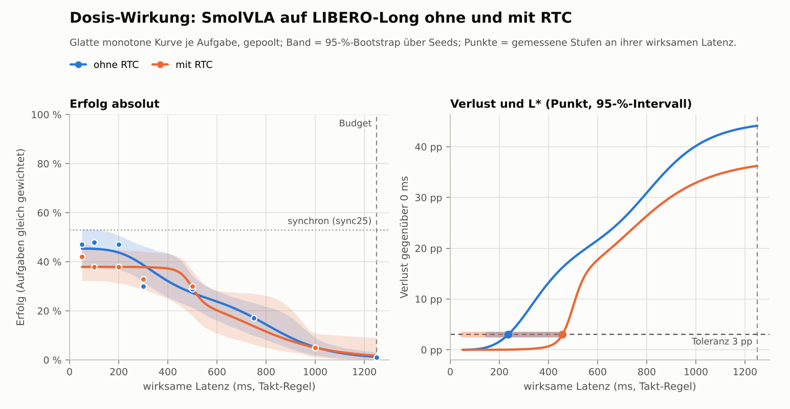
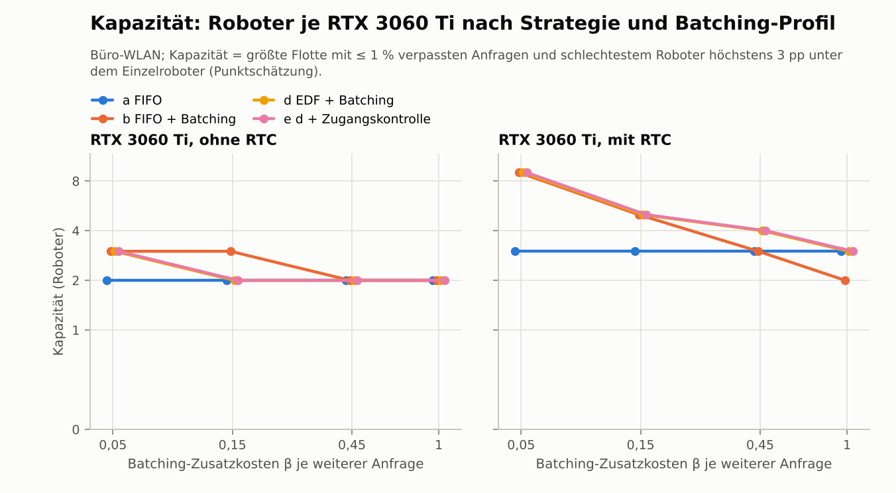
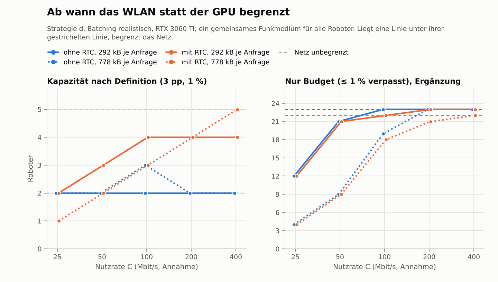
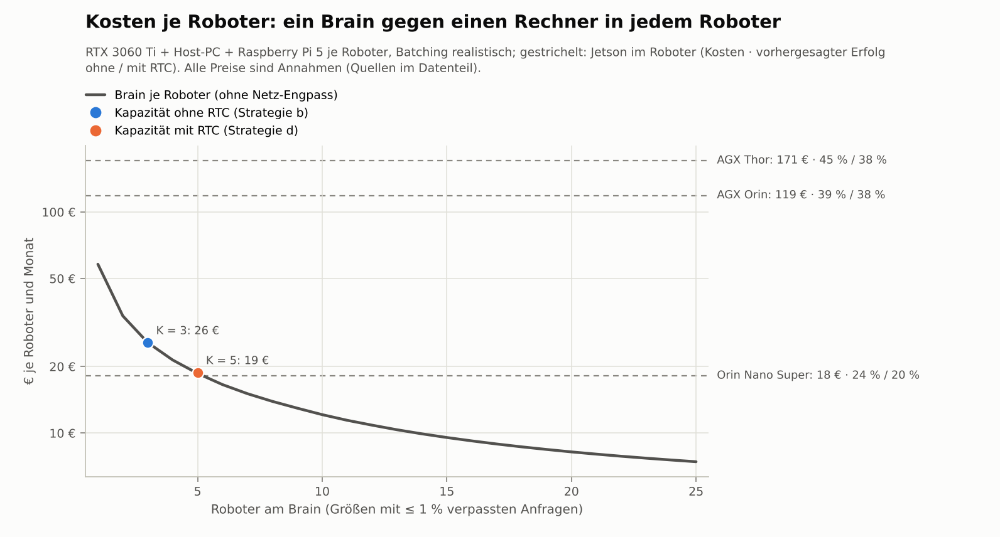

# Kortyn Phase 4 – Real-Time Chunking: Bedient ein Brain viele Roboter ohne nennenswerten Qualitätsverlust?

**Zentrale Frage:** Kann Real-Time Chunking (RTC) SmolVLA so verzögerungstolerant machen, dass ein Brain viele
Roboter ohne nennenswerten Qualitätsverlust bedient?

_Stand 27.10.2026, 05:35 UTC. Alles in Simulationszeit auf einer CPU-Maschine (4 vCPU, keine GPU).
GPU-Servicezeiten sind benannte Annahmen (RTX 3060 Ti: 220 ms je Plan, mit RTC 222,5 ms; Batching-Profile aus
Phase 3). Erfolgsquoten sind echte LIBERO-Rollouts. Vorab festgelegt in
[`reports/phase4_preregistration.md`](phase4_preregistration.md) (Commit `f993fd6`, 26.10. 18:33 UTC, vor dem
ersten Lauf). Rohtabellen in [`reports/phase4_data.md`](phase4_data.md), erzeugt mit
`python -m kortyn.report_phase4`._

## Ergebnis in Kürze

| Frage | Antwort |
|---|---|
| **Macht RTC SmolVLA verzögerungstolerant?** (H1, präregistriert) | **Nein, nicht nachweisbar.** Mittlerer Gewinn über die 25 Takte im Budget: **−1,6 pp [−6,1; +3,4]**. RTC macht die Kurve flacher, aber indem es ihr oberes Ende abschneidet: bis 250 ms 38 % statt 42–45 %, nur zwischen 350 und 500 ms 2–6 pp besser, darüber wieder gleich oder schlechter. |
| **L* ohne / mit RTC** (größte Latenz mit ≤ 3 pp Verlust gegenüber 0 ms derselben Bedingung) | **200 ms** (konservativ 150, obere Grenze 450) gegen **450 ms** (konservativ 50, obere Grenze 450). ΔL* = +250 ms [−200; +300]: nicht nachgewiesen (H2, Teststärke vorab als gering ausgewiesen). Der Gewinn ist relativ: Bei L* liefert RTC 35 % Erfolg, ohne RTC 44 %. |
| **RTC bei 0 ms wie synchron?** (R-RTC) | **Nicht erfüllt.** 42 % gegen 53 % (`sync25`), −11 pp [−23; +1], McNemar p = 0,13. Die untere KI-Grenze verfehlt −15 pp. Ein Teil ist nicht RTC: Ohne RTC liegt 0 ms bei 47 %. RTC kostet bei kleiner Latenz zusätzlich 5–10 pp, fast nur in Aufgabe 0. |
| **Verlustfreier Codec** | **zstd Stufe 9 wird Standard:** bitgleiche Bilder und tensorgleiche Modelleingaben (500/500 Anfragen), 292 statt 778 kB je Anfrage (−62 %), 1,9 statt 5,0 Mbit/s je Roboter, 17 ms Kodieren + Dekodieren. |
| **Roboter je RTX 3060 Ti** (Kapazität, präregistriert; Batching realistisch) | Ohne RTC: **a 2, b 3, d 2, e 2**. Mit RTC: **a 3, b 5, d 5, e 5**. Konservativ (97,5-%-Quantil) überall 2. Mit optimistischem Batching und RTC 9, mit pessimistischem 4. |
| **Was bringt RTC der Flotte absolut?** | **Etwa einen Roboter.** Der schlechteste Roboter erreicht mit RTC bei 5 Robotern 35,7 %, ohne RTC bei 4 Robotern 35,9 % und bei 5 Robotern 34,2 %. Bis 3 Roboter ist ohne RTC besser. Den Sprung bei Strategie d von 2 auf 5 erzeugt vor allem das relative 3-pp-Kriterium: RTC senkt den Einzelroboter von 40,6 auf 37,8 % und damit die Messlatte. |
| **Engpass: GPU oder WLAN?** | **Bis zur Kapazität die Kurve, dahinter die GPU.** Nach dem Budget allein trägt die Karte 22–23 Roboter (GPU zu 100 % belegt). Das WLAN bremst erst darunter: mit Codec ab 13 Robotern bei 25 Mbit/s und ab 22 bei 50 Mbit/s Nutzrate, ab 100 Mbit/s nie. Rohbilder sättigen dasselbe WLAN schon ab 5, 10 und 19–20 Robotern: **Der Codec verdreifacht die Flotte, die ein langsames WLAN trägt.** |
| **Stimmt die Vorhersage?** (Validierung, präregistriert) | **Im präregistrierten Sinn ja, aber mit Abschlag.** Beide Fälle erfüllen das Kriterium: 5 Roboter 31,7 % gemessen gegen 43,4 % vorhergesagt (−11,7 pp [−24,6; +1,8]), 10 Roboter 38,0 % gegen 45,4 % (−7,4 pp [−21,4; +8,6]; 50 statt 60 Episoden, Speichergrenze). Gepoolt (nach Sichtung) −9,7 pp [−18,8; −0,6], etwa die Hälfte davon ist Glättung der Kurve. Das Warteschlangenmodell trifft die Latenzen auf 20 ms. |
| **Woher kam der Phase-3-Bias?** (Re-Test) | **Aus einem Renderfehler der Flotten-Rollouts.** Mehrere LIBERO-Simulatoren in einem Prozess löschten sich gegenseitig Render-Ressourcen, die Roboter sahen falsche Bilder. Das traf die Phase-3-Validierung und den ersten Lauf dieser Phase (10 % statt 43 %). Behoben in `4c83bac`, Einzelroboter-Läufe waren nicht betroffen. Der präregistrierte Re-Test (−19,6 pp, „nicht erklärt“) misst gegen diese fehlerhaften Flotten. Zusätzlich war die Phase-3-Stufe 500 ms für Aufgabe 8 zu niedrig: 26 % gegen 46 % in frischen Prozessen und 44 % in Block A. |
| **Ist das Brain bei gleichem Erfolg günstiger?** | **Gegen langsame Jetsons ja, gegen schnelle nein.** Orin-Nano-Super-Niveau (20–24 %): 16–17 Roboter je RTX 3060 Ti für 8,93–9,22 € statt 18,16 € je Roboter und Monat. AGX-Orin-Niveau (38–39 %): 1–2 Roboter für 34–58 € statt 118,83 €. Das Thor-Niveau (45 %) erreicht kein Brain, auch nicht mit einem einzigen Roboter (40,6 %). |
| **Trägt die Geschäftsidee?** (Regel aus Abschnitt 8) | **Formal „trägt“**: Mit RTC bedient das Brain 5 Roboter (≥ 4) bei 35,7 % für 18,80 € je Roboter und Monat. Das günstigste Gerät mit mindestens diesem Erfolg ist der AGX Orin (37,8 %) für 118,83 €. **Inhaltlich dünn:** Der Vorteil kommt aus dem Teilen der Hardware, nicht aus RTC, und gilt nur gegen langsame Rechner im Roboter. Mit dem Validierungsabschlag schrumpft er gegen den Orin Nano Super auf Faktor 1–1,5, und das AGX-Orin-Niveau erreicht das Brain nicht mehr. |

**Für die Geschäftsfrage:** Die Hypothese dieser Phase hält nicht. RTC in der LeRobot-Implementierung macht
SmolVLA nicht verzögerungstoleranter, es tauscht Erfolg bei kleiner Latenz gegen etwas Erfolg bei 350–500 ms.
Das Brain gewinnt trotzdem, aber über die Kostenstruktur, nicht über RTC: Eine geteilte RTX 3060 Ti kostet je
Roboter einen Bruchteil eines Jetson AGX Orin und hält dabei fast dessen Erfolg. Gegen schnelle Hardware im
Roboter (Thor, 50 ms) verliert jedes Brain mit 220 ms Servicezeit beim Erfolg, weil SmolVLA schon bei 250 ms
Latenz Erfolg verliert. Der Hebel ist nicht der Scheduler und nicht RTC, sondern die Servicezeit des Brains
(kompilierte oder C++-Laufzeit) und eine Policy, die Latenz verträgt. Die Validierung bestätigt die Methode,
liegt aber rund 10 pp unter der Kurve: Im ungünstigsten Fall bleibt vom Kostenvorteil gegen den Orin Nano Super
nur Faktor 1–1,5.

## 1. Ablauf

| Zeit (UTC) | Schritt |
|---|---|
| 26.10. 17:10–18:33 | Branch und PR, RTC-Recherche, Laufzeitmessung, Power-Analyse; **Präregistrierung committet** (`f993fd6`, 18:33) |
| 18:42 | Codec-, RTC- und Auswertungscode committet (`55e3d1f`); fester Code-Stand aller Rollouts ist der Worktree auf `3fa4d62` |
| 18:42–18:48 | **R0 nicht bestanden** (3 von 4 Phase-3-Episoden nicht reproduziert), Diagnose: LIBERO trägt Zustand zwischen Episoden; alle Stufen ohne RTC werden neu gemessen; Kürzungen 1 und 2 |
| 18:49–23:07 | **Block A** ohne RTC: 8 Stufen × 100 Episoden. Container-Neustart um 21:19, Fortsetzung ab 21:24 |
| bis 20:07 | Stufe 1 ohne RTC (Warteschlangen-Simulation) neben Block A |
| 23:07–23:33 | RTC-Mehraufwand (30 Paare), Codec-Messung, **Kürzung 3** (23:12) |
| 23:34–02:34 | **Block B** mit RTC: 6 Stufen × 100 Episoden, Standard-Codec |
| 23:35–00:20 | Re-Test, Sensitivität, Stufe 1 mit RTC und mit WLAN-Modell (neben Block B) |
| 27.10. 02:35–02:46 | Kurven, L*, Kapazität, Wirtschaftlichkeit |
| 02:41–02:43 | Validierung: erster Start bricht beim Fork ab (`ENOMEM`), Korrektur, Neustart |
| 02:43–03:22 | Erster Validierungslauf, d mit 5 Robotern: **ungültig** (Renderfehler, Abschnitt 5.4); der Fall mit 10 Robotern startet nicht |
| 02:50–04:04 | Ergänzung: Frischprozess-Diagnose (50 Episoden, ein Prozess je Episode) |
| 03:02–03:40 | Diagnose (Replay, Inferenz im Simulationsprozess, Spur der Kontext-Freigaben), Korrektur `4c83bac` mit Test |
| 03:45–04:50 | **Validierung** neu: d mit 5 Robotern (60 Episoden, bis 04:29), dann mit 10 Robotern; dieser Fall endet um 04:50 an der Speichergrenze nach 50 von 60 Episoden |
| 04:50–05:35 | Auswertung, Report, README, Abnahme |

Die Präregistrierung schätzte ≈ 11,8 h bis ≈ 05:00 UTC. Die Läufe endeten um 04:50, die Phase um 05:35 UTC (≈ 12,4 h).
R0 (≈ +2,2 h), der Container-Neustart (≈ +0,25 h) und der Renderfehler (≈ +1 h) kosteten mehr, als die drei
präregistrierten Kürzungen sparten (≈ 1,7 h). Alle Abweichungen mit Zeitpunkt und Grund stehen am Ende dieses
Reports.

## 2. Schritt 1: verlustfreier Bildtransport

**Umsetzung.**

- **Kandidaten** wie präregistriert, alle auf die zwei übereinander gestapelten Kamerabilder je Anfrage:
  - PNG (OpenCV), Stufe 1 und 6
  - WebP verlustfrei (Pillow, `lossless=True, exact=True`), `method` 0 und 4
  - zstd auf den Rohbytes, Stufe 3 und 9
- **Konfiguration** über `image_transport: {codec, level}`. Ohne Angabe bleibt roh, alle bisherigen Modi sind
  unverändert reproduzierbar.
- **Schutz des Brains:** Die Dekodierer prüfen Bildgröße und Kanalzahl gegen die angekündigte Form. zstd
  dekomprimiert höchstens die erwartete Bytezahl (keine Dekompressionsbombe). Unbekannte Kodierungen sind ein
  Fehler.

**Bitgleichheit, zweifach nachgewiesen** (Abnahmekriterium 3):

1. `tests/test_codec.py`: decode(encode(x)) == x für Rauschbilder, einfarbige Bilder, einen Kanal und jede
   Stufe.
2. `kortyn.bench_codec` auf 1 000 echten LIBERO-Bildern aus 500 Anfragen (100 Episoden, Takte 0–200): Für
   jeden Kandidaten sind **alle Bilder bitgleich und alle 500 Modelleingaben tensorgleich** (`torch.equal`
   nach der Vorverarbeitung des Brains).

| Kandidat | Bytes je Anfrage (Mittel / p95) | Anteil an roh | Mbit/s je Roboter | Kodieren + Dekodieren | ≤ 25 ms |
|---|---:|---:|---:|---:|---|
| roh | 777 638 / 777 638 | 100 % | 4,98 | 0,3 ms | ja |
| png_1 | 260 451 / 318 875 | 33 % | 1,67 | 27,8 ms | nein |
| png_6 | 228 109 / 289 066 | 29 % | 1,46 | 83,8 ms | nein |
| webp_0 | 190 967 / 250 971 | 25 % | 1,22 | 47,3 ms | nein |
| webp_4 | 154 562 / 206 111 | 20 % | 0,99 | 297 ms | nein |
| zstd_3 | 312 361 / 403 274 | 40 % | 2,00 | 6,0 ms | ja |
| **zstd_9** | **291 912 / 381 063** | **38 %** | **1,87** | **17,1 ms** | **ja** |

**Entscheidung nach der Regel:** **zstd Stufe 9 wird Standard.** Es hat die kleinsten Bytes unter den Kandidaten
mit ≤ 25 ms Kodieren plus Dekodieren. zstd_3 ist 7 % größer, also kein Gleichstand. Bandbreite je Roboter:
1,87 statt 4,98 Mbit/s (−62 %). Block B und die Validierung laufen mit zstd_9; Block A lief mit roh, was wegen
der Bitgleichheit dieselben Modelleingaben ergibt.

- **Was PNG und WebP kosten:** Sie komprimieren stärker (bis 20 % von roh), sprengen aber die Zeitgrenze, vor
  allem beim Kodieren im Roboter.
- **Einschränkung:** Die Zeiten stammen von einem Xeon-Kern. Ein Raspberry Pi 5 kodiert schätzungsweise 3- bis
  5-mal langsamer; zstd_9 läge dann bei 50–80 ms, zstd_3 bei 15–25 ms. Auf schwacher Roboter-Hardware ist
  zstd_3 die sichere Wahl (7 % mehr Bytes).
- **Phase 3 zum Vergleich:** JPEG q90 brauchte 42 kB je Anfrage, kostete aber möglicherweise Erfolg (Phase 3,
  Abschnitt 2.3). Verlustfrei heißt: kein Erfolgsrisiko, dafür 7-mal mehr Bytes als JPEG.

## 3. Schritt 2: RTC in Brain und Agent

**Umsetzung, ohne LeRobot zu verändern.**

- **Brain:** Für ein Profil mit `rtc:` setzt Kortyn LeRobots eigenen Konfigurations-Hook: `RTCConfig(enabled,
  prefix_attention_schedule=EXP, max_guidance_weight=10)`, dann `init_rtc_processor()`. Je Anfrage ruft es
  `predict_action_chunk(batch, noise, inference_delay=d, prev_chunk_left_over=…, execution_horizon=H)`. Kein
  Fork, keine kopierte LeRobot-Zeile.
- **Agent:** Er schickt den Rest seines laufenden Plans als Führung mit, im Format der Phase-2-Führung: die
  aktuelle Aktion und die 24 gequeuten (H = 25). Die ersten d davon laufen bis zum neuen Plan sicher noch
  (Gewicht 1), die übrigen führen weich. Das Brain liest daraus d und H und normalisiert die Aktionen mit dem
  Normalisierer der Policy.
- **Kaltstart:** Der erste Plan einer Episode und jeder Plan nach leerer Queue läuft ohne Führung.
- **Strategie `rtc`** = „halten“ aus Phase 3 plus RTC. Alle bisherigen Strategien bleiben per Konfiguration
  unverändert. Eine Führung an eine Policy ohne RTC ist ein Konfigurationsfehler.
- **Tests** (`tests/test_rtc.py`, präregistrierte Prüfungen 1–3):
  - RTC aus und RTC ohne Vorgänger sind bitgleich zum Pfad ohne RTC.
  - Mit Vorgänger liegen die ersten d Aktionen näher am alten Plan.
  - Der Agent führt nur einen laufenden Plan fort.
- **Eigenheit von LeRobot 0.6.1** (vorab festgehalten): `denoise_step` wertet v_t aus, bevor x_t Gradienten
  verlangt. Die Korrektur ist damit der gewichtete Fehler selbst, ohne Vektor-Jacobi-Produkt durch das Netz.
  Gemessen wird diese Implementierung, nicht das Verfahren aus dem RTC-Paper.

**Mehraufwand je Anfrage** (ein CPU-Thread, LIBERO-Eingabe, 5 Aufwärm-Inferenzen, 30 abwechselnde Paare, d = 5,
H = 25): Median 2 439 ms ohne, 2 467 ms mit RTC, **r = +1,1 % [−0,4; +6,6]**. Die Servicezeit mit RTC auf der
RTX 3060 Ti ist damit 220 ms · 1,011 = 222,5 ms. RTC kostet also kaum Rechenzeit. Das folgt direkt aus der
fehlenden Rückwärtsrechnung.

### 3.1 R-RTC: RTC bei 0 ms gegen die synchrone Referenz

| Paare | `sync25` (Phase 3) | RTC bei 0 ms | Differenz [95-%-KI] | nur sync / nur RTC | McNemar p | Urteil |
|---:|---:|---:|---|---|---:|---|
| 100 | 53 % | 42 % | −11 pp [−23; +1] | 27 / 16 | 0,126 | **nicht erfüllt** |

Kriterium 1 (p ≥ 0,05) ist erfüllt, Kriterium 2 (untere KI-Grenze ≥ −15 pp) nicht. Nach der Power-Analyse
bestand diese Prüfung bei einer wahren Quote von 46 % nur mit 39 % Wahrscheinlichkeit. Abnahmekriterium 4 ist
damit **nicht erfüllt**. Die RTC-Läufe liefen wie präregistriert weiter; alle Schlüsse mit RTC sind unter diesem
Vorbehalt zu lesen.

**Woran es liegt, gepaart je Stufe** (gleiche Seeds, gleiche Zufallsströme; Ergänzung, ohne Gate):

| Latenz | ohne RTC | mit RTC | Differenz [95-%-KI] | nur ohne / nur mit | McNemar p | Aufgabe 0 | Aufgabe 8 |
|---|---:|---:|---|---|---:|---:|---:|
| 0 ms | 47 % | 42 % | −5 pp [−18; +7] | 23 / 18 | 0,53 | −14 pp | +4 pp |
| 100 ms | 48 % | 38 % | −10 pp [−21; +1] | 22 / 12 | 0,12 | −24 pp | +4 pp |
| 200 ms | 47 % | 38 % | −9 pp [−21; +3] | 23 / 14 | 0,19 | −16 pp | −2 pp |
| 300 ms | 30 % | 33 % | +3 pp [−7; +13] | 11 / 14 | 0,69 | +2 pp | +4 pp |
| 500 ms | 29 % | 30 % | +1 pp [−9; +11] | 12 / 13 | 1,00 | ±0 pp | +2 pp |
| 1 000 ms | 5 % | 5 % | ±0 pp [−5; +5] | 3 / 3 | 1,00 | ±0 pp | ±0 pp |

- **Zwei Effekte addieren sich:** Asynchron bei 0 ms liegt schon ohne RTC 6 pp unter `sync25` (der neue Plan
  greift einen Takt später, Kaltstart). RTC kostet bei kleiner Latenz weitere 5–10 pp.
- **Der RTC-Verlust sitzt in Aufgabe 0** (−14 bis −24 pp bis 200 ms, je 50 Episoden). Aufgabe 8 bleibt gleich.
  Einzeln ist keine Stufe signifikant; die Richtung ist aber in allen drei Stufen bis 200 ms dieselbe.
- **Wahrscheinliche Ursache: die präregistrierte Führungslänge H = 25.** Bei kleiner Latenz (d = 1 Takt) zieht
  die Führung nicht nur die eine fixierte Aktion, sondern 24 weitere Aktionen in Richtung des alten Plans, der
  1,25 s früher beobachtet wurde. Der neue Plan reagiert dadurch langsamer auf das, was er sieht. LeRobot
  empfiehlt 8–12; die Präregistrierung wählte 25, damit auch große d vollständig geführt werden. Bei großer
  Latenz (300–500 ms) hilft genau diese Führung. Geprüft ist diese Erklärung nicht (nächster Schritt).
- **Kein Hinweis auf einen Integrationsfehler:** Die Unit-Tests belegen Bitgleichheit ohne Führung und die
  Wirkung der Führung. Die Aufgabe-8-Episoden laufen mit RTC gleich gut, und bei 300–500 ms ist RTC leicht
  besser. Ein Fehler im Datenpfad würde alle Stufen treffen.

## 4. Schritt 3: Dosis-Wirkung ohne und mit RTC

100 gepaarte Episoden je Stufe (Aufgaben 8 und 0 × Init-States 0–49, Seeds 1000–1099), Kaltstart, Strategie
„halten“ bzw. `rtc`. Ohne RTC sind nach R0 alle Stufen im Budget neu gemessen (Block A); 1 500 und 2 000 ms
stammen aus Phase 3 (0/100 und 0/100, nur Schwanzregel). Mit RTC entfielen 750 und 1 250 ms (Kürzungen 1
und 3).

### 4.1 Messung und glatte Kurven

| Latenz | 0 | 100 | 200 | 300 | 500 | 750 | 1 000 | 1 250 ms |
|---|---:|---:|---:|---:|---:|---:|---:|---:|
| ohne RTC, gemessen | 47 % | 48 % | 47 % | 30 % | 29 % | 17 % | 5 % | 1 % |
| ohne RTC, Kurve [95-%-Band] | 45 [37; 53] | 45 [37; 53] | 44 [37; 51] | 39 [32; 46] | 27 [21; 35] | 17 [10; 23] | 5 [2; 9] | 1 [0; 3] |
| mit RTC, gemessen | 42 % | 38 % | 38 % | 33 % | 30 % | – | 5 % | – |
| mit RTC, Kurve [95-%-Band] | 38 [32; 48] | 38 [32; 46] | 38 [31; 45] | 38 [29; 44] | 29 [18; 36] | 14 [6; 27] | 5 [1; 11] | 2 [0; 9] |
| Differenz der Kurven | −7,4 pp | −7,3 pp | −5,8 pp | −0,9 pp | +2,1 pp | −3,5 pp | −0,2 pp | +0,5 pp |

**Kurvenmodell** (präregistriert, Abschnitt 5.2): log-logistisch je Aufgabe über die wirksame Latenz
(Takt-Regel), gepoolt mit gleichen Gewichten. Alle vier Anpassungen bestehen den Anpassungstest; die
Ausweichkurve griff nie.

| Bedingung | Aufgabe | p (Plateau) | x₅₀ | Steilheit h | GOF p |
|---|---|---:|---:|---:|---:|
| ohne RTC | 0 | 45 % | 370 ms | 4,2 | 0,65 |
| ohne RTC | 8 | 45 % | 843 ms | 7,6 | 0,57 |
| mit RTC | 0 | 28 % | 501 ms | 20,0 (Schranke) | 0,92 |
| mit RTC | 8 | 48 % | 788 ms | 5,6 | 0,30 |

**Ohne RTC: flach bis 200 ms, dann ein Sprung.** Bis 200 ms verliert SmolVLA nichts (47–48 %), bei 300 ms
schon 17 pp. Die Phase-3-Annahme einer konvexen Kurve (lineare Interpolation 46 % → 20 % zwischen 0 und
500 ms) ist widerlegt: Die Kurve ist bis 250 ms konkav und liegt über der Sehne.

**Mit RTC: flach bis 400 ms, aber tiefer.** Aufgabe 0 verliert ihr Plateau (28 statt 45 %), hält es dafür bis
fast 500 ms und fällt dann senkrecht (h an der Schranke 20). Aufgabe 8 bleibt praktisch unverändert.

### 4.2 L*, H1 und H2

| Bedingung | L* (Punkt) | konservativ (2,5 %) | obere Grenze (97,5 %) | x* (stetig) | Erfolg bei 0 ms | Erfolg bei L* |
|---|---:|---:|---:|---:|---:|---:|
| ohne RTC | **200 ms** | 150 ms | 450 ms | 236 ms | 45 % | 44 % |
| mit RTC | **450 ms** | 50 ms | 450 ms | 457 ms | 38 % | 35 % |

| Hypothese | Schätzung | 95-%-KI (gepaart) | Urteil |
|---|---|---|---|
| H1: mittlerer Gewinn über die 25 Takte im Budget | −1,6 pp | [−6,1; +3,4] | **nicht nachweisbar** |
| H2: ΔL* = L*(mit) − L*(ohne) | +250 ms | [−200; +300] | **nicht nachgewiesen** |

**Lesart:**

- **L* verdoppelt sich im Punkt, aber nur relativ.** L* misst den Verlust gegenüber der eigenen 0-ms-Stufe.
  RTC senkt diese Stufe um 7 pp. Bei 450 ms liefert RTC 35 %, ohne RTC 30 %; bei 200 ms ohne RTC 44 %. Wer
  absolute Qualität braucht, ist ohne RTC bis 300 ms besser.
- **Das konservative L* mit RTC ist 50 ms:** Die Bootstrap-Unsicherheit der RTC-Kurve ist groß (Aufgabe 0 mit
  senkrechtem Abfall). Die präregistrierte Teststärke für H2 lag bei 0–18 %; ein Nichtnachweis ist kein Beleg
  gegen eine Verschiebung.
- **H1 ist das primäre Kriterium und hatte Teststärke** (75–100 % bei einer Streckung der Latenzachse um 1,5).
  Das KI schließt einen mittleren Gewinn über 3,4 pp aus. Die präregistrierte Erwartung „RTC streckt die
  Kurve“ (k = 1,5 entspräche +5 bis +9 pp) ist damit praktisch ausgeschlossen.

### 4.3 Re-Test des Phase-3-Validierungsbias: formal nicht erklärt, tatsächlich ein Renderfehler

Die neue Kurve ohne RTC sagt die 180 informativen Phase-3-Validierungsepisoden voraus (präregistriert, 5.4):

| Vorhersage | gemessen − vorhergesagt [95-%-KI] |
|---|---|
| dichte Kurve, eigene Latenzen | **−19,6 pp [−26,8; −11,7]** |
| dichte Kurve, Latenzen aus Stufe 1 | −18,8 pp [−26,0; −11,1] |
| Phase-3-Regel (zum Vergleich) | −7,4 pp [−17,1; +2,1] |
| Sensitivität: dichte Kurve mit gepoolten Phase-3-Stufen (nicht präregistriert) | −17,0 pp [−24,1; −9,2] |

**Urteil: nicht erklärt** (Schwelle für „verkleinert“: |Bias| ≤ 3,7 pp). Die Phase-3-Vermutung (lineare
Interpolation einer konvexen Kurve) ist widerlegt: Die dichte Kurve liegt zwischen 0 und 500 ms über der Sehne,
nicht darunter. Die echten Phase-3-Flotten erreichten bei 460–725 ms Latenz (Median) 10–17 %, die dichte Kurve sagt
28–36 % voraus.

**Nachträglich erklärt: Die Phase-3-Flotten waren fehlerhaft.** Die Validierung dieser Phase deckte einen
Renderfehler auf, der jede Flotte mit mehreren Simulatoren in einem Prozess trifft (Abschnitt 5.4). Die
180 Phase-3-Episoden, gegen die der Re-Test misst, stammen aus solchen Flotten. Ihr Erfolg ist zu niedrig
gemessen; der Bias von −19,6 pp ist kein Befund über die Kurve. Das präregistrierte Urteil bleibt formal
„nicht erklärt“, die Frage, ob die Vorhersage stimmt, beantwortet die korrigierte Validierung.

**Was die Eingrenzung vorher ergeben hatte:**

- **Kein Kurvenproblem:** Anpassungstest p ≥ 0,57. Mit den Phase-3-Stufen gepoolt bleibt der Bias bei −17 pp.
- **Der Test auf Störung zwischen Simulatoren war zu schwach:** Zwei Simulatoren, verschränkt gesteppt, liefen
  bitgleich. Der Fehler braucht einen Reset, während ein *anderer* Simulator seinen Kontext aktiv hat; im Test
  baute der zweite Simulator erst bei seinem Reset auf.
- **Die 500-ms-Stufe selbst unterscheidet sich zwischen den Messungen:** Aufgabe 8 erreichte bei 500 ms in
  Block A 44 %, in Phase 3 26 % (gleiche Seeds, gleicher Code; McNemar p = 0,049). Aufgabe 0 stimmt überein
  (14 und 14 %). Das betrifft Einzelroboter-Läufe, also nicht den Renderfehler; Abschnitt 4.4 prüft es.

### 4.4 Ergänzung: Hängt der Erfolg an der Reihenfolge der Episoden?

Aufgabe 8 lag bei 500 ms in Block A bei 44 %, in Phase 3 bei 26 %, mit gleichen Seeds und gleichem Code.
Beide Läufe unterscheiden sich nur in der Folge der Episoden je Prozess, und LIBERO trägt Zustand von Episode
zu Episode (R0). Ergänzung (festgelegt um 23:50, vor jedem Lauf): dieselben 50 Episoden, jede in einem eigenen,
frischen Prozess (`libero_fresh.yaml`).

| Vergleich (50 gepaarte Seeds) | Erfolg | Differenz frisch − Vergleich [95-%-KI] | nur Vergleich / nur frisch | McNemar p |
|---|---:|---|---|---:|
| frischer Prozess | **46 %** | – | – | – |
| Block A (alle Stufen eines Seeds nacheinander) | 44 % | +2 pp [−14; +18] | 8 / 9 | 1,00 |
| Phase 3 | 26 % | **+20 pp [+4; +36]** | 4 / 14 | 0,031 |

- **Block A steht:** Frische Prozesse treffen seine Quote. Die Reihenfolge ändert einzelne Episoden (17 von 50
  fallen anders aus), aber nicht die Quote.
- **Die Phase-3-Stufe war zu niedrig.** Der Renderfehler scheidet aus: `run_virtual` nutzt je Worker einen
  Simulator, Episoden laufen nacheinander. Ob ein Zufall (p = 0,031 bei mehreren Vergleichen) oder der andere
  Laufkontext in Phase 3 (dort liefen vor 500 ms unter anderem synchrone und JPEG-Episoden desselben Seeds)
  die Ursache ist, bleibt offen. Für Kortyn zählt: Die Phase-4-Kurven sind die belastbare Referenz; Phase 3
  hat den Erfolg bei 500 ms für Aufgabe 8 unterschätzt.

> **Nachtrag aus Phase 5 (29.10.2026): Ursache gefunden.** Der Zustand, den LIBERO von Episode zu Episode
> trägt, ist die Position des Herds in Aufgabe 8. LIBERO hängt bei jedem Hard Reset einen weiteren
> Ein/Aus-Sampler an eine Liste, die nie geleert wird. Jeder Sampler verbraucht vor dem Platzieren der
> Einbauten eine Zufallszahl, also verschiebt sich die Herd-Position mit der Zahl der Resets des Simulators.
> Der Herd steht im Modell (`body_pos`), nicht im Init-State. Aufgabe 0 hat kein solches Objekt und
> reproduziert sich Episode für Episode. Die Phase-3-Stufe war deshalb weder „falsch“ noch reproduzierbar:
> Sie stammt aus anderen Herd-Positionen. Behoben in `kortyn/libero_env.py` (Commit `7fc321f`); Details,
> Kontrollmessung und betroffene Aussagen: `paper/report.md`, Abschnitt 4.8.

## 5. Schritt 4: Kapazität, WLAN und Validierung

**Stufe 1** (Warteschlangen-Simulation in Simulationszeit, Einstellungen wie Phase 3): RTX 3060 Ti
(s₁ = 220 ms, mit RTC 222,5 ms), vier Batching-Profile, Strategien a, b, d, e, Büro-WLAN, jede Flottengröße ab
1, 5 Wiederholungen. Vorhersage je Roboter: Mittel der gepoolten Kurve seiner Bedingung über die Latenzen seiner
Anfragen.

### 5.1 Kapazität (präregistriert)

Kapazität = größte Flotte, bei der sie und jede kleinere (1) höchstens 1 % verpasste Anfragen und (2) einen
schlechtesten Roboter höchstens 3 pp unter dem Einzelroboter haben. In Klammern konservativ (Kriterium 2 mit
dem 97,5-%-Quantil).

| Batching | a FIFO | b FIFO + Batching | d EDF + Batching | e d + Zugangskontrolle |
|---|---|---|---|---|
| **realistisch, ohne RTC** | 2 (2) | **3** (2) | 2 (2) | 2 (2) |
| **realistisch, mit RTC** | 3 (2) | **5** (2) | **5** (2) | **5** (2) |
| optimistisch, ohne RTC | 2 (2) | 3 (2) | 3 (2) | 3 (2) |
| optimistisch, mit RTC | 3 (2) | 9 (3) | 9 (2) | 9 (2) |
| pessimistisch, ohne RTC | 2 (2) | 2 (2) | 2 (2) | 2 (2) |
| pessimistisch, mit RTC | 3 (2) | 3 (2) | 4 (2) | 4 (2) |
| kein Gewinn, ohne RTC | 2 (2) | 2 (2) | 2 (2) | 2 (2) |
| kein Gewinn, mit RTC | 3 (2) | 2 (2) | 3 (2) | 3 (2) |

- **Kriterium 1 bindet nie:** Bis zur Kapazität verpasst keine einzige Anfrage ihr Budget. Begrenzend ist
  immer das 3-pp-Kriterium, also die Kurve.
- **Warum schon 2–5 Roboter die Grenze sind:** Ein Roboter allein sieht ≈ 246 ms Latenz (Median; 220 ms GPU
  plus Netz) und liegt ohne RTC schon auf der Flanke (41 % statt 45 %). Jeder weitere Roboter streckt die
  Latenzen: Mit Strategie d liegt der Median des schlechtesten Roboters bei 249 ms (2 Roboter), 288 ms (4) und
  357 ms (5). Ab 300 ms fällt die Kurve ohne RTC steil.
- **Konservativ sind es überall 2:** Die Bootstrap-Unsicherheit der Kurve (1,5–3,7 pp je Kontrast, vorab
  geschätzt) frisst die 3-pp-Toleranz fast vollständig.
- **Batching und Strategie zählen kaum, solange die Kurve begrenzt:** Ohne RTC liegen alle Strategien bei 2–3.
  b liegt bei 3, weil es bis zu 25 ms auf weitere Anfragen wartet. Damit rutscht schon der Einzelroboter öfter
  in den 300-ms-Takt (38,8 statt 40,6 %), und das relative Kriterium bekommt mehr Spielraum.

### 5.2 Was RTC der Flotte absolut bringt

Erfolg des schlechtesten Roboters (Vorhersage, Strategie d, Batching realistisch, Mittel über 5
Wiederholungen); Ergänzung, ohne Gate:

| Roboter | 1 | 2 | 3 | 4 | 5 | 6 | 8 | 10 | 12 | 15 | 20 |
|---|---:|---:|---:|---:|---:|---:|---:|---:|---:|---:|---:|
| ohne RTC | **40,6** | **39,2** | **37,5** | 35,9 | 34,2 | 33,1 | 30,6 | 29,5 | 27,9 | **25,0** | **18,9** |
| mit RTC | 37,8 | 37,5 | 37,0 | **36,3** | **35,7** | **34,7** | **32,4** | **31,0** | **28,4** | 23,8 | 15,7 |
| Differenz | −2,8 | −1,7 | −0,5 | +0,4 | +1,5 | +1,6 | +1,8 | +1,5 | +0,5 | −1,2 | −3,2 |

- **Bis 3 Roboter ist ohne RTC besser, von 4 bis 12 mit RTC, um höchstens 1,8 pp.** Das liegt weit innerhalb des
  Kurvenbands (±7 pp).
- **Bei gleichem absolutem Erfolg gewinnt RTC etwa einen Roboter:** 35,7 % erreicht ohne RTC eine Flotte von 4,
  mit RTC eine von 5.
- **Der Kapazitätssprung von 2 auf 5 ist vor allem ein Effekt des relativen Kriteriums.** RTC senkt den
  Einzelroboter um 2,8 pp und damit die Messlatte, an der die Flotte gemessen wird.

### 5.3 Engpass: GPU oder WLAN

Geteiltes Funkmedium (FIFO, beide Richtungen) zusätzlich zum Latenzmodell des Büro-WLANs; Strategie d,
Batching realistisch. Nutzlast je Anfrage: 292 kB mit Standard-Codec bzw. 778 kB roh, Antwort 1,4 kB. Neben der
präregistrierten Kapazität steht die Kapazität nach dem Budget allein (Kriterium 1; Ergänzung, nicht
präregistriert): Sie zeigt, wo das Funkmedium sättigt.

| Nutzrate C | Kapazität mit RTC: WLAN (unbegrenzt) | Funk belegt bei K | nur Budget, Codec: WLAN (unbegrenzt) | Engpass | nur Budget, roh | Engpass |
|---|---|---:|---|---|---|---|
| 25 Mbit/s | 2 (5) | 15 % | 12 (22) | Netz ab 13 | 4 (22) | Netz ab 5 |
| 50 Mbit/s | 3 (5) | 11 % | 21 (22) | Netz ab 22 | 9 (22) | Netz ab 10 |
| 100 Mbit/s | 4 (5) | 8 % | 22 (22) | GPU | 18 (22) | Netz ab 19 |
| 200 Mbit/s | 4 (5) | 4 % | 23 (22) | GPU | 21 (22) | Netz ab 22 |
| 400 Mbit/s | 4 (5) | 2 % | 23 (22) | GPU | 22 (22) | GPU |

- **Nach der präregistrierten Definition „bremst das Netz“ mit RTC bei jeder Nutzrate** (Kapazität 2–4 statt 5).
  Ab 100 Mbit/s ist das aber keine Sättigung (Funk 2–8 % belegt). Die Übertragungszeit (23 ms je Anfrage bei
  100 Mbit/s, 6 ms bei 400 Mbit/s) schiebt den schlechtesten Roboter bei 5 Robotern knapp über die 3-pp-Grenze
  (Verlust 3,1–3,5 statt 2,2 pp). Bei 400 Mbit/s ist der Unterschied Rauschen der Simulation: Mit Rohbildern,
  also mehr Bytes, sind es dort wieder 5. Ohne RTC bleibt die Kapazität mit Codec bei jeder Nutzrate 2.
- **Wo die Hardware wirklich begrenzt:** Nach dem Budget allein trägt die RTX 3060 Ti 22–23 Roboter, die GPU ist
  dann zu 100 % belegt. Ab 100 Mbit/s Nutzrate (gutes Wi-Fi 5/6) begrenzt mit Codec die GPU, darunter das WLAN.
- **Der Codec verdreifacht die Flotte, ab der ein langsames WLAN bremst** (25 Mbit/s: 12 statt 4 Roboter,
  50 Mbit/s: 21 statt 9). Bei 100 Mbit/s bremsen Rohbilder ab 19 Robotern, der Codec gar nicht.
- **Für Kortyn:** Bei 5 Robotern je Brain ist das WLAN mit Codec kein Thema (≈ 9 Mbit/s Nutzdaten). Erst wenn
  die Kurve 15–20 Roboter erlaubt, braucht jedes Brain ein eigenes, gutes Funkmedium.

### 5.4 Validierung mit echten Flotten

**Konfiguration (präregistriert, 7.5):**

- **Strategie:** beste mit RTC nach Kapazität: d (b, d und e gleichauf bei K = 5; Reihenfolge d, e, b, a).
- **Rahmen:** RTX 3060 Ti mit RTC (s₁ = 222,5 ms), Batching realistisch, Büro-WLAN, Standard-Codec.
- **Flottengrößen:** n₁ = max(2, min(5, 8)) = 5 und n₂ = min(10, 16) = 10. Beide passen in den Speicher.
- **Umfang:** je Fall 60 gezählte Roboter-Episoden (Kürzung 2), Seeds 1000–1059 reihum, 4 Inferenz-Prozesse,
  Startzeiten wie Wiederholung 0 von Stufe 1.
- **Vorhersage je Episode:** Kurve ihrer Aufgabe mit RTC, gemittelt über die Latenzen ihres Roboters aus
  Stufe 1. Kriterium: Das 97,5-%-KI von gemessen − vorhergesagt enthält die Null.

#### Erster Lauf: ungültig, weil das Rendern mehrerer Simulatoren fehlerhaft war

Der erste Lauf mit 5 Robotern erreichte **10 % gegen 43 % vorhergesagt (−33 pp [−41; −24])**. Seeds, die in
Block B auf jeder RTC-Stufe gelingen, scheiterten in der Flotte. Den Fall mit 10 Robotern habe ich vor seinem
Start angehalten und die Ursache eingegrenzt (Ergänzung, nicht präregistriert):

1. **Replay als Einzelroboter.** Die erste Episode jedes der 5 Roboter, in einem frischen Prozess mit exakt den
   protokollierten Latenzen nachgespielt (`libero_diag_replay.yaml`): Anfragen und Takte sind identisch, bis
   die Flotten-Anfragen plötzlich fast doppelt so groß werden (374–597 statt ≈ 200 kB). Die Kamerabilder
   unterscheiden sich, die Latenzen nicht.
2. **Der Zeitpunkt ist vorhersagbar.** Die Bilder eines Roboters kippen beim ersten Rendern, nachdem ein
   *anderer* Roboter seinen Simulator zurückgesetzt hat, und zwar genau dann, wenn der betroffene Roboter vor
   diesem Reset zuletzt gerendert hatte. Das erklärt alle vier Divergenzen, ebenso die Resets, nach denen ein
   Roboter unverändert blieb.
3. **Nicht die Inferenz.** Mit der Policy im Simulationsprozess statt in den Worker-Prozessen divergieren die
   Roboter an exakt denselben Stellen.
4. **Ursache.** robosuite gibt beim Hard Reset oder Schließen eines Simulators dessen MuJoCo-Render-Ressourcen
   (`mjr_freeContext`: Texturen, Puffer, Offscreen-Framebuffer) in dem GL-Kontext frei, der gerade aktiv ist,
   nicht im eigenen. Mit mehreren Simulatoren in einem Prozess ist das der Kontext des Roboters, der zuletzt
   gerendert hat: Seine Ressourcen werden unter denselben Nummern gelöscht, seine Bilder sind bis zu seinem
   nächsten Reset falsch. Weil jeder Agent beim Start seine Beobachtung einmal prüft (`env.reset(seed=0)`),
   besitzt jeder Roboter schon vor seiner ersten Episode einen Simulator, und fast jeder Reset trifft einen
   fremden Roboter.
5. **Korrektur** (Commit `4c83bac`, Kortyn-Wrapper; LIBERO und robosuite unverändert): Vor jedem Hard Reset und
   Schließen setzt der Wrapper den Kontext des alten Simulators aktiv. Neuer Test: Reset und Schließen von
   Roboter B lassen die Bilder von Roboter A bitgleich zu A allein. Ohne Korrektur scheitert er.
6. **Bestätigung auf Flottenebene.** Im neuen Lauf sind die ersten Episoden aller 5 Roboter byte-gleich zu
   ihren Einzelroboter-Replays.

**Was betroffen ist und was nicht:**

- **Nicht betroffen:** alle Einzelroboter-Läufe, also die Dosis-Wirkung (Block A, Block B, Phase 3), R0, Codec-
  und RTC-Messung. Dort gibt ein Reset immer den eigenen, gerade aktiven Kontext frei (Spur aller Freigaben
  eines Einzelroboter-Prozesses). Die Stufe-1-Simulation rendert nicht.
- **Betroffen:** jede Flotten-Validierung mit echten Rollouts, auch die aus Phase 3. Deren Befund
  „Vorhersage 5–7 pp zu optimistisch“ und der Re-Test-Bias dieser Phase (Abschnitt 4.3) messen gegen
  fehlerhafte Flotten (Nachtrag in `reports/phase3.md`).

#### Gültiger Lauf

Korrigierter Code (`4c83bac`), sonst unverändert:

| Fall | Episoden | gemessen | vorhergesagt | Differenz [97,5-%-KI] | Kriterium | Latenz Median / p95: Stufe 1 → Rollouts |
|---|---:|---:|---:|---|---|---|
| d, 5 Roboter | 60 | 31,7 % | 43,4 % | −11,7 pp [−24,6; +1,8] | **erfüllt** | 345 / 495 → 325 / 476 ms |
| d, 10 Roboter | 50 (Abbruch) | 38,0 % | 45,4 % | −7,4 pp [−21,4; +8,6] | **erfüllt** | 425 / 575 → 429 / 575 ms |

**Validierung insgesamt: erfüllt** (präregistriertes Kriterium in beiden Fällen). Abnahmekriterium 5 ist damit
erfüllt.

- **Speichergrenze im Fall mit 10 Robotern:** Der Lauf endete nach 50 von 60 gezählten Episoden. Die Sandbox
  begrenzt den Speicher auf 13,4 GiB. Als alle zehn Roboter auf Aufgabe 0 wechselten (Seeds 1050–1059), deren
  Szene etwa doppelt so viel Speicher braucht wie die von Aufgabe 8 (gemessen: 3 Simulatoren 4,5 statt 2,3 GB),
  beendete der OOM-Killer den Prozess. Ausgewertet sind die 50 fertigen Episoden, alle Aufgabe 8. Die
  präregistrierte Ausweichregel (größte passende Flotte) hätte einen neuen Lauf über die 12-Stunden-Grenze
  hinaus gebraucht.
- **Das Warteschlangenmodell stimmt:** Die Latenzen der Rollouts treffen Stufe 1 auf 20 ms. Die Vorhersage aus
  den eigenen Latenzen jeder Episode ist praktisch dieselbe (43,4 und 45,4 %).
- **Aber beide Fälle liegen unter der Vorhersage:** gepoolt −9,7 pp [−18,8; −0,6] (Ergänzung nach Sichtung,
  Cluster-Bootstrap über die 60 Seeds, 110 Episoden). Die Flotten-Episoden sind byte-gleich zu Einzelroboter-
  Replays mit denselben Latenzen. Die Lücke liegt also in der Vorhersage aus der Kurve, nicht in der Flotte.
- **Etwa die Hälfte ist Glättung:** Mit den gemessenen RTC-Stufen (linear interpoliert) statt der glatten Kurve
  läge die Vorhersage bei 38,5 und 42,4 %, die Lücke bei −6,9 und −4,4 pp. Zwischen 250 und 450 ms liegt die
  Kurve über den Stufen (Aufgabe 8 bei 300 ms: 38 % gemessen, 48 % in der Kurve). Den Rest von ≈ 5 pp können
  schwankende Latenzen erklären, die das Kurvenmodell nur mittelt, oder Rauschen; mit 110 Episoden ist das nicht
  zu trennen.
- **Lesart:** Kapazitäten und Kosten dieses Reports sind eher optimistisch. Abschnitt 6.3 rechnet den Abschlag
  durch.

## 6. Schritt 5: Wirtschaftlichkeit

**Annahmen** (Details mit Quellen und Datum in [`phase4_data.md`](phase4_data.md), alle Preise netto, Stand
25.10.2026): Brain = PC ohne GPU (950 €, 70 W) plus RTX 3060 Ti (255 €, gebraucht, 200 W); je Roboter ein
Raspberry Pi 5 als Client (114,62 €, 6 W, 4,22 € je Monat). 36 Monate Abschreibung, Strom 0,2366 €/kWh, Betrieb
rund um die Uhr. Rechner im Roboter: Jetson Orin Nano Super (498,40 €, SmolVLA 567 ms), AGX Orin 64 GB
(3 967,06 €, 262 ms), AGX Thor (5 713,61 €, 50 ms). Ihr Erfolg kommt aus derselben Kurve bei ihrer
Inferenzzeit (ohne Netz).

| Gerät | Latenz | Erfolg ohne / mit RTC | € je Roboter und Monat |
|---|---:|---|---:|
| Jetson Orin Nano Super | 567 ms | 24 % / 20 % | 18,16 € |
| Jetson AGX Orin 64 GB | 262 ms | 39 % / 38 % | 118,83 € |
| Jetson AGX Thor | 50 ms | 45 % / 38 % | 170,80 € |

Kein Jetson profitiert von RTC: Bei ihren Latenzen liegt die RTC-Kurve gleich oder darunter.

### 6.1 Präregistrierte Entscheidungsregel: „trägt“

| Batching | Bedingung | Brain an der Kapazität | Referenz (günstigstes Gerät mit ≥ diesem Erfolg) | günstiger | K ≥ 4 |
|---|---|---|---|---|---|
| **realistisch** | **mit RTC** | **d, 5 Roboter, schlechtester 35,7 %, 18,80 €** | **AGX Orin (37,8 %, 118,83 €)** | **ja** | **ja** |
| realistisch | ohne RTC | b, 3 Roboter, 35,9 %, 25,66 € | AGX Orin (38,7 %, 118,83 €) | ja | nein |
| optimistisch | mit RTC | d, 9 Roboter, 35,0 %, 12,89 € | AGX Orin (37,8 %, 118,83 €) | ja | ja |
| optimistisch | ohne RTC | d, 3 Roboter, 37,7 %, 25,77 € | AGX Orin (38,7 %, 118,83 €) | ja | nein |

**Urteil nach Abschnitt 8: trägt.** Mit RTC und realistischem Batching ist das Brain 6,3-mal günstiger je
Roboter als das günstigste Gerät, das seinen Erfolg erreicht, und die Kapazität ist 5 ≥ 4. Ohne RTC verfehlt es
nur die Flottengröße (3 < 4), nicht den Preis.

### 6.2 Wo das Brain gewinnt und wo nicht

**Gleicher Erfolg** (größte Flotte, deren schlechtester Roboter den Erfolg des Geräts erreicht; Batching
realistisch, beste Strategie je Fall):

| Gegner | Erfolg des Geräts | Brain-Flotte auf diesem Niveau | € je Roboter: Brain | € je Roboter: Gerät | Gewinner |
|---|---:|---|---:|---:|---|
| Orin Nano Super, ohne RTC | 24 % | 16 Roboter (b, d, e) | 9,22 € | 18,16 € | **Brain, Faktor 2,0** |
| Orin Nano Super, mit RTC | 20 % | 17 Roboter (b, d, e) | 8,93 € | 18,16 € | **Brain, Faktor 2,0** |
| AGX Orin, ohne RTC | 39 % | 2 Roboter (a, d, e) | 33,99 € | 118,83 € | **Brain, Faktor 3,5** |
| AGX Orin, mit RTC | 38 % | 1 Roboter (a, d, e) | 58,14 € | 118,83 € | **Brain, Faktor 2,0** |
| Thor, ohne RTC | 45 % | keine (Einzelroboter am Brain: 40,6 %) | – | 170,80 € | **Thor** |
| Thor, mit RTC | 38 % | keine (Einzelroboter: 37,8 %, 0,1 pp darunter) | – | 170,80 € | **Thor** (knapp) |

**Das Brain gewinnt:**

- gegen langsame Rechner im Roboter (Orin Nano Super, AGX Orin), bei gleichem Erfolg um den Faktor 2–3,5;
- an seiner Kapazität (5 Roboter, 35,7 %) um den Faktor 6 gegen den AGX Orin, bei 2 pp weniger Erfolg;
- bei der Investition: 356 € je Roboter (5 Roboter je Brain plus Raspberry Pi) gegen 3 967 € für einen AGX Orin.

**Das Brain verliert:**

- gegen schnelle Rechner im Roboter: Den Erfolg eines Thor (45 %) erreicht es mit keiner Flottengröße. Die
  220 ms Servicezeit plus Netz liegen schon auf der Flanke der Kurve.
- überall dort, wo Erfolg mehr zählt als Hardwarekosten: Jeder zusätzliche Roboter kostet den schlechtesten
  Roboter 1–2 pp.
- ohne Batching: Strategie a hält das Orin-Nano-Niveau nur mit 5 Robotern; dann ist der Orin Nano günstiger.

**RTC ändert an diesem Bild wenig:** Die Kosten bei gleichem Erfolg sind ohne und mit RTC praktisch gleich
(9,22 gegen 8,93 € auf Orin-Nano-Niveau). RTC entscheidet nur, ob die präregistrierte Flottengröße 4 erreicht
wird.

### 6.3 Nicht in der Rechnung

- **Redundanz:** Ein zweites Brain als Reserve verdoppelt den Brain-Anteil. Auf Orin-Nano-Niveau (16 Roboter)
  steigen die Kosten von 9,22 auf ≈ 14,22 € je Roboter, der Vorteil schrumpft auf Faktor 1,3. Gegen den AGX Orin
  bei 5 Robotern (≈ 33,40 statt 18,80 €) bleibt Faktor 3,6.
- **WLAN:** Ein Access Point je 15–20 Roboter (≈ 150–300 €) kostet ≈ 0,3–0,6 € je Roboter und Monat.
- **Betrieb:** Software-Pflege, Updates und Überwachung, beim Brain zentral, beim Jetson je Roboter.
- **Der Validierungsabschlag** (Abschnitt 5.4). Ungünstigster Fall: Die 9,7 pp gelten für jede Flotte, aber
  nicht für die Rechner im Roboter (feste Latenz, wie die Kurve). Dann sinkt der schlechteste Roboter bei
  5 Robotern mit RTC auf ≈ 26 %. Auf Orin-Nano-Niveau trägt die RTX 3060 Ti mit RTC 10 Roboter für 12,14 €
  (statt 17 für 8,93 €; Gerät 18,16 €), ohne RTC nur 5 für 18,62–18,78 € (Gleichstand). Das AGX-Orin-Niveau
  erreicht das Brain in keiner Größe mehr. Die Entscheidungsregel bliebe formal bei „trägt“, weil sie das Brain
  gegen das günstigste Gerät mit *mindestens* seinem Erfolg misst, also gegen den AGX Orin.

## 7. Einordnung für Kortyn

**Die Hypothese dieser Phase ist widerlegt, die Geschäftsidee nicht.** Phase 3 hatte gefolgert: „RTC macht die
Kurve flacher und damit jede Kapazität größer.“ Flacher wird die Kurve, aber auf niedrigerem Niveau. Gemessen
am absoluten Erfolg bringt RTC einer Flotte etwa einen Roboter.

**Was die Wirtschaftlichkeit tatsächlich trägt:** Das Teilen der Hardware. Eine RTX 3060 Ti mit PC kostet
1 205 €, ein AGX Orin 3 967 €. Schon ein einzelner Roboter am Brain kostet je Monat halb so viel wie ein AGX
Orin (58 statt 119 €), zwei Roboter weniger als ein Drittel. Das gilt ohne RTC genauso.

**Blinde Flecken, die das Bild kippen können:**

1. **Das absolute Niveau.** Alle Zahlen bewegen sich bei 35–45 % Erfolg auf LIBERO-Long. Kein Kunde setzt eine
   Policy mit 40 % Erfolg produktiv ein. Ob die Latenzempfindlichkeit bei einer Policy mit 90 % Erfolg genauso
   aussieht, ist offen. Die Wirtschaftlichkeit hängt an der Kurve der Policy, die der Kunde wirklich einsetzt.
2. **Die Vorhersage für Flotten.** Die korrigierte Validierung besteht, liegt aber gepoolt ≈ 10 pp unter der
   Kurve. Im ungünstigsten Fall schrumpft der Kostenvorteil gegen den Orin Nano Super auf Faktor 1–1,5, und das
   AGX-Orin-Niveau ist für ein Brain nicht erreichbar (Abschnitt 6.3).
3. **GPU-Zahlen sind Annahmen.** s₁ = 220 ms und das Batching-Profil sind nicht gemessen. Eine kompilierte
   Laufzeit (vla.cpp: Faktor 3 auf der RTX 3090) brächte den Einzelroboter in den flachen Teil der Kurve
   (≤ 200 ms) und hebt die Kapazität stärker als RTC.
4. **Der Gegner wird schneller.** Thor-Klasse-Hardware erreicht 50 ms und damit den vollen Erfolg der Policy.
   Ein Brain mit 220 ms Servicezeit verliert gegen sie immer beim Erfolg; es gewinnt nur beim Preis.
5. **Dev-Kit-Preise.** Die Jetson-Kosten sind Preise von Entwickler-Kits. Serienmodule mit eigenem Trägerboard
   können günstiger sein; das verschiebt jeden Vergleich zugunsten des Rechners im Roboter.

**Burggraben:** unverändert gegenüber Phase 3. Deadline-bewusstes Batching (Robion u. a.) ist publiziert, RTC
ist Open Source. Kortyns Asset ist die Methode: die Frage „wie viele Roboter je GPU, ohne dass die Arbeit
schlechter wird“ mit Messungen statt SLO-Annahmen zu beantworten. Dass die Antwort für SmolVLA heute „2–5“
lautet, ist ein Ergebnis, das ein Kunde vor dem Kauf braucht. Dass erst eine präregistrierte Validierung einen
Simulationsfehler aufdeckte, der zwei Phasen lang unbemerkt blieb, zeigt den Wert genau dieser Disziplin.

## 8. Einschränkungen

- **GPU-Zeiten sind Annahmen.** 220 ms je Plan auf der RTX 3060 Ti und die Batching-Profile stammen aus der
  Literatur und Phase 3; gemessen ist keine GPU. Der RTC-Mehraufwand (+1,1 %) ist auf der CPU gemessen und auf
  die GPU übertragen.
- **Eine RTC-Einstellung.** Gemessen ist LeRobot 0.6.1 mit H = 25, Gewicht 10, EXP-Schedule und ohne
  Vektor-Jacobi-Produkt. Eine kürzere Führung oder das Paper-Verfahren können anders wirken; Abschnitt 3.1
  spricht für eine kürzere Führung bei kleiner Latenz.
- **Zwei Aufgaben, 100 Episoden je Stufe.** L* ist auf ±1–4 Takte genau, H2 hatte vorab 0–18 % Teststärke. Der
  RTC-Verlust bei kleiner Latenz stammt fast nur aus Aufgabe 0.
- **Lücken in der RTC-Kurve:** 750 und 1 250 ms fehlen (Kürzungen 1 und 3). Zwischen 500 und 1 000 ms
  interpoliert die Kurve; dort liegen Flotten ab ≈ 15 Robotern.
- **LIBERO trägt Zustand zwischen Episoden.** Ergebnisse sind nur bei gleicher Episoden-Reihenfolge je Prozess
  bitgleich reproduzierbar; der Code selbst ist bitgleich (R0). Die Quote hängt nicht daran (Abschnitt 4.4),
  einzelne Episoden schon.
- **Einzelroboter-Kurve gegen echte Flotten:** Die Validierung besteht, aber 60 bzw. 50 Episoden schließen nur
  grobe Fehler aus; gepoolt liegt die Messung 9,7 pp unter der Vorhersage (nach Sichtung). Validiert sind
  Flotten mit 5 und 10 Robotern, mit 10 Robotern nur auf Aufgabe 8. Größere Flotten sind Vorhersage.
- **Flotten-Rollouts vor `4c83bac` sind ungültig** (Renderfehler, Abschnitt 5.4): die Phase-3-Validierung und
  der erste Lauf dieser Phase. Einzelroboter-Läufe sind nicht betroffen.
- **WLAN-Modell:** ein FIFO-Medium mit fester Nutzrate. Kollisionen, Funkqualität, Wiederholungen und andere
  Nutzer des WLANs fehlen. Die Nutzraten sind Annahmen.
- **Policy auf der CPU, Simulationszeit.** Auf einer GPU weichen die Zahlen in den letzten Bits ab.
- **Preise** sind Annahmen mit Quelle und Datum (Oktober 2026, netto). Die Jetson-Latenzen stammen aus vla.cpp
  (C++, GGUF) bzw. Robion, nicht aus PyTorch.

## 9. Abnahme

| # | Kriterium (Vorgabe) | Stand | Beleg |
|---|---|---|---|
| 1 | pytest, ruff und mypy grün (beide Umgebungen) | **erfüllt**: Standardumgebung 496 bestanden, 10 übersprungen (nur in der LIBERO-Umgebung lauffähig); LIBERO-Umgebung 77 bestanden, 1 übersprungen (braucht Meta-World); ruff und mypy strict ohne Befund. Ein Echtzeit-Test fiel einmal unter Volllast neben der Validierung (Planalter 19,5 ms über der Toleranz von 8 ms) und bestand auf ruhiger Maschine | Kommandos im README, Abschnitt „Entwicklung“ |
| 2 | Präregistrierung vor dem ersten Lauf committet | **erfüllt**: `f993fd6` um 18:33, erster Lauf (R0) um 18:42 | `reports/phase4_preregistration.md` |
| 3 | Verlustfreier Codec bitgleich nachgewiesen | **erfüllt**: Unit-Tests und 1 000 echte Bilder, 500 tensorgleiche Modelleingaben je Kandidat | Abschnitt 2 |
| 4 | RTC bei 0 ms entspricht der synchronen Referenz | **nicht erfüllt**: −11 pp [−23; +1], p = 0,13; untere Grenze unter −15 pp. Ausgewiesen, Ursache eingegrenzt | Abschnitt 3.1 |
| 5 | Kurven, L*, Kapazitäten und Validierung liegen vor | **erfüllt**: Kurven mit Band, L* (Punkt, konservativ, obere Grenze), Kapazität je Strategie und Batching-Profil ohne/mit RTC, WLAN-Modell, Validierung in beiden Fällen bestanden (10 Roboter mit 50 statt 60 Episoden) | Abschnitte 4 und 5 |
| 6 | `reports/phase4.md` und README aktualisiert | **erfüllt** | dieser Report, README |

## 10. Nächste Schritte

| Priorität | Schritt | Warum | Aufwand |
|---|---|---|---|
| 1 | **Servicezeit senken statt Kurve strecken:** SmolVLA kompiliert oder in einer C++-Laufzeit auf der RTX 3060 Ti messen (`docs/benchmark_rtx3060ti.md`) | Unter 200 ms Servicezeit liegt der Einzelroboter im flachen Teil der Kurve. Das hebt Kapazität und Erfolg stärker als RTC, und s₁ und β sind die zwei ungemessenen Eingaben jeder Zahl hier | 1–2 h auf deiner Karte, Neuberechnung in Minuten |
| 2 | **RTC mit kurzer Führung** (H = d + 4 statt 25), präregistriert, Stufen 0–500 ms | Abschnitt 3.1: Der Verlust bei kleiner Latenz kommt vermutlich aus der langen Führung. Wenn RTC dort neutral wird, bleibt der Gewinn bei 350–500 ms | ≈ 4 h Rechenzeit |
| 3 | **Validierungsabschlag zerlegen:** dieselben Seeds mit fester mittlerer Latenz der Flotten-Roboter und mit ihren schwankenden Latenzen; dazu RTC-Stufen bei 250, 350 und 400 ms | Gepoolt liegt die Flotte 9,7 pp unter der Kurve; etwa die Hälfte ist Glättung. Ob schwankende Latenz den Rest kostet, entscheidet, wie stark Batching-Jitter in jede Kapazität eingeht | ≈ 4 h Rechenzeit |
| 4 | **Eine Policy mit hohem Erfolg** (z. B. π0.5 oder SmolVLA mit LIBERO-Finetuning auf > 80 %) | Bei 40 % Erfolg ist jede Wirtschaftlichkeitsaussage fragil; die Kurve einer produktiven Policy entscheidet | 1 Tag plus Rechenzeit |
| 5 | Validierung größerer Flotten auf einer Maschine mit mehr RAM | 10 Roboter auf Aufgabe 0 sprengen hier schon die 13,4 GiB (≈ 1,5 GB je Simulator) | kostenpflichtige Cloud-Maschine, deshalb nicht hier |

## Abweichungen und Präzisierungen der Präregistrierung

Alle Einträge sind vor der Auswertung der jeweils betroffenen Ergebnisse festgehalten worden. Ergänzungen sind
als „nicht präregistriert“ markiert und ändern keine präregistrierte Zahl.

| Zeit (UTC) | Abschnitt | Was | Warum | Wirkung |
|---|---|---|---|---|
| 18:41 | 4 | **Präzisierung:** Im Modus `rtc` geht nur dann eine Führung mit, wenn vom laufenden Plan noch Aktionen in der Queue stehen. | Der erste Durchstich (eine Episode, verworfen) zeigte: Die erste Anfrage einer Kaltstart-Episode trug sonst eine Führung aus einer einzigen Halte-Aktion. Die Präregistrierung sagt: „Der erste Plan einer Episode … läuft ohne Führung.“ | Umsetzung entspricht jetzt dem präregistrierten Text; kein Einfluss auf andere Modi (Phase-2-Inpainting unverändert). Vor allen gezählten Läufen. |
| 18:45 | 5.1 | **R0 nicht bestanden:** Der Re-Lauf von `fest_500ms` (Seeds 1000–1003) reproduziert 3 von 4 Phase-3-Episoden nicht (1000: Erfolg nach 497 statt 391 Schritten; 1001 und 1002: Erfolg statt Fehlschlag). | Diagnose (drei Zusatzläufe à eine Episode): (1) Frische Läufe sind deterministisch: Seed 1001 zweimal bitgleich. (2) Der Phase-3-Code (Commit 6d60fff) und der Phase-4-Code liefern auf frischem Worker **bitgleiche** Episoden: Der Code ist nicht die Ursache. (3) Läuft Seed 1000 vorher im selben Worker, endet Seed 1001 nach 397 statt 395 Schritten: Der LIBERO-Simulator trägt Zustand von einer Episode in die nächste desselben Prozesses. Ergebnisse hängen damit bitgenau von der Episoden-Reihenfolge je Worker ab. | Nach der präregistrierten Regel werden alle Stufen ohne RTC im Budget neu gemessen (0, 500, 1 000, 1 250 ms; +400 Episoden). Die Phase-3-Episoden bleiben gültige Stichproben, werden aber nicht gepoolt (als Sensitivität berichtet). |
| 18:48 | 5.1 | Die Phase-3-Stufen **1 500 und 2 000 ms werden nicht neu gemessen.** | Sie liegen außerhalb der glatten Anpassung (Schwanzregel ab dem Budget) und dienen nur als beschreibender Beleg für 0 % jenseits des Budgets (0/100 und 0/100). Neu gemessen kosteten sie ≈ 1,1 h. | Die Schwanzregel stützt sich weiter auf die Phase-3-Werte. |
| 18:48 | 10 | **Kürzung 1** (RTC-Stufe 1 250 ms entfällt) und **Kürzung 2** (Validierung mit 60 statt 100 Roboter-Episoden je Fall) | Durch R0 liegt der Plan ≈ 2 h zurück (Regel: Kürzungen der Reihe nach, sobald > 1 h). Nach beiden Kürzungen liegt er < 1 h zurück, Kürzung 3 entfällt vorerst. | RTC-Kurve zwischen 1 000 und 1 250 ms nur geglättet fortgesetzt; Validierungs-KI ±13 statt ±10 pp. |
| 19:05 | 3, 10 | **Reihenfolge:** Die Codec-Messung läuft nach Block A statt davor (ruhige CPU; Block A lief sofort nach R0 an). | Zeitplan nach R0. | Keine: Block A nutzt roh wie Phase 3; laut Abschnitt 3 sind Läufe mit roh wegen der Bitgleichheit identisch. Block B läuft mit dem Standard-Codec. |
| 19:10 | 8 | **Präzisierung der Entscheidungsregel:** Das Brain läuft an seiner Kapazität K (7.3) mit dem Erfolg S des schlechtesten Roboters. Referenz ist das günstigste Gerät, dessen Erfolg S erreicht (erreicht keines S: das erfolgreichste). „Beste Strategie“ wie in 7.5 (größte Kapazität, Gleichstand d, e, b, a); Strategie a batcht nicht und zählt in jedem Profil. | Der Text nennt „gleichen Erfolg“ und „die Kapazität (7.3)“, legt aber nicht fest, an welcher Flottengröße der Erfolg gemessen wird. | Festgelegt vor jeder Auswertung (Code in `kortyn/economics_phase4.py`, Commit 6768af8). Die Tabelle „gleicher Erfolg“ zeigt zusätzlich je Gerät, ob das Brain bei dessen Erfolg günstiger ist. |
| 19:10 | 8 | **Präzisierung „gleicher Erfolg“:** wörtlich die größte Größe mit Kriterium 1 und schlechtestem Roboter ≥ Erfolg des Geräts; zusätzlich ausgewiesen die größte Größe, bis zu der jede kleinere das erfüllt. | Wörtliche Umsetzung; die zweite Zahl zeigt, ob Rauschen im Schlechtesten-Wert die erste trägt. | Keine Änderung der präregistrierten Größe. |
| 19:10 | 7.4 | **Präzisierung der WLAN-Nutzlast:** mittlere Bytes des Standard-Codecs plus die gemessenen Metadaten einer Anfrage (Phase 3: Anfrage roh minus Bildtensoren); Antwort = mittlere Antwortgröße aus Phase 3. Die RTC-Führung (≤ 1,6 kB, < 1 % der Nutzlast) bleibt unberücksichtigt. Zusätzlich roh als Vergleich. | Abschnitt 7.4 nennt nur die Bildbytes. | Vernachlässigbar; der Vergleich mit roh zeigt, was der Codec beim Netz bringt. |
| 21:21 | 5.1 | **Unterbrechung von Block A:** Ein Neustart des Cloud-Containers beendete Block A nach 52 vollständigen Seeds (416 Episoden). Die vier laufenden Seeds gingen verloren; um 21:24 lief Block A mit demselben Code-Stand (Worktree, Commit 3fa4d62) weiter und überspringt die fertigen Seeds. | Infrastruktur, nicht geplant. | Alle Episoden bleiben gültige Stichproben. Wegen der Reihenfolgeabhängigkeit des LIBERO-Simulators (R0) sind die Seeds 1052–1099 nicht bitgleich zu einem ununterbrochenen Lauf; das ändert weder Stichprobe noch Auswertung. ≈ 15 min Verzug. |
| 23:12 | 10 | **Kürzung 3** (RTC-Stufe 750 ms entfällt): Block B misst 0, 100, 200, 300, 500 und 1 000 ms. | An der Blockgrenze A→B liegt der Plan ≈ 2 h zurück: Block A endete um 23:07 statt um 21:16 (R0 verdoppelte Block A, der Container-Neustart und CPU-Konkurrenz durch Tests kosteten zusammen ≈ 0,5 h). Präregistrierte Regel: die nächste Kürzung, sobald der Plan an einer Blockgrenze > 1 h zurückliegt. Vor dem Start von Block B entschieden. | 600 statt 700 RTC-Episoden (≈ −0,55 h). Die RTC-Kurve hat zwischen 500 und 1 000 ms keine Stützstelle; die glatte Kurve interpoliert dort. |
| 23:33 | 5.1 | **Code-Stand von Block B:** derselbe wie Block A (Worktree, Commit 3fa4d62); nur die Konfiguration (Standard-Codec, Kürzung 3) stammt aus Commit 2ab4c48. | Zwischen 3fa4d62 und dem Branch-Stand änderte sich am Rollout-Pfad nur der OpenBLAS-Standard in `kortyn/__init__.py`; ohne ihn bleibt Block B im Code exakt wie Block A. | Keine. |
| 23:35 | 5.4 | **Ergänzung:** Sensitivität mit gepoolten Phase-3-Stufen (0, 500, 1 000, 1 250 ms) und ein Test auf gegenseitige Störung zweier LIBERO-Simulatoren in einem Prozess. | Der Re-Test ergab einen größeren Bias als Phase 3 (−19,6 statt −7,4 pp); beide Prüfungen grenzen Ursachen ein. | Nicht präregistriert, getrennt berichtet. |
| 00:20 | 7.4 | **Ergänzung:** WLAN-Kapazität nach dem Budget allein (Kriterium 1). | Ohne RTC begrenzt das 3-pp-Kriterium die Flotte auf 2–3 Roboter; das Netz kann nach der präregistrierten Definition dann nie begrenzen. | Nicht präregistriert, neben der präregistrierten Kapazität berichtet. |
| 02:41 | 7.5 | **Validierung: erster Start ohne Daten abgebrochen, Code-Korrektur.** Der erste Start (d mit 5 Robotern) brach beim Start der Inferenz-Prozesse mit `ENOMEM` ab, bevor eine Episode lief; der Fall mit 10 Robotern wurde vor dem gleichen Fehler gestoppt. Ursache: Ein Fork-Pool startet seine Worker erst beim ersten Auftrag, wenn die Simulatoren der Roboter schon ≈ 47 GB Adressraum reservieren; die Overcommit-Heuristik des Kernels verweigert dann den Fork. Korrektur in `kortyn/fleet_rollout.py` (Commit 9e47fb6): Die Worker starten beim Anlegen des Pools. Die Validierung läuft mit Code-Stand 3fa4d62 plus dieser Datei. | Infrastruktur; in Phase 3 (2–4 Roboter) nicht aufgetreten. | Keine auf die Ergebnisse: Jede Anfrage wird mit demselben Code gerechnet, nur die Prozesse starten früher. ≈ 5 min Verzug. |
| 23:50 | 5.4 | **Ergänzung (nicht präregistriert): Frischprozess-Diagnose.** Aufgabe 8 (Seeds 1000–1049) bei 500 ms, jede Episode in einem eigenen, frischen Prozess, gepaart je Seed mit Block A und Phase 3. Konfiguration (`libero_fresh.yaml`) und Auswertung (`phase4_steps fresh`) in Commit 82e95dd, vor jedem Lauf. | Der Re-Test-Bias ist größer als in Phase 3, und Aufgabe 8 erreichte bei 500 ms in Block A 44 %, in Phase 3 26 % (gleiche Seeds, gleicher Code). Beide Messungen unterscheiden sich nur in der Reihenfolge der Episoden je Prozess. | Ohne Gate, getrennt berichtet. Läuft nach Block B, ab 02:50 neben der Validierung: Simulationszeit und getrennte Prozesse, also ohne Einfluss auf die Ergebnisse. |
| 03:05 | 4, 7.3 | **Ergänzungen nach Sichtung** der Kurven und Kapazitäten (nicht präregistriert): gepaarte Vergleiche ohne/mit RTC je Stufe und Aufgabe (Abschnitt 3.1) und der absolute Erfolg des schlechtesten Roboters je Flottengröße ohne/mit RTC (Abschnitt 5.2). | L* und Kapazität messen relativ zur eigenen 0-ms-Stufe bzw. zum eigenen Einzelroboter; RTC senkt beide. Ohne die absoluten Zahlen wäre der Kapazitätsgewinn mit RTC missverständlich. | Beschreibend, ohne Gate; keine präregistrierte Zahl ändert sich. |
| 03:20 | 7.5 | **Erster Validierungslauf ungültig, Fall mit 10 Robotern vor dem Start angehalten.** Ergänzende Diagnose (nicht präregistriert): Replay der ersten Episoden als Einzelroboter (`libero_diag_replay.yaml`), Inferenz im Simulationsprozess statt in Worker-Prozessen. | d mit 5 Robotern erreichte 10 % gegen 43 % vorhergesagt; die Diagnose fand einen Renderfehler, sobald mehrere LIBERO-Simulatoren in einem Prozess laufen (Abschnitt 5.4). | Der Lauf ist gesichert (`results/phase4/validation_renderfehler`) und nur zur Dokumentation ausgewertet. |
| 03:40 | 5.1, 7.5 | **Code-Korrektur** in `kortyn/libero_env.py` (Commit `4c83bac`): vor jedem Hard Reset und Schließen wird der GL-Kontext des alten Simulators aktiv gesetzt. Die Validierung läuft neu, in einem zweiten Worktree mit Code-Stand `3fa4d62` plus `fleet_rollout.py` (`9e47fb6`) und `libero_env.py` (`4c83bac`). | Fehlerbehebung: robosuite gibt die Render-Ressourcen eines zerstörten Simulators im gerade aktiven GL-Kontext frei. | Fälle, Umfang und Kriterium wie präregistriert. Einzelroboter-Läufe sind nicht betroffen (dort ist stets der eigene Kontext aktiv). Verzug ≈ 1 h. |
| 04:50 | 7.5 | **Fall n₂ = 10 nach 50 von 60 gezählten Episoden durch die Speichergrenze beendet.** Ausgewertet werden die 50 fertigen Episoden (Seeds 1000–1049, alle Aufgabe 8); `meta.json` des Falls ist nachträglich aus der Konfiguration und den Episoden geschrieben und als abgebrochen markiert. | Der OOM-Killer der Sandbox (13,4 GiB) beendete den Prozess, als alle zehn Roboter auf Aufgabe 0 wechselten, deren Szene etwa doppelt so viel Speicher braucht. Die Ausweichregel aus 7.5 (größte passende Flotte) hätte einen neuen Lauf über die 12-Stunden-Grenze hinaus gebraucht. | 50 statt 60 Episoden, nur Aufgabe 8; Kriterium und Vorhersage unverändert. |
| 05:05 | 7.5, 8 | **Ergänzungen nach Sichtung** der Validierung (nicht präregistriert): gepoolter Abschlag beider Fälle (Cluster-Bootstrap über Seeds), Vorhersage aus den linear interpolierten RTC-Stufen statt der glatten Kurve, Kosten bei gleichem Erfolg mit diesem Abschlag. | Beide Fälle liegen in derselben Richtung unter der Vorhersage; die Wirtschaftlichkeit hängt daran. | Beschreibend, ohne Gate; das präregistrierte Urteil („erfüllt“) bleibt. |
